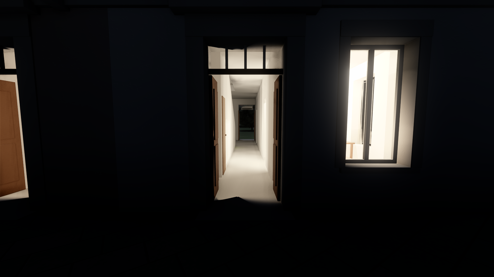
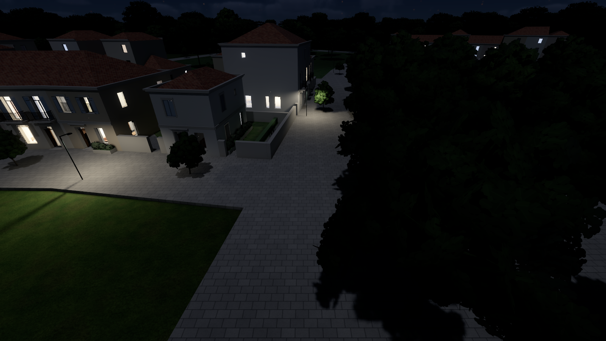
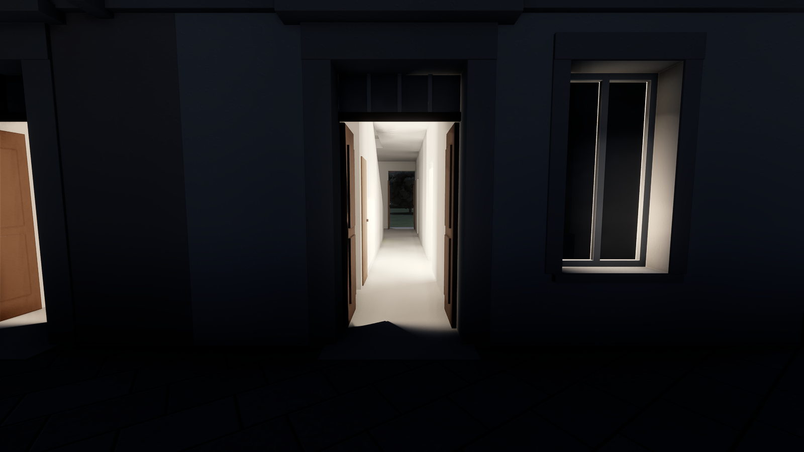
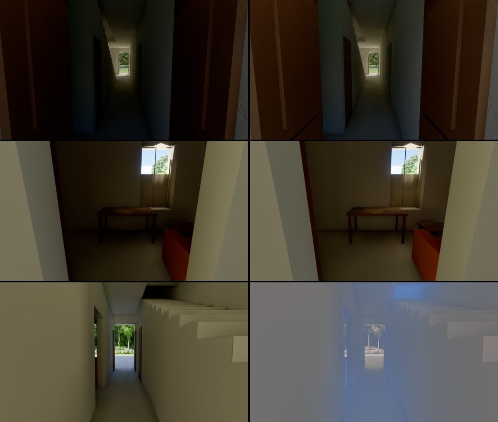
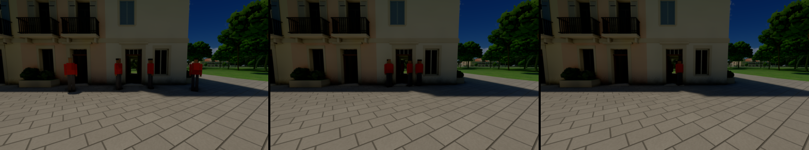
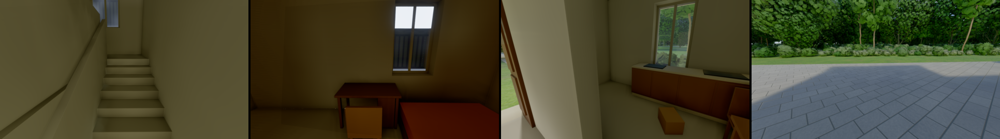

# City plan — a city's layout before any building (`forge-procgen::city`)

The first step of D-059: a city's plan made from a site and a parameter record, judged as a map
image before any building exists (`docs/research/city-generation.md`, "Recommendation for
Forge", stages 1–5, and its extension §7–§19). It is engine-generic. The example below is an
invented coastal city made for the engine's tests and docs.

```
cargo run --release -p city-map -- --size 4000 --scale 2 --out captures/city
```


*The example city at 4 m a pixel.*
- **Water:** the sea, a beach, a river with its quays.
- **Blocks by district:** an organic old town on the river, perimeter blocks round courtyards
  (the pale insides), a waterfront, an eco-quarter, courtyard blocks.
- **Parks:** a river park, and the parks the 3-30-300 rule added.
- **Streets:** traced as streamlines of a tensor field. Eight bridges.
- **Transit:** two tram lines with their stops, a boat crossing.
- **Landmarks:** two red diamonds.

## What it does

| Stage | How | Module |
|---|---|---|
| Districts | each land cell to the anchor nearest relative to its radius, edges roughened by noise | `city::district_field` |
| Street pattern | a tensor field: a grid per district at its angle, rings at radial squares, the water's tangents near the coast and rivers (Chen et al. 2008) | `city::tensor` |
| Streets | main roads traced first (bridging rivers up to 260 m), then streets at each district's spacing; each stops half a block short of a parallel street, and its end joins the nearest street ahead | `city::streets` |
| Road graph | streets cut where they cross or meet, ends snapped, dead ends under 60 m pruned; blocks as the graph's bounded faces | `city::graph` |
| Blocks | quays where a face holds water; parks from park districts, then from the 3-30-300 rule (a park of 1 ha within 300 m of every built block); squares: the built block nearest each built district's centre and each landmark, and small ones through old towns 180 m apart (`add_squares`); once the streets' profiles are known, a buildable outline per block on each street's building line (`geom::inset_by`) and a courtyard a building's depth inside it | `city::blocks` |
| Lots | recursive splits across each piece's long axis (Vanegas et al. 2012); only the pieces on a street are kept where a block has a courtyard | `city::blocks` |
| Forest | ground above a height or steeper than a slope goes to the first reserve district (a real site's hills) | `city::district_field` |
| Transit | tram lines by the shortest path through their waypoints, main roads preferred (a waypoint far from any main road snaps to the nearest street); stops every 450 m moved to nearby junctions; lines added until a target share of blocks has a stop within 400 m (`transit::cover`); boat crossings where a river runs long without a bridge; street profiles between building lines (tram avenue 24 m with 6 m pavements, avenue 18 m with 6 m pavements (5 until the owner found the trees too close to the windows), shared street 10 m, pedestrian 8 m, path 4 m: narrowed on 2026-10-11 after the owner found too much road, the default height-to-width ratio raised from 1.5 to 1.75 to keep the homes) | `city::transit` |
| Masses | each lot's building: strips of its district's building depth along each street the lot fronts (lots are cut inside the block's building lines, half each street's profile width from its centreline); floors from the district's range, capped by the style bible's height-to-width ratio on the street it fronts; green, solar or terrace roofs | `city::mass` |
| Style bible | one TOML record of the city's rules (height to street width, green roofs, green area per block, park and stop reach, the streets' share, per-district floors, lots, spacing, building depth, tiled roofs and walls), put into the plan's parameters and measured by a checker that names what fails | `city::bible` |
| Trees | rows along the streets by profile (on avenues one a side by the kerb, 0.8 m into the pavement, in slots every 8 m that alternate with the lamps, so a tree every 16 m; one down the middle of shared streets every 14 m and of lanes every 18 m), each crown keeping 2.5 m from the building line, none within 10 m of a junction; a jittered grid in parks (13 m, a little over half filled), on the quays (14 m, under half) and in courtyards (16 m, half). None within 3 m of a lamp or 4 m of a river's water, and the parks', quays' and courtyards' none within 1.5 m of a road or path (the owner saw trees on the water, the roads and the paths, and a few too many). The demo keeps them 6 m clear of the tram stops | `city::trees` |
| Lamps | along every street by profile: on avenues in the kerb rows' free slots between the trees, a lamp every 16 m a side, staggered, 8 m tall with two arms (over the carriageway and over the pavement), lit only underneath; one side of shared streets every 30 m, lanes and paths lower, at the pavement's edge; none in a junction (within its widest street's half width and 4 m) and no two within 10 m (two streets' lamps stood side by side in the corners, the owner's second walk): where step 5's lights will stand | `city::lamps` |
| Maps and numbers | a small rasteriser: the plan (with the districts', landmarks' and lines' names in the engine's font, kept from overlapping), a checks map (blocks by what they lack), an oblique massing view of any window; the plan's numbers and its digest | `city::map` |

Everything is a pure function of the site and the parameters. Costs are integers in the
router, and `forge_core::dmath` does the trigonometry. Two runs give the same digest (D-016).

## Numbers (the example, 4 km, release build, one thread)

| | |
|---|---|
| Land | 14.3 km² |
| Main roads / streets | 59 km / 149 km, 8 bridges |
| Built blocks / parks / squares | 667 (mean 1.66 ha) / 48 / 12 |
| Lots / blocks with a courtyard | 11 224 / 605 |
| Parks' share of the land | 10.5 % |
| Built blocks with a 1 ha park within 300 m | 100 % |
| Built blocks within 400 m of a tram stop | 45 % (two lines, no line added) |
| Streets' share of the land | 18.0 % |
| Tram lines | 7.8 km, 19 stops |
| Masses / floor area | 12 614 / 19.0 km² (13 ms; floors capped by street width) |

| Stage | Time |
|---|---|
| districts | 2.3 ms |
| tensor field | 7.5 ms |
| main roads | 2.3 ms |
| streets | 8.6 ms |
| road graph and faces | 10.3 ms |
| blocks and parks | 5.5 ms |
| transit | 0.2 ms |
| courtyards and lots | 5.8 ms |
| **the whole plan** | **≈ 42 ms** |

## Tests

`cargo test -p forge-procgen city`:
- the example has streets, bridges, blocks, parks, lots and trams;
- no block's reference point is in the water;
- every built block has its park within reach;
- the plan is the same every time;
- no two roads cross except at a node;
- lots sit inside their blocks;
- added lines raise the stop coverage by over 20 points;
- masses stand inside their blocks and outside their courtyards.

## The style bible's checks (the example)

```
ok   height at most the street's width times the ratio: 1.000
ok   green roofs' share: 0.507 (limit 0.500)
FAIL built blocks at their green area: 0.788 (limit 1.000); 143 failing, e.g. block 10: 0.06, …
ok   built blocks with a park within reach: 1.000
FAIL built blocks within 400 m of a tram stop: 0.454 (limit 0.900)
ok   streets' share of the land at most: 0.215 (limit 0.250)
```

The old town's small blocks have no room for a courtyard, so they miss the green area; the
example adds no tram lines, so it misses the stops. A city's own bible and its added lines
(`max_extra_lines`) close those.

## Massing


*A kilometre round the example's centre, seen obliquely from the south: perimeter blocks of
4–8 floors round their courtyards, green, solar and terrace roofs, the river and a bridge, two
tram lines.*

**Superblocks and open blocks (both off in the example).** Where the traced streets run far
apart, a block's courtyard became a park of a hectare or more, and its fronts ran for hundreds
of metres. The owner found the courtyards unrealistically large, and the long rows of big
buildings too close, on their second walk (2026-10-11). A plan can now set two options:
- `CityParams::max_block`: a built block longer than this many times its district's street
  spacing gets a shared street across its middle, again until none is (four rounds at most).
  In the private sandbox, at 1.6: 2 148 → 2 764 built blocks, the mean 1.67 → 1.31 ha, homes
  919 k → 1.07 M people with the open blocks below.
- `DistrictSpec::gaps` (open blocks, Portzamparc's *îlot ouvert*): a lot between a block's
  corners left as a garden at the district's share, and wherever a block's front has run
  `DistrictSpec::run` (120 m when not given) since the last gap; never two side by side. Under
  60 m a corner lot may be a gap too: separate buildings round a shared green rather than a
  ring (the owner's photos of open blocks: open, organic, not oppressive). Light, views and
  people reach the courtyard, the walls beside a gap get windows, and in 3D a paved path runs
  from each gap to the court's middle. It is paved with the block's forecourt as one surface off
  the streets. Drawn over the paving, it began on the street's centreline, lay across the
  carriageway on some seeds, and showed as a patch on the pavement (the owner). Test:
  `the_court_paths_are_paved_with_the_forecourts_off_the_carriageways`, four seeds. The sandbox
  opens its modern districts (runs of 35–55 m, gaps 10–25 %) and keeps its centre and old town closed: about
  1.05 M people (977 k once the stair cores took their floor, step 3).

**Footprints.** A footprint's corner sharper than 55° is chamfered where its wedge is 6 m
wide, or at 0.45 of its shorter side: a building came to a point at a block's sharp corner by
a bridge (the owner: an impossible building). Each footprint is then cleaned of repeated and
collinear points within a centimetre (`geom::clean`): ear clipping stalled on them, and 1 372
roofs lost big triangles (the owner saw them). Tests: `no_building_comes_to_a_point`,
`every_footprint_triangulates_whole`.

## In 3D

```
cargo run --release -p city-plan
cargo run --release -p city-plan -- --village 600   # the first map's village (D-062, #266)
```


*The example city's masses, trees, gardens, parks, streets, tram tracks and river, drawn by
city-blocks' renderer (sky, clouds, ray-traced soft shadows, probes, TAA) through its scene
interface.* `demos/city-plan` turns any plan and its masses into meshes in tiles of 250 m: the
site's land and water as runs of cells, blocks and street ribbons, walls and roofs (green,
solar, terrace). The rivers are smooth strips along their centrelines; the sea and lagoons come
from the site's cells. A private sandbox hands its own plan to `PlanScenario::new`.

It loads behind the loading screen (#274): `city_blocks::run_making` lays the plan out in its
tiles on the loading thread, the blocks' ground and the buildings' structures made on all
cores (the blocks' ground kept in the derived cache, #345: 1.3 s at the city's first start,
0.22 s after), and `Scenario::prepare` cooks the scene's meshes there or reads them from the derived
cache (each under its place in the scene, its content's digest and the cooking code's), beside
a fresh cache's shaders compiled ahead; the generated textures are read back from the cache
too. The log names each step's milliseconds; `tools/load-time.sh city-plan --village 600`
times the loads.

| | |
|---|---|
| Meshes / triangles / trees | 484 / 720 k (309 k before the afternoon of 2026-10-11: dropped kerbs, paved corners, quay walls, the rivers' banks) / 27 379 instances of one tree (36 717 before the avenues' trees alternated with lamps) |
| Built and cooked | 1.3 s then; 2026-10-16 (#274, `docs/PROFILE.md`, "Loading `city-plan`"), to the loading screen's end: the city 4.44 s warm and 15.1 s on a fresh cache (23.6 and 52.0 s before), the village 1.15 and 9.4 s (4.53 and 32.9 s) |
| GPU frame at 2800 × 1575, this view | 3.84 ms (3.33 without trees or facade textures) |
| p50 / p99 frame | 3.67 / 7.28 ms |


*35 m up: the walls' window bays and shopfronts are two generated textures
(`forge_render::textures::facade` and `shopfront`) read through the walls' coordinates, a shop
band on the ground floor along avenues and lanes, window bays above, four render tints of the
palette chosen by lot. Whole bays only, centred: the wall left at each end, and all of a wall
shorter than a bay, is plain plaster (the end's part of a bay put a window and its shutter at
the corner, the owner); walls onto a neighbour's lot are plain too. Variety in the facades
themselves comes with D-039's modules.*


*At eye height on the river avenue (`--street`), late afternoon and midnight: buildings behind raised
pavements with kerbs, shopfronts and shuttered window bays, a row of plane-like trees each side,
tram tracks, the tree-lined quay and the river; at night the shopfronts and windows glow (lamps
stand along the streets, their heads in the crowns, and light nothing yet: step 5). Next at this
height: finer trees, street furniture, the modules (#247).*


*Midnight (`--time-of-day 1.5`), 35 m up: about 40 % of the open windows lit, warm or cool, and the
shopfronts, from emissive maps beside the facade textures. Left, metered; middle, a fixed EV 3;
right, without the probes. The probes took the windows' light into the city many times over
(the walls and courtyards glowed as by day), so night views ran with `--no-probes` (#254). The
emissive was scaled by the frame's reference illuminance for a run held at one time of day: a
stopgap.*

**Emissive in cd/m² (2026-10-15, #254).** The windows', shopfronts', screens' and lamps' rows
give their luminance in cd/m² (`RenderLayer::emissive_absolute`). The renderer converts it each
frame by the reference illuminance it shades in (D-046: L·π / E). A running day (`--day 40`) at
21:00 now shows the lamps and the lit windows as `--time-of-day 1.25` does. Before, they kept the
noon reference's scale, about nothing at night. At a fixed hour nothing changes: 72 pixels of
1.4 M.

**The probes at night (2026-10-15, #254).** The probes' rays read each hit's emission at the
row's full value, but the frame no longer shows it so:
- a window's glass shows its room lit at a share of the lamp (4 % then, 25 % since the residents
  light their own; twice that for a shop);
- a far facade emits only through its lit windows, the emissive map's few texels.

The hits now emit as the frame shows them: the emissive map's average (its last mip, as the
albedo), and a window's lamp share over walls about half as bright as white. At 21:00 from 30 m,
the facades that glowed as by day are dark now. The street lamps light their streets and the
facades beside them, and the lit windows dot the city. Night views run with the probes again.

## Buildings from the grammar and the kit (D-039, #247)

```
cargo run --release -p city-plan -- --street --detail 450
cargo run --release -p city-plan -- --rules my-style.rules   # another style set's rules
```


*Within `--detail` metres of the view (450 here), each mass is built from the first style set's
rules and kit; beyond, it stays a textured box. Top left, a lane at 16:40: French windows with
louvred shutters, balconies on consoles with wrought-iron railings on the first floor,
shopfronts with fascias, a string course over the ground floor, the cornice, sun shadows
across it all. Top right, the same lane at night, lit windows, without the probes (#254).
Bottom left, the river avenue's shops, entrances and awnings. Bottom right, from 60 m: the
kit's quay front, the textured masses behind.*

Three stages, each generic:
- **`forge_procgen::city::facades`, the component split.** Each mass's walls become faces that
  look onto:
  - the **street**: outside the wall is street, up to the building line;
  - the **courtyard**: the wall looks into its own lot or block;
  - a **party wall**: another lot's building stands within 3 m of it.

  Walls between two pieces of one lot are inside the building and get no face, if the lot's
  other pieces cover them all along: each wall is probed at five points. A single probe at
  its middle dropped 816 of 2 627 walls covered only in part, and the courtyards saw into
  the buildings, their window frames floating (the owner's second walk). A wall with another
  lot's building within 3 m straight out is a party wall, blank, whatever lot lies between: a
  slit between two buildings had windows facing a wall a metre away. Farther, the wall looks
  over the neighbour's garden and gets its windows: a wall onto a neighbour's lot was blank
  for the law's 1.9 m to a direct view, and the courts showed blank walls on two sides of four
  (the owner, 2026-10-15: "would not match if real apartments were inside"). A street face
  knows the corners it turns, and each building's longest street face holds its entrance.
  `city-map` draws the split as `faces-centre.png`.
- **`forge_procgen::grammar`, a split grammar** with CGA's operators (Müller et al. 2006):
  - scopes split along x or y into parts sized absolute, relative (`'0.5`) or floating (`~1`),
    which may name an attribute;
  - repeats `{ ... }*`, whose members know their index, count, first, last and middle;
  - conditions on the context (`[street && level.index == 0]`);
  - weighted choices, per building or per attribute;
  - `let` values each building draws from its seed;
  - a text form with line-numbered errors.
- **`forge_geom::modules`, the kit:** wall, party wall, string course, cornice, parapet, French
  window (with or without shutters, a quarter of them closed), low window, courtyard window, balcony, entrance, shopfront
  with or without an awning (its valance 2.3 m up, so walkers pass under it). Each module is a small part program of boxes and quads with one
  section layout, so eight material groups dress any of them: four shutter colours, each with
  dark and lit glass (each window its own mix of dark glass and curtains). Walls, bands and
  cornices change size with every scope and are merged into
  the tiles; openings repeat at a few sizes and are instanced. With `--railing-cards` a
  railing's bars are one card between its rails, a grating the cut-out raster draws by the
  share of each pixel the bars cover, so they cannot flicker; off by default (no gain on DLAA),
  it costs about 0.1 ms at street level and nothing from the air since #265 (`research/trim-sheets.md` §2.9).
- **Thin sheets** (2026-10-15, the owner's sightings in a running test). The awnings, the stalls'
  valances, the Market Hall's glass roof, the terraced hall's canopies, the belvedere's dome and
  the trams' roof lights are drawn from both sides as `modules::sheet`, their back face 2 cm
  behind the front.
  - **The fault:** the two faces stood on one plane, and the coarser levels of detail folded
    them into each other. From the air the awnings vanished but for a cheek's thin blue blade,
    while the ray-traced shadows still cast them on the pavement: "shadows on each side of the
    building" with nothing over them.
  - **Also:** a moving tram's roof flickered.
  - The stalls' canvas had been fixed this way that morning.

The engine's example style set is `crates/forge-procgen/src/city/mediterranean.rules`, about
fifty lines. Each building picks its bay (2.8–3.4 m), its balconies, its shutters and whether its
top floor is an attic storey of small windows, and
neighbours differ.

| The kit within 450 m of the avenue view (example city) | |
|---|---|
| Buildings / faces / terminals | 1 021 / 4 466 / 198 335 |
| Instances / unique modules | 35 985 / 32 (9.8 M instanced triangles; four terrace layouts a width) |
| Merged triangles added (walls, bands, cornices) | 416 k |
| Derived and assembled | 80 ms (one thread) |
| Longest run of one opening along a floor of a street front | 10 |
| GPU frame at 2800 × 1575, this view, best of 3 | 3.78 ms (3.42 ms with `--detail 0`) |
| Scene built and cooked | 2.79 s (2.35 s) |


*The component split round the example's centre: street faces red, courtyard faces blue, party
walls grey, entrances as dots, corners in yellow.*

**Perimeter blocks, closed.** The first street views showed the avenues lined with gardens and
the backs of buildings. Lots were cut from the block's outline on the streets' centrelines, so
a lot on a 28 m avenue kept a metre or two behind the building line, and the courtyard's
convex hull ate the buildings along concave sides. Now:
- each block gets a buildable outline, moved in to each street's building line
  (`geom::inset_by`);
- lots are cut from that outline;
- every lot is built as strips of its district's building depth along each street it fronts:
  a lot between two streets has two fronts, and a corner lot wraps its corner;
- the courtyard is the buildable outline moved in by that depth.

The blocks close round their courtyards and the avenues are lined on both sides:
- masses: 12 935 (was 14 807);
- floors: 18.3 km² (was 20.5, now one building deep rather than up to 20 m);
- blocks with a courtyard: 602 (was 563);
- blocks under their green area: 83 (was 143).

**No slivers.** One mass in 17 was a slab 2–4 m thick, a blank party wall seen from the street.
Two causes:
- **Short street edges set far back.** Where a short edge between two wide streets turned over
  when moved to its building line, the block fell back to a uniform inset by its narrowest
  street. Its lots along the wide street then kept up to 11 m of street, leaving a 2–3 m
  building. The building lines now drop each edge the move turns over
  (`geom::inset_by_collapsing`, the straight skeleton's edge event).
- **Corner lots.** A corner lot a little deeper than its first strip left a sliver along its
  second street. The first strip now takes that sliver in. A sliver it cannot take joins
  another strip of its lot where the two make a convex piece, or is dropped.

No building is now under 4 m thick:
- masses: 12 373 (was 12 877);
- floors: 18.4 km² (was 18.3);
- lots: 10 985 (was 11 048).

A neighbour's garden is a view, not a neighbour: a wall onto a lot whose building stands more
than 3 m off is a court face with windows (2026-10-16; before, an empty lot only).

**Parcels for the first map** (`city::parcels`, 2026-10-16; `research/parcels-and-rooms.md`):
the lots above are cut across the piece's longer side, which on a tensor-field block gives
wedges and slivers (the owner: "non-rectangle shaped buildings for no reason, spaces between
them that don't make sense"). `parcels::strips` cuts a block the way a cadastre reads: each
street side a strip of one depth (the block inset, mitred at the corners), the strip into lots
by cuts square to its street at widths a type draws (a village house 5–8 m on 14 m; a
perimeter block's building 12–25 m on 18 m), the corner lots taking the corners (an acute one
gives a flatiron), a strip's end short of a lot's least width going to the last lot, a party
side left to the court. The block's middle is the court. A block too thin or concave for the
depth all round takes no strips, and the caller falls back on the cut above. Tested on a
rectangle and a trapezoid (every lot's frontage on the outline, no lot under the least width,
every inner party side square to the street); `PARCELS_PNG=path cargo test -p forge-procgen
the_trapezoid` draws one. The first map's village takes it first; the city, block by block.

**Houses from their rooms** (`city::rooms`, 2026-10-16; the research's §4): the owner's
principle that a house is thought from its rooms. `rooms::programme` gives a household's
rooms from its size and its means (poor: one or two rooms at the minimums, the kitchen in the
living room; modest: a living room, a kitchen, a bedroom a couple and one a child or two;
comfortable: a bedroom a person, a dining room, a study, two bathrooms; rich: a salon, suites
with their bathrooms, service rooms), each with its area; `rooms::plan` lays them on a lot of
a given width, a hall with the stair 2.95 m wide from the party wall's middle the whole depth, the rooms
beside it in bands from the front to the back: a band as deep as its first room is square
(2.6 to 6.5 m), its rooms side by side across the width, the largest first and the small ones
filling the bands' ends; the day rooms on the ground floor, the bedrooms upstairs once the day
rooms take half the depth, a new storey when one is full. A band's rooms share its width and
every storey's last band stretches to the house's depth, so the bands tile each storey and the
storeys stack; no room goes under what it asked nor under the 9 m² the decency decree wants
for a main room. The footprint's depth and the storeys come out of the rooms. (The first
solver, the same day, stacked every room across the whole width at 2.6 m deep at least: a
rich house on a wide lot wasted its width and climbed to nine storeys.) Tested on a modest
family of four on a 6 m lot (two storeys, the ground floor the day's), a poor household of
three (the minimums kept), a rich house of five on 14 m (its suites upstairs), each storey's
rooms tiling it with none over another. **On their lots** (`city::houses`): each strip's lot gets a household's plan at the
lot's width and the strip's depth less a 1.5 m yard; the footprint runs from the street to the
plan's depth, cut to the lot where a corner lot narrows, the rest of the lot the garden. The
house takes only the stretch of the front where the lot is at least a room deep (2.6 m,
sampled every quarter metre): a corner lot's bisector cuts the strip to a wedge, and a house
across the whole front had a window at its end with the roof right behind it and no room (the
owner, 2026-10-16, the sandbox's item 26); the wedge stays garden, and a front left under a
hall and a room wide keeps no house.
`HOUSES_PNG=path cargo test -p forge-procgen houses` draws the trapezoid block's houses, their
footprints shaded by their storeys.

**The village** (`city::village`): a site a few hundred metres across planned as the city is
(streets, blocks, parks: the example's site at 600 m gives 30 nodes, 44 edges, 15 blocks, 9
built), each built block cut into strips of village lots and a house from its rooms put on each,
the households drawn by the seed (one to five people; 15 % poor, 50 % modest, 30 % comfortable,
5 % rich). The lots are cut to the houses, the owner's way round: each lot as wide as its
household's rooms need on two storeys at the strip's depth (`parcels::strips_with`, which
hands back each lot's key, so a corner sliver merged into its neighbour does not shift the
households after it), never under the type's 5 m; a thin block takes a shallower strip (11 m,
then 8 m, a house with no yard), one too thin for that keeps no houses. Each house is also one
of the city's masses on its own lot, appended to the plan's (old stone, a tiled roof, homes
only), so the structures, the facades and the kit draw it as they draw the city's buildings.
The example village on the city's parameters: 8 blocks with strips round their courts, 1 too
thin, 384 houses of one to four storeys (7, 209, 146 and 22), 1 200 people, every house with
a door and 346 with a stair (`reports/2026-10-16/village-600m.png`; `VILLAGE_PNG=path cargo
test -p forge-procgen village` draws it; 406 houses before the corner wedges lost their
slivers). The first cut (2026-10-15) drew the widths at random: 191 houses, 586
people, and once the houses were masses the rich households on 5 m lots stood nine storeys.
**Its own plan** (`village::params`, the same day): one village district on the site's middle
with lanes that wander (`Pattern::Organic`), one main road, no trams, boats nor landmarks, a
green within 200 m of every block. The traced lanes make blocks of many short edges, which the
strips refused (the inset by the depth lost corners): a strip is now the block within the
depth of its street side between the bisectors at the side's two corners (a reflex corner's
too), and the court is the inset that drops the edges it turns over
(`geom::inset_by_collapsing`); every built block takes strips. **In its forest** (the same
day): the district reaches 1.6 times its radius of 120 m and the land beyond is countryside,
which `CityParams::forest` plants, 12 m clear of the roads (`trees::Setting::Forest`). Since
D-063 (the same afternoon) the forest is `forge_flora`'s: the Mediterranean wild species placed
by their habitats on the site's ground, once for the whole map, never round the player
(`place::place`), each tree keeping its species (`Tree::species`). On flat ground the flow's
wetness index read every sample as a valley floor and the holm oak took the whole forest, so
there moisture, soil and warmth follow the distance from the water, an assumption of this map:
deep moist alluvium by the river, the thin dry soil of a limestone plateau 300 m from it. At
600 m: 278 Aleppo pines, 870 holm oaks, and 21 002 garrigue shrubs (2 291 rosemary, 7 999
cistus, 10 712 kermes oaks). The demo grows three individuals of each species once
(`forge_flora::grow`) and instances them, each scaled to its plant's height and crown, in its
species' bark and foliage (`grown_mesh`): a tree's wood 5 cm thick or more as tapered limbs
(since 2026-10-21 each axis one closed tube, its rings carried along it and shared at its bends,
mitred, its tips capped: the owner saw holes in the trunks, the most at the bends, where each
segment had been an open tube of its own, its ring turned anyhow; `the_trees_wood_has_no_holes`),
its leaf clusters gathered on a grid of a sixth of its crown (an eighth of a broadleaf's, a third
of a shrub's, a tenth of its height at least) into lumps sized by how many clusters they hold,
a shrub's of 20 triangles. A tree takes 8 000 to 33 000 triangles, a shrub about 600 (the full
graphs' 2 000 to 250 000; the demo's test keeps them under 40 000 and 1 000). The map check's
views take 2.2–2.6 ms of GPU where they took 1.6–1.9. The lumps became leaf cards the same
afternoon (below). The road through the forest: `reports/2026-10-16/village-forest.png`. **The gardens' olives**
(the same afternoon): behind each house where 30 m² or more of garden stay 1.5 m clear of it,
an olive of 4.5–7 m at the garden's middle, two along a garden of 150 m² or more, a lot
without a house all garden; the village plants them in the plan's own trees
(`CityPlan::planted`, `trees::Setting::Garden`), grown and drawn as the forest's (72 in the
village). **Every tree a species** (#257, the same afternoon): `city::trees` gives the planted
trees theirs by setting, three new to the grower's data (`research/flora.md` §2.1): planes along
the avenues and the shared streets and round the squares, limes along the lanes and, with
olives, in the courts, umbrella pines within 30 m of the water, the parks a mix of planes,
limes, umbrella pines and holm oaks. The demo grows each species' individuals at a quarter,
half and all of its maturity and gives each plant the one nearest its height (a 10 m plane
was the mature tree shrunk, a ball on a stem), the planted ones with their crowns lifted to 38 %
of their height (half an umbrella pine's, 15 % an olive's) and their leaves' lumps kept above
it. The one model is left only to the planters' shrubs (rosemary since the leaf cards, below); the map check's views take 2.2–2.8 ms. Only plans with a forest (the village's maps) get them: the 4 km city's thousands of street and park trees grown took 23–34 ms of GPU in the sandbox's day check where the one model takes 4.4–4.9, so the city keeps its one model until D-013's far tiers
(`reports/2026-10-16/village-street-trees.png`, the walk under a plane's crown). **Three of each
age** (the owner, the same evening: "trees are too much identical, they need variations"): one
individual an age made every mature holm oak of the wood's edge the same tree. Each age is now
grown three times, from its own seed, the second in a breeze of 0.3 from one side on a site of
0.8, the third in one of 0.27 from another on 0.9 (`FLORA_SEEDS`), and a plant's hash picks one
of the three at the age nearest its height and stretches its crown by up to 8 % along its turn.
No tree stands within 2 m of any water, the sea's and the lakes' too (on a quay's edge a trunk
stood over the water in its reflection: "tree above water"). The wood's wild trees keep the same
rules since 2026-10-19 (2 m from any water, 4 m clear of a river's bank): placed by their own
point alone, two trunks stood in the river, one on either bank (the owner). Their crowns may
still reach over the water.

**Leaf cards** (D-013, the same afternoon). Each lump is now a core and the cards round it.
- **The core:** 20 triangles at a fifth of the lump's radius, in 0.15 of the leaves' colour,
  the shade inside a crown. At 0.6 of the radius in the leaves' own colour its smooth faces
  showed, and at half with 12 cards at most a lump the near holm oaks still showed it as dark
  balls; at two fifths in half the colour, once the metered exposure lit the wood, as faceted
  green stones among the leaves; at three tenths in three tenths of the colour, with the leaves'
  detail (#346), as faceted olive balls through the gaps close up (2026-10-22: of four
  versions, the smaller and darker, the one recommended, with the owner's go).
- **The cards:** 6 to 16 squares round each lump (a shrub's 4), cut from a leaf atlas drawn at
  start-up (`forge_render::textures::leaves`, 1024 × 1024). Its four sprays are small oval
  leaves for the oaks, broad ones for planes and limes, needle tufts for the pines, the cypress
  and rosemary, and narrow ones for olives and cistus. A card's side is 1.5 lump radii, at most
  1.2 m for broad leaves and 0.8 m for small ones: at 1.5 radii alone a plane's leaves were
  drawn 40–60 cm wide.
- **Their row** (`RenderLayer::foliage`): double-sided, with normals bent out from the crown's
  middle and the lump's and never turned towards the viewer, and a mix of two tones per tree.
- **Their mips** keep the share of texels the alpha test keeps (Castaño 2010). A dither of the
  mips' alpha against the frame's noise, tried first, flickered on 0.5 % of a still view's
  pixels under DLAA.
- **Size:** a tree takes 900 to 23 000 triangles, a shrub 200 to 1 000 (the test's budget for a
  shrub is now 1 500).
- **The planters** grow rosemary, 0.9 m over the soil and 0.8 m across, 0.7 m apart, where the
  plan draws the forest's species: the one model's smooth balls stood out beside the cards
  (`reports/2026-10-16/village-planter-rosemary.png`, before and after). The city's planters
  keep the one model with the city's trees.

| at 600 m | lumps | leaf cards |
|---|---|---|
| GPU, outdoor views | 1.9–2.8 ms | 2.2–4.3 ms; 2.2–3.4 ms since the cut-outs' own list (#265); 2.4–3.7 ms with the smaller cores and up to 16 cards |
| GPU, inside a house | 2.2–2.3 ms | 2.4–2.5 ms |
| still camera under DLAA, pixels changing frame to frame (main view, junction) | 0.03–0.05 %, 0.04–0.05 % | 0.13–0.15 %, 0.04–0.07 %; the main view 0.17–0.20 % with up to 16 cards |
| the main view without the sun's shadows | 0.01–0.02 % | 0.04 % |
| 1.4 m/s dolly, pixels changing unlike the 2 × 2 supersampled run | 17.1–17.8 % | 20.5–20.8 % |

Much of the cards' cost was #265's: both rasters ran over every visible cluster, each skipping
the other's. Since the cull lists the cut-out clusters apart (27dc59e), `meshlet pass 1` takes
1.19 ms from the air (1.80 before) and 0.53 ms along the road (1.11), the images unchanged to the
pixel.

The still camera's remainder comes with the ray tracing (`--no-shadows` turns it all off: 0.04 %).
Without the GI probes it is 0.08–0.10 %, and without the shadow denoiser 0.41–0.56 % (the lumps
0.10–0.12 %), so the probes and the denoised sun shadow share it; the ambient occlusion has no
part. None of these changed it: the cards' shadow rays aimed at the sun's middle, tested on a
coarser mip or started on the card's sunward side, the cut-out tested one mip coarser, 256 probe
rays. The denoiser's history at the leaves' edges, which move with the jitter, is the next lead. The dolly's measure
flags every edge, and the paving and the grass make most of it in both builds. Captures:
`reports/2026-10-16/village-leaf-cards.png` (the plane over the junction) and
`village-leaf-cards-road.png`.

**Leaves with detail** (#346, 2026-10-22; the owner: "the leaves have no details";
`research/leaf-detail.md`'s first four recommendations).
- **The atlas** (`textures::leaves`): each leaf its own value (0.64 to 1, was 0.74 to 1) and
  hue (yellower or bluer), darker at its base, secondary veins off the midrib on the broad
  enough leaves, a faint mottle, and a leaf's shade 2.5 texels past its edge on the leaves
  under it.
- **Their normals** (`textures::leaf_normals`, the cards' normal map at 0.6): each leaf leaning
  its own way, up to 24°, and folded along its midrib, each twig rounded, so a card's leaves
  catch the sun and the sky each their own way rather than all as the crown's bent normal.
- **Undersides** (`Look::underside`, the row's `RenderLayer::underside`): seen from under the
  crown, as from the street, a leaf turns paler and greyer, a holm oak's and an olive's most.
- **Light through the leaves** (`Look::through`, the row's `scatter`): the sun or the moon behind
  a leaf lights it towards the camera (Barré-Brisebois and Bouchard's approximation), yellower
  than its face, as far as the traced shadow lets the light reach it. A leaf card's sun shadow
  is now traced from whichever side faces the sun, the light through it needing it where the
  leaf turns away.
- **No added shimmer:** under DLAA the still main view changes 0.30–0.37 % of its pixels frame to
  frame, the same as the build before (6bb18a14), the leaf normals off or the shading's terms off.
  Of that, the local exposure (on in the village since 2026-10-21, #275) makes about 0.15 %: 0.18–0.22 %
  without it, its changes 3 to 8 levels (at most 17, 13 without).

**The probes meet crown proxies, not the cards** (#297, 2026-10-19). Each grown plant is cooked
with a proxy (`grown_proxy`): its wood, and each lump of its crown a closed shell of 0.6 of the
lump's radius, opaque, in the leaves' colour. The probes' rays meet the proxy alone and the
picture, the shadows and the mirrors the cards alone (`forge_render::Visibility`, #301).
`--leaf-probes` sends the probes' rays through the cards again. Under the main street's holm oaks
the frame went 6.16 → 4.64 ms and the probes' rays 3.02 → 1.49 ms; the light there is 0.15 EV
darker than through the cards, elsewhere within 0.07 EV (D-036; `docs/PROFILE.md`). A proxy has
40–60 % of its plant's triangles, mostly its wood.

**The trees' ladder** (D-075 step 2, #302, 2026-10-19; not yet the default). With
`--tree-ladder [PX]` each grown plant crosses from its leaf cards to its crown's closed shells
(`grown_shells`: each lump a 20-triangle shell at its full radius, in a row of its own at 0.55 of
the leaves' colour, its normals bent out from the crown's middle as the cards' are since
2026-10-22, so the crown is lit as one rounded mass) once the lumps stand `PX` pixels across (6 by default), dithered over a quarter
of that size either side: each pixel of a crossing tree keeps one of the two by the frame's noise,
and DLAA averages them. `--show-ladder` (or the console's `r.show.ladder`) tints the shells blue.
From the air the far woods stand whole where the cluster LOD had thinned some species' cards to
bare twigs, and the frame is 0.35 ms shorter (4.69 → 4.34 ms); on the ground, where more trees are
crossing, it is about the same (`docs/PROFILE.md`). A still camera's frames 10 apart differ on
0.06–0.07 % of their pixels, 0.08 % without. The rays keep meeting the cards, except the shadow
rays from points 60 m off and more (`--far-shadows M`, 0 never; D-075 step 3): those meet each
plant's opaque shadow proxy (each lump at 0.8 of its radius), which halves `shadow/trace` from the
air (0.22 → 0.11 ms) and leaves the far shadows' shapes as they were. Capture:
`reports/2026-10-19/village-tree-ladder.png` (left: the far woods with cards, with the ladder,
the shells in blue; right: the meadow's trees gliding, cards above, the ladder below).

**Grass near the camera** (D-075, #300, 2026-10-22; not yet the default). With `--grass [M]` (50
by default) the gardens' lawns and the parks' grass stand as blades within `M` metres of the
camera (`forge_render::grass`): a map of 0.5 m cells painted from the ground tiles' garden and
park triangles (56 blades of 12 cm a lawn's cell, 80 of 22 cm a park's), cleared under the houses
and along the garden walls. A cell grows in the ninths of it the lawn holds, so the blades stop at
the paving within 8 cm (they first spread over their whole cell, up to 25 cm onto it). Each blade
is drawn into the visibility buffer and shaded in its section's row, a clump's colour, darker at
its root, its normal and contrast converging to the clump's by 20 m. Every blade stands out to the
reach, so the lawn ends without the curve a 20 m reach showed (D-075 keeps the counts: no fewer,
wider blades far off); over the last fifth of the reach they sink into the ground's grass. A
breeze sways them (`--grass-wind S`, the tips' lean, 0.15 by default, 0 still), their pixels
moving with them for DLAA. The four passes take about 0.40 ms (0.13 at 20 m,
`docs/PROFILE.md`); the fallback path draws the same pixels, and the images without the flag are
unchanged.

**The trees' impostors** (D-075 step 4, #302, 2026-10-22; not yet the default). With
`--tree-ladder --impostors [PX]` each plant's crown shells fade in turn once its sphere stands
under `PX` output pixels across (40 by default), and its impostor takes the pixels they leave
(`forge_render::impostor`). Before the first frame the scenario's plants are baked, one for each
species and age (the village's 27 in 1.4 s, the run's clock and captures waiting; 0.33 s from
the derived cache once baked; block-compressed, 1.0 MB a kind, ꟻLIP 0.007 against half floats
from the air): 8 × 8 views
over the upper hemisphere in a hemi-octahedral layout, each drawn at full detail from 1000 radii
off and taken 4 × 4 into its 64² square, the base colour with its coverage, the normals with the
depth, then the share of the sky each point sees past the plant itself. Drawn after the resolve,
each impostor writes its depth where the leaves are and is lit as the resolve lights the leaves:
its own tone on its leaves, the sun through one ray into the far shadows' world, the sky, the
sky's reflection dimmed by its occlusion. From the air the far woods read as their shells (green 67.3 and
76.4 against 66.8 and 80.7), the square's trees as their cards (90.7 against 89.2), and
the frame is 0.11 ms shorter (4.03 → 3.92 ms; on the main street the same, `docs/PROFILE.md`).
Against the cards at full detail they are as contrasty; from the air the young street trees'
sunlit crowns still read brighter than their shells (D-075, "The crowns' contrast"). Capture:
`reports/2026-10-22/village-impostors.png` (from the air: the cards, the shells, the impostors).
`--impostor-bake DIR` writes each kind's atlases as
`<species>-<age>-albedo.png`, `-normal.png`, `-depth.png` and `-occlusion.png`.

**The stairs' shimmer** (the owner, the same evening). In a hall lit only through its door, the
light on the flight rose and fell: a still camera's frames 10 apart differed on 3–7 % of their
pixels, all of it gone without the GI probes. The probes' rotations repeat with TAA's 8-frame
jitter (#48), and each of the eight rotations' 96 free rays found the door a different number of
times: the hall's light swung through an 8-frame cycle, at 7.5 Hz, which TAA does not average
away for lighting (#272; captures every 50 frames aliased it into a slow 200-frame swell). With
256 rays a probe, as the models lab's rooms took for the same reason (#171), the rotations agree
and the hall settles to 0.004–0.015 %. The village's maps (a plan with a forest) now take 256
rays (`Look::probes`), the city 128: along the road 3.73 → 4.51 ms (`gi/probe rays` 1.43 → 2.07
ms), the map check's views 3.0–4.5 ms. Cheaper fixes (a longer rotation cycle, a higher
hysteresis in rooms) are #272's.

A village's whole network is under the 3 km a cut-off
network had to reach to be kept (`graph::MIN_NETWORK`), so the plan came out empty under
twice the radius: a network is now kept over 3 km or over half of all the streets. The example
site at 600 m on its own plan: 16 nodes, 22 edges, 7 blocks, 5 built and all with strips, 171
houses, 517 people, 3 118 trees in the forest at the time (`reports/2026-10-16/village-own-organic.png`;
`VILLAGE_OWN_PNG=path` draws it). The first cut on the whole site, without the forest, had
559 houses on 13 blocks. **Its rings** (`research/cadastre-villages-and-towns.md` §2, the
same day): a block's lot type follows its distance from the centre against the district's
radius. Within 0.9 of it the old core (`ParcelType::CORE`): lots 6–9 m wide on 12 m, the
house the whole lot, a court only where the rooms leave one. Within 1.35 the faubourg
(`FAUBOURG`): a block on the road out takes its lanières on that side only, 6–12 m wide and
40 m deep (32, 25 or 18 where the block is thinner), the house on the street line and the
garden behind it; its lane sides take no lots and are the gardens' ends (`parcels::strips_by`
cuts with a depth per edge and splits a corner where its two depth lines meet, so the corner
lot keeps its depth). A faubourg block off the road out is cut on all its sides, 30 m deep, a
garden of 12 m at least behind each house. Spacing the lanes wider towards the rim was tried
first: the tracer then kept 8 junctions of 16 and the village two blocks. Beyond, the lotissement (`LOTISSEMENT`): lots 15–25 m wide on 35 m (500 to
900 m²), the house free on four sides, 5 m back from the street, 3 m off the sides, 8 m of
garden behind; its front still counts as a street wall (`facades::SETBACK`), so it gets its
door and windows. Each ring falls back on shallower strips where a block is thin. The traced
lanes gave the blocks short edges along their curves, and each edge took a strip of its own
with one narrow lot: the buildable outline is simplified within 0.6 m before the cut. A lot
whose front is cut short (a corner's wedge) and whose household's rooms would pile over three
storeys stays garden. **The rich house on the square** (the research's §5): the village's
rich household (five people, rich) takes the lot whose front lies nearest the square, and its
block is cut again for that household's width; on the example site it stands 9 m wide and
three storeys on the square's block, the village's tallest. **Its distribution** (the owner's
question, the test prints it): the core block's 25 houses on lots of 82 m², more than half
of them with land left beside the house (a court of 17 m² on average); the two faubourg blocks
on the road out, 10 and 5 houses on lanières of 252 and 372 m², each with a garden (159 and
249 m² on average); the faubourg block off it, 34 houses on lots of 161 m², nine in ten with a
garden of 81 m²; the lotissement block's 8 houses on lots of 406 m², 309 m² of garden each.
The village at 600 m: 82 houses
on 5 blocks (one core, three faubourg, one lotissement), 255 people (on the city's
parameters 97 houses, 325 people, 55 of one storey, 33 of two, 9 of three; one in twenty
vacant as the city's). The lots grew wider when the houses' halls took their cores' width
(below, "Its insides"). Two strips could overlap where a short edge between them collapsed or
a block narrowed under two depths (a lotissement's lots crossed on its acute corner): each
now keeps to its side of the line where the two depths stand in proportion, and strips that
only meet are left alone. **Its garden walls** (`city::walls`, the same day): wherever no
house stands on a lot's or a court's outline, a stone wall 0.4 m thick closes it, 1.8 m high
along the streets and lanes, 1.5 m between neighbours, 1 m on a lotissement's front; each
garden with a side on the street keeps a gate 1.2 m wide, level with the street (before the
house on a lotissement's front), and each stretch of a court along a lane 6 m or more one in
its middle. Where walls meet one butts against the other, never overlapping, since two tops
on one plane would flicker: a wall stops at the face of one passing through, two walls in line
meet halfway, mitred, and at a corner the lower (then the shorter) stops at the higher's face;
walls left sharing ground step back, and two lots back to back across a sliver of court keep
one wall. The village has 662 m of wall along its streets and lanes, 1 779 m between gardens
and 42 gates; the kit draws them in stone and the walker meets them
(`reports/2026-10-16/village-garden-walls.png`, the map check's garden view along the longest
of them). **The owner's sighting the same evening**, a dark upright strip in a wall: two walls
in line each moved halfway along its own line, and a court 5 cm in from the lane left a 5 cm
step whose face stood in shade. Walls in line now meet at the middle of their two ends, and
join up to 0.75 m apart; where a junction of four lots still leaves a slot between two of them
(each stopped at another wall's face), a piece of wall fills it, a centimetre lower where it
shares a corner's sliver with a crossing wall. The village's test finds no slot or step
between walls within a thickness of each other's line (four steps and three slots before;
`reports/2026-10-16/village-wall-joint.png`, before and after). **Hedges, open lots and common
courts** (the owner's walk of the same evening: "why is this place full of surrounding walls?",
"the middle area should not exist or be common, sometimes it's better to have plants (hedges)
separating the gardens"). The courts, the blocks' middles behind the strips, were walled all
round, a yard of walls with a gate and nothing in it, and so were the lots that kept no house.
A court is now the block's common ground, open to the lanes, an olive grove of a tree every 8 m
3 m in from its edges, and the gardens' backs onto it are hedges; a lot without a house is open
ground with its olives; between two gardens two stretches in five are hedges, by a hash of
where they lie (`walls::HEDGE_SHARE`). A hedge is a row of kermes oaks 0.9 m apart, 1.4 to
1.8 m high. The village now has 234 m of wall along its streets and lanes, 801 m between gardens
and 19 gates. A hedge stands only where both its sides are garden (behind the houses' backs, a
lot without a house, the court): across a corner lot's paved front one crossed the paving ("positions
of the hedges don't make sense"). **Square corners** (the same evening; the owner: "diagonal layouts
like in your picture: no"): where two strips met at a block's corner they were split on the
bisector, and the corner lots were wedges with diagonal party lines and houses turned against
each other. A corner that turns by 30° or more between two strips is now a lot of its own, from the
corner along both streets to the feet of the court's corner on them, its two inner sides square to
their streets (`parcels::strips_by`); it may take up to 80 % of an edge, and of two corner lots
leaving less than a lot between them the larger goes. A lane's rounded corner, cut into short edges
that each turn less, still splits on the bisector. **Rows that touch**: every house of a row
started a quarter metre in from its lot's side (the front was sampled every 25 cm, and on the lot's
corner the probe fell on the side line, outside), a sliver between each two with a garden wall's
piers in it; probed 2 cm in, the rows' houses share their party walls. **No parapet over a tiled
roof**: a party wall rose 0.9 m over the roof line, a wall standing above the eaves where the
neighbour was lower or apart ("wall exceeds roof height"); under a tiled roof it now stops at the
roof line, the tiles running across as in Provence and Italy (`research/house-layouts.md` §2).

**The anomaly check** (`city::anomalies`, the same evening; the owner: "if it does not snap
everywhere, it means something is wrong, we need a way to detect anomalies"): the village checked
against the rules of `research/house-layouts.md` §8, each breach with its place and a point to look
at it from. `city-plan --village 600 --anomalies` prints them with a `--view` each and stops; the
test `the_villages_anomalies_never_grow` fails when a kind's count rises over its bound, and each
fix lowers the bound. Since 2026-10-21 (#308) it checks the villages of 400 and 500 m too. They
had no houses before: at 400 m the plan's only block became a park serving itself alone, and at
500 m the square took the block the park had left. Now a park must serve another built block, and
a square never takes its district's last one. They have 9 and 7 houses; 400 m shows no anomaly,
500 m one garden wall end (two walls meeting a little apart at a corner, bound 1). The 600 m plan
and the city's are unchanged (the map check, the city and island captures at 0 px).

Since 2026-10-22 it checks 700, 800 and 900 m as well, after a pass over what broke there: 77
anomalies down to 11 (20 → 3, 33 → 3, 24 → 5).
- **Upper rooms out of reach (16):** houses of storeys on a faubourg's shallowest strip were kept
  to the type's 5.5 m, shorter than their flight, and got no stair; they take the flight's depth
  where the lot has it. A footprint's edge under 0.5 m goes too: the facades gave it no face, and
  a house with an inner wall counted as a wing another building's core serves.
- **Slivers and lone party walls at bends:** each house stood square to its own front, so two row
  houses at a bend opened a V behind their shared corner, 5 cm to a metre wide. A row house within
  half a metre of its lot's corner takes the corner, and an end on the corner runs along the lot's
  side line.
- **Backs:** a house that cannot shrink to the 3 m light court without a fourth storey adjoins the
  side behind it where its lot reaches; walls within 0.5° to 3° of facing are swung together.
- **A court door on a flight:** a corner house whose back is a party wall took its garden door on
  the court side its flight runs along; that door skips windows before a house's flight.
- **Garden walls at acute corners (36° to 75°):** mitred on the face through the corners their
  faces make. Butted, the higher one ran on past the other's far face, its end a spike meeting
  nothing.
- **Garden walls stopping beside a house:** a wall centred on a lot line 0.33 m behind a house's
  back stopped where the house began, its face 13 cm off it: an end counted as on the house
  within a whole wall's thickness. It now counts within half a thickness and 5 cm, and the stub
  joining it to the house stays: at a corner, a wall that would vanish clearing the other runs on
  instead, the other butting it. The anomaly check takes such a stub, square to a house's wall,
  for what it is, not a crooked wall.
- **Garden walls at obtuse corners (100° to 162°)** are mitred too: two walls whose thickness both
  took the garden's side left their ends' faces 0.27 m apart at the corner. A wall's end stopping
  against a hedge's side meets it (the check knew only the hedges' ends). The 500 m village's
  last free end goes with them.
- **One ridge along a row:** of two touching houses with as many storeys, more than 0.3 m apart in
  depth (a lot keeping one shallower, or the backs shrinking one), the deeper is laid again at
  the other's depth where its rooms keep their storeys and its stair's depth.
- **Unlit rooms (2026-10-23, 11 → 8):** a storey with more than two bands of rooms that want a
  window (an office before two bedrooms before a bedroom with its bathroom, 700 m's house 52) left
  the middle band dark in a row house lit front and back only. Where no other storey takes it, the
  storey is laid again: those rooms in two bands, front and back, each at least 2.4 m wide, the
  bathrooms between (`rooms::repack`). A one-storey end house too narrow for that (900 m's house
  26, 4 m of rooms across) lays its hall along its party wall instead, the plan turned over
  (`structure::hall_far`): along the open side wall the hall took its light. The 400, 600 and
  800 m villages are unchanged to the bit (`village_digests`, a digest of each size's masses and
  structures to run before and after a change).
- **A blank street wall (2026-10-23, 8 → 7):** a corner house on a bend (800 m's house 58) has
  its rooms laid square to its front, so where its side line breaks in two the kitchen's edge ran
  0.08 to 0.8 m off the second street wall, and no room counted as touching it. A street wall still
  without an opening on a storey now takes a window from the room nearest behind it within
  1.2 m (`windows::blank_walls`): the wedge between is that room's floor.
- **Sharp wall corners (2026-10-29, #363):** the owner's walk found two garden walls meeting in a
  V (`--view=-86.30,19.65,-80.59,3.7,-26.2`). The check counts them now (`SharpWallCorner`, two
  walls ending together sharper than 70°): 3 at 600 m, 1 to 8 elsewhere. Where two walls alone
  meet there, a short wall cuts the corner off (`walls::chamfer_sharp_corners`, 1.2 m long),
  its two corners at 90° plus half the V's: 600 m 3 → 2, and the free ends at 400, 800 and 900 m
  went with them. The owner's V keeps its point: a third wall ends there, along a spike of lot 52's
  outline (a sliver under a metre wide between lots 50 and 53, from the ground merged into its
  neighbours on 2026-10-24), which the lots' own fix has to take out. That fix: a merged lot's
  corner under 15° whose sides part by half a metre to a metre where the shorter ends, its longer
  side along a neighbour's edge, gives that sliver to the neighbour (`village::sliver_along`;
  thinner, its new side would lose its wall in the joints, as one of 0.39 m did at 700 m). At
  600 m lot 50 takes lot 52's 0.6 m sliver and the V goes (sharp corners 2 → 1); the other sizes
  are unchanged. The garden plants are laid again round it, so a shrub outside the map check's
  room window moved.
- **Sharp corners at a T (2026-10-29, #363):** the owner then asked for the rest at 600 m. Where
  one of the two walls runs on through the point in line with a third wall or a hedge (three lots
  meeting, or a lot on the court), only the slanting wall is cut short and a 1.2 m wall closes the
  V from it onto the line, which stays whole, so no two gardens join: the point goes to the garden
  across the slanting wall, its corner on the line at 75° or more. Sharp corners: 600 m 1 → 0,
  700 m 4 → 3, 800 m 6 → 2; no other anomaly moved at any size. Moving the junctions instead
  (slid along a line, or the lots' tips given to a neighbour) split or bent the lot lines into
  pieces the walls' joints could not close, and left free wall ends. What is left at 500 and
  700–900 m: three or four walls at one point, slivers of a few degrees, two walls with a house
  on the point.
- **The render's relief (2026-10-29, #363):** the owner's walk found a triangle on a house's face
  unlike the rest of it (`--view=-32.16,6.74,-83.17,94.5,-12.7`): the sunlit part of the wall,
  where a noon sun grazing it raised the render's concrete grain into speckles, cut off by the
  neighbour's shadow. The grain's normal strength went 0.25 → 0.12 on the owner's word: the
  speckle fades and the patch with it. The map check moved by ꟻLIP means under 0.007 (the vault
  view's wall caps), accepted.

The 600 m village changed in two places, accepted in the map check: a corner house that stopped a
quarter metre short of its lot's corner (a walled slit) reaches it, its rooms laid again (the
walked house: the room view now shows two chairs at the table), and two acute garden-wall
corners are mitred. Left at the larger sizes: free wall ends at junctions with hedges, ridge
steps where a lot keeps one house of a row shallower, and a sliver and two lone party walls at
900 m.

**One more house at 600 m** (the owner's go, 2026-10-22). A wide lot on the north-east street was
refused its house for a shallow end of its front: its depth was measured along the whole front,
before the house was narrowed to a squarer plan beside its neighbour. Measured where the house
stands, the lot is 11 m deep, and a house of two storeys stands there behind a front garden. Its
front wall, 20.6 m, is now the village's longest garden wall, so the map check's garden and vault
views (the longest wall and the longest low one) moved to it. Inserted among the houses, it moved
the frosted windows of 11 others, which a hash of each house's index picks.

| Anomaly | Rule | When the check came in | After the fixes above |
|---|---|---|---|
| a room past its house's walls (its plan's rectangle on a footprint the lot cut) | — | 66 | 45 |
| a partition meeting the facade within a window or a door | 13 | 4 | 7 |
| a bedroom, living room, dining room, kitchen, study or salon without a window | 14 | 189 | 183 |
| two houses of a block facing each other under 3 m apart without touching | 1 | 64 | 19 |
| attached houses' eaves under 0.8 m apart but not equal | 3 | 0 | 0 |
| a garden wall off every lot line near it | — | 0 | 0 |
| a planted tree or shrub in a house or a wall | — | 5 | 1 |

What is left is the next work: the slivers and the rooms past their walls where a lane bends (the
lots fan out and a house's rectangle leaves a wedge behind its front), the windows placed for the
facade and not for the rooms behind them, and the rounded corners; the owner asked to wait for the
research on building systems and their connectors ("snap"), to apply one system to the buildings,
the walls, the pavements and the roads.

**Sockets and rows** (D-066 ✅, the same night). The pieces' sockets (`forge_procgen::sockets`,
`research/building-sockets.md`): a socket's kind, its place, its outward normal, its extent (a
point or a face) and its thickness, one `compatible` rule and a matcher (`match_all`) that reports
the required sockets meeting nothing and the faces covered on under 95 % of their width. The
village gives its pieces theirs (`anomalies::village_sockets`): each house's party walls as faces
needing a neighbour's back to back, its other walls as anchors; each garden wall's two ends
(needing a wall's end or face, a house's wall, a gate's jamb or a hedge's end) and two faces; each
gate's jambs and each hedge's ends. Three kinds join the check: a garden wall's free end, a party
wall with no neighbour against it, and two houses back to back at one eave height but of different
depths, whose ridges cannot meet. Through them, the houses:
- **Rows of one depth:** houses whose fronts run end to end, sharing a corner, are a row, and
  each takes the row's deepest house's depth where its lot allows (`houses`), so their backs line
  up and houses of a height share one ridge ("they would probably share their roof structure in
  the middle").
- **No long houses:** a house is 12 m deep at most (`houses::MAX_DEPTH`: two rooms, lit front and
  back, `research/house-layouts.md` rule 16); the faubourg's ran 18 m back on 6 m fronts, hipped
  front to back ("I'm not sure long houses like that are viable"), and the lots widen instead.
- **Party walls on the lot lines:** a house across its lot's whole front, on a lot deep enough
  along it, stands on the lot's side lines, so a row's houses share their walls where a lane bends
  (square to its front, two houses met at the street and parted behind it: "there are either
  adjoining properties or there should be a legal distance"). Its rooms keep the plan's
  rectangles, a band's within the width every depth of it shares, and only the room against a
  slanted side wall takes the slant (`interior`), its furniture within its square part
  (`furnish`). A house whose hall or band a slanted wall narrows under a metre (a lot closing to
  a wedge behind the core) stays closed: 67 of 77 houses have their insides.
- **A door's floor:** the reveals' floor from the kit's threshold stone (0.35 m in) to the inner
  face, in the floor's stone: the street's paving showed through the doorway ("entry pavement
  leaks into the house floor").
- **The door on its sill:** the facade grammar split a door's opening `{ glass: Entrance | ~1:
  Wall }`, with no `sill:` part under it as a window's has, so every door module stood on its
  storey's floor, 30 cm under its sill at the walking level: its threshold stone under the
  paving (the paving through the doorway, the two fighting), its leaves through the floor inside
  ("the door bottom intersect the house floor"; z-fighting at the doorway's foot) and its head
  30 cm under the opening's. The rule now reads `{ sill: Wall | glass: Entrance | ~1: Wall }` (in
  the sandbox's copy too), and the leaves stand 2.5 cm over the sill, clear of the floor.
- **Sharp tips left open:** a block's corner under 60° (a triangle between two roads) ends its
  strips square at the feet of the court's corner, as a square corner does, and its region stays
  open ground, a small green, rather than a corner lot or two wedges split on the bisector ("still
  the diagonal issues").
- **Holes and fills** (D-066's next slice, 2026-10-17). Each opening of a structure is a hole,
  and the kit's module the facade rules put in it its fill (`facades::fills`). The balconies'
  rule draws a French window from 0.1 m over the floor whatever the window's sill, so 92 of the
  village's windows had a door drawn outside and a wall inside up to their 0.9 m sill: the
  insides open each wall round the structure's opening, and the probes' regions take its reveal.
  The windows the rules shape themselves are now fitted to their modules before the kit, the
  insides and the regions read them (`facades::fit_windows`), and a new kind of anomaly,
  `OpeningMisfit`, counts any opening its module does not fill to 2 cm (0 in the village; a door
  or a shopfront off its opening is the rules' error, never fitted).
- **Thresholds** (D-066, 2026-10-17). A door opens onto walkable ground: the metre before each
  ground-floor door, across its width, meets no garden wall, no standing piece of the gardens
  and no other house (`DoorBlocked`). It found 11. Nine were court doors behind a garden wall
  standing in a slot half a metre off the house: a lot line ran just behind the row's backs,
  and the paths to the doors ended at the wall. A stretch along a house's wall nearer than a
  gate's width (1.2 m) is no longer walled, the house's own wall bounding the garden, and the
  ends it frees turn square to meet the house (`walls::stubs`). The last was a court door a
  garden wall ended against: it goes back to a window, as a door onto ground no one reaches.
  Now 0.

**The camera** flies the village at 4 m/s (the city's 40), and the mouse wheel sets the speed
for good, a quarter more or less a notch, 0.25 to 400 m/s, for every demo (`forge_app::FlyCamera`;
the owner: "make the camera slower for when I want to test without walking").

| Anomaly | When the check came in | Now |
|---|---|---|
| a room past its house's walls | 66 | 0 |
| a partition in an opening | 4 | 1 |
| a habitable room without a window | 189 | 123 |
| a sliver between two houses | 64 | 11 |
| a plant in a wall | 5 | 1 |
| a garden wall's free end | — | 11 |
| a party wall with no neighbour against it | — | 19 |
| one eave height, two ridges | — | 6 |

The village has 77 houses (82 before the depth cap: wider lots), 241 people.

**The night's next steps** (the owner's sightings and asks of the same night):
- **Small lots join their neighbours** (`houses::merge_small`): a lot whose front is a room deep
  along less than a house needs (the hall with its stair, one room and a party wall, about 5.6 m:
  a strip's end at a lane's bend, a corner's wedge) joins its neighbour along the street, fronts
  within 15°, and the neighbour's household builds on both ("house on top right looks too small
  … I would have make the house it is stuck to bigger and remove this one").
- **Backs 3 m apart or none** (`houses::BACK_GAP`): a house whose back faces another house under
  3 m away is made shallower, both when the backs face each other, its rooms laid again, so the
  core's back-to-back rows keep a light court of 3 m (the rule's other way, touching, would close
  their back rooms' windows).
- **Every tiled house pitched** (`city::roofs`, the kit's roof geometry moved into the engine so
  the check can count it): a footprint whose short side turned over at once took a flat roof,
  grey in a row of tiles with its neighbours' gables bare over it; its roof now leaves out the one
  corner whose loss changes its area least (`roofs::fit`), and the footprints lose their corners
  that turn under 3° or close an edge under 15 cm (`houses::tidy`). A new kind counts flat roofs:
  3, then 0.
- **Windows by room** (`city::windows`; the owner: "the living spaces like the bedrooms very likely
  have at least a window …", "windows should match a corridor, a room, but not have a wall right
  of their edge"): a house with its rooms' plan takes its windows from its rooms, not from the
  facade's bays. Its rooms are laid without windows first; then each living room, salon, dining
  room, kitchen, bedroom and study gets a window on each stretch of outside wall it stands
  against (one for a bedroom, kitchen or study: its longest; two on a living room's stretch of
  3.6 m or more), a pier inside the stretch; a bathroom a small high window (0.6 by 0.7 m, its
  sill at 1.4 m or more) in 6 houses in 10, a service room in 4; a store none; the hall none (the
  stair rises there). Each stands on the facade's old bay axis nearest where it would centre when
  that axis falls in the room, so windows stand over each other storey to storey where the rooms
  allow (rule 6). A bathroom's glass is obscured (`Opening::frosted`, the grammar's `opening.kind
  == 5`, the kit's `window_frosted` with its own section, a milky rough glass that glows softly
  when the room is lit; 2026-10-17; the log names `the village's frosted window`).

| Anomaly | When the check came in | After the sockets | Now |
|---|---|---|---|
| a room past its walls | 66 | 0 | 0 |
| a partition in an opening | 4 | 1 | 0 |
| a habitable room without a window | 189 | 123 | 33 (rooms with no outside wall: a deep plan's middle band) |
| a sliver | 64 | 11 | 9 |
| a lone party wall | — | 19 | 17 |
| a flat roof on a tiled house | — | — | 0 |

**The night of 2026-10-16 to 17** (the owner's walk: blank upper walls on the street, the flight
a hand off its wall and starting behind the front door, z-fighting on the floors, shadows
"shimmering a lot and very strangely placed", the cornices' corners open; and "using the nav
mesh to test navigations inside the houses"):

- *Rooms where an architect would put them* (`rooms::plan`). The day rooms come first, the
  largest first. The night rooms keep the programme's order, so each bathroom follows the
  bedrooms it serves (sorted by area, the bathrooms came last and a top storey held a bathroom
  alone, its street front blank). The bedrooms go upstairs together, decided by the first of
  them. A storey's bands are arranged with a room wanting a window at the front and at the back,
  the bathrooms and stores between them where a row house has no outside wall. Small rooms
  left past a storey's depth take the depth the bands spare (none under its least or its rooms
  under 9 m²). Where they still need a storey, an office keeps them company at the front, or a
  guest room where the household has an office (the owner: "it can be an office, a guest room,
  or an utility room"). A plan is no deeper than its lot allows along its front
  (`houses::houses`): deeper plans had left their lot's lines for a rectangle, a sliver beside
  the neighbour. A first version inserted an office for a bathroom that never fitted behind it,
  again and again, and took Windows down twice; the planner now places one only where both
  fit, and asserts it ends.
- *Windows on the street* (`windows::by_room`). A room on a street shows it a window whatever it
  is, a bathroom's small and high. A room with one window adds one on its street stretch where
  its longest is elsewhere, and a hall without a stair (a house of one storey) gets one on its
  street.
- *The flight* (`cores`). It stands at the end of the front beside a party wall (a corner
  house's ran along its side street, a blank wall the whole depth) and is slid against its side
  wall (`cores::snug`: the 0.2 m core wall and the door's half-metre places left a gap). It
  climbs from the back of the hall towards the street, so the front door opens beside free
  floor and not over the first steps (`Interior::climb`). Its steps are the floors' smooth
  limestone (in the facades' pitted stone they glittered in the door's grazing light), and a
  plastered soffit slopes under each flight (`soffits`): from below it read as every step's
  flat bottom, a sawtooth. Each side of the flight is one plastered face, a closed string with
  the steps' profile over the slope: the steps' own sides met half along their edges and the
  light showed through the seams. The stairwell's rim through each upper floor's slab is drawn;
  with only the slab's top and underside it was a slot one saw through ("a kind of black
  rectangle"). Under the flight a cupboard (the owner: "Below the stairs there can be
  different type of cupboard"): its side to the corridor closed under the slope, its end under
  the head, an oak door with its knob by the head where it stands 1.2 m or more (a coat
  cupboard by the front door), and a metre of it in the walker's pieces. Under the ground
  floor's flight only: the flights stack in one box, and the cupboard under an upper one hung
  across the stair below it, three risers over its steps, in every house of three storeys (the
  owner, from the landing: "is there enough space for people to pass in this stair case?"). A
  test now finds 2 m clear over every tread of the village's flights, across their width.
  That point test is the fast first pass. On top of it, the practical test sweeps a walker's
  shape through what was built (#276; the owner: "use the 'capsule' hit box ... not just
  rays"):
  - **The shape:** `city::sweep::WALKER` is an upright capsule 0.3 m in radius, from 0.35 m over
    the ground (what a walker steps over: a riser, a sill) to 1.95 m.
  - **How it moves:** in steps of 5 cm, against the drawn solids as prisms.
  - **The flights:** it climbs the middle of every flight, from 0.6 m before its foot to 0.7 m
    onto the landing above. It stands on the floor, each tread and the landing, and is swept
    against the partitions, the cupboard, the guards and the upper floors round their
    stairwells. All 76 flights of seed 1 are clear.
  - **The doorways:** it passes through every doorway of the insides, 0.4 m either side of the
    partition, against the partitions and their heads, the drawn furniture and the floors. All
    350 doorways are clear.
  Along its open side, away from the walls, each flight has a plastered balustrade 0.9 m over the
  steps' nosings and 7.5 cm thick (`balustrade`), on the string's plane, a box over each tread in
  the walker's pieces. Before, the steps' edges stood open to the corridor, a fall of up to
  3.7 m at the head, and from the hall the flight's side read as a sawtooth.
- *The walk* (`city::walk`, the first stage of the navigation `research/game-ai-ecosystems.md`
  plans, Recast's voxel step). Each storey of a house with its insides is rasterised at 5 cm:
  the floor inside the walls, the partitions open at their doorways, the furniture and the
  flights blocked, the free cells eroded by 0.3 m, a walker's half-width. A flood starts inside
  the front door and goes up each flight from its foot to its head. What it misses is an
  anomaly: a room, a flight's foot, an outside door, and a door whose leaves swing into
  furniture or a flight. The furnishing is vetted by it (`walk::furnished`): while a room is
  missed, the piece nearest its doorways goes. The whole village walks in about 0.3 s, and
  `walk::map` prints a storey's grid for looking into one.
- *Doorways* (`insides`). A door's floor through its wall sat at the paving's height and
  fought it in every doorway, the paving winning on half the jitter's cycle. The cap compared
  the door's sill (at the walking level) with the storey's level and took a window sill's. It
  now stands at its storey's floor (`floor_level`).
- *The probes* (`PlanScenario::look`). 2 m apart in six cascades (the coarsest 64 m apart, as
  the city's), at 128 rays. 4 m apart, coarser than the rooms (3 × 4 m) and their walls, the
  sky's light leaked in blue and the shadows sat in odd places and swung with the jitter:
  15 000 pixels of a hall changed between frames 10 apart, about 100 now. At 2 m the shimmer of
  #272 is gone at 128 rays as at 256 (the loading session's measures, #274), and the frame
  costs less than before (see `docs/PROFILE.md`). Then 1 m apart (the coarsest cascade 32 m
  apart), as the models lab's rooms: at 2 m a room 3 m wide had a probe or two across, and a
  probe's sunlight came through a room's wall, a bright patch with a hard edge on the wall and
  the floor by its doorway, gone with `--no-probes` and at 1 m. The rooms are lighter and
  more even, the halls lose the last of the sky's blue; a still camera's changing pixels are
  as few or fewer (a hall 95–240 of 1.44 million against 98–172, a room 381–585 against
  440–801, the room with the patch 958–1553 against 1418–2564), for 0.1–0.45 ms a frame. The
  probes' rays keep a leaf card or a railing a quarter of the time (`PROBE_LEAF_KEPT` in
  `meshlet.slang`), as a crown lets light through: kept every time, a crown darkened every
  probe about it and left a dark blot on the
  wall beside the tree (the owner: "strange shadows or lighting artifact on the wall"). The
  sun's shadows keep every leaf. The lookup (`cascade_irradiance` in `probes.slang`) skips a
  probe in front of the surface only under 1 % of trilinear weight, not 5 % (#70's), in
  cascades of room-sized cells (1.5 m or finer): in a room's corner by a window those were
  the room's only probes to see the wall, and without them the sunlit probes outside came in
  round the window's head, a bright tooth with a torn edge up to the ceiling and a band down the
  corner (the probes' weights alone, tinted: all of it from probes behind the wall). It costs
  the village 0.14–0.23 ms (the room 3.63 → 3.77 ms, the hall's door 4.09 → 4.32, the green
  4.65 → 4.81) and the city nothing; for every cascade it cost the city 0.2 ms. A threshold
  lowered only where the kept probes were mostly behind the surface cost as much and missed the
  band down a corner. The leaks left (a partition's tinted blotch, a lit cap in a window head's
  reveal) are D-068's question (`research/probe-leaks-indoors.md`).
- *Probe regions* (D-068, `probe_regions`). The houses whose insides are drawn give the probes
  their rooms, about 1 350 volumes:
  - each room and the hall (its stair well included) a region of its own;
  - each doorway, along which one side's probes give way to the other's;
  - each window's inner reveal, from just behind the glass to the room, its room's;
  - each house's body round them, lit by every probe as before.

  A probe takes the region it stands in while young; a surface the region 2 cm in front of it,
  and only that region's probes light it, every probe where none of them stands among the eight.
  The partition's blotch and the window head's cap are gone (rooms 33-0 and 0-1, 0-0).

  With regions, an upstairs room seen through the landing's doorway went black. Its probes saw
  nothing through its window: the glass is drawn from outside only, and a probe's ray that met it
  from behind ended there, so the rooms had only ever taken their daylight from their doors and
  from the light that leaked in. A room's probe's ray now passes a window's glass met from
  behind (`glazed` rows: a home's, a shop's, a bathroom's frosted glass), and the rooms are
  lit by their windows, brighter than before (the owner: "I would expect the inside to be a bit
  brighter").

  A probe outside every house lights what its rays meet as the outside's, without the lookup
  (most probes, the coarse cascades' too). `--show-regions` tints each surface by the region
  that lights it: green in a reveal, white in a house's body, black outside, red where it fell
  back to every probe. It costs 0.17–0.21 ms a frame (the room 3.67 → 3.85 ms, the hall 4.05 →
  4.26, the green 4.40 → 4.57, the landing 4.19 → 4.39), the city 0.04 (`docs/PROFILE.md`).
- *Clear glass over the rooms* (D-065's part 4, #270: `module_panes`, `KIT_OPEN_GROUPS`,
  `forge_render::Glass`).

  

  *The way in at 22:00 (`--time-of-day 1.333 --view=75.2,1.7,-180.4,146.8,-5`): the room behind
  the right window is the house's own, lit by its lamp and drawn through the pane, where a faked
  room was drawn on the glass before.*

  The houses whose insides are drawn show their rooms through their windows, from the street
  and from inside:
  - **Their windows take the kit's groups again** (`plan-kit-open-*`), with the glass row left
    out of the visibility pass (`RenderLayer::drawn_after`). The resolve shades the room behind
    it. The rays still meet the faked glass, so the probes light the rooms as before. Without
    it in the rays' scene, the rooms went 2.7 EV darker (#280).
  - **The panes are drawn after the resolve** (`forge_render::Glass`), copied from the modules'
    glass: 1 116 triangles in the village.
    - Each pane shows the room through what Fresnel lets pass, and reflects by its mirror ray:
      the street from outside, the room from inside.
    - Past the frame's lamps, a lit room's glow shows on its panes: its strongest lamp's light by
      the share the frame leaves unlit, at any distance, less when seen aslant (#284; it faded in
      from 30 to 60 m by its facade's draw before, not its room's lamps). A pane whose room has
      no lamp still fades in from 30 to 60 m at half the faked rooms' light: the houses across
      the green stay lit at night.
  - **Each pane its own condition** (#339, the owner on 2026-10-21: "too perfect"; step 1 of
    `research/glass-credibility.md`): from a hash of the pane, a tilt of up to 0.006 rad each
    way, roller waves of up to 0.003 rad every 0.9 m (faded out where a pixel covers a quarter
    of a wave), double glazing's reflectance (2.5 times the look's, two panes in three) and a
    haze of up to 8 % of what passes, given back as a veil the sky lights. The mirror ray
    follows the bent normal, so neighbouring panes reflect the street a little askew of each
    other. A still camera's frames 10 apart change as before (1 052–1 417 px in the house view,
    against 1 048–1 404).
  - **The sun's glint** (#339, step 3): the key light's disc in the pane's mirror direction, a
    normalised lobe no narrower than GGX's alpha 0.05 so a glint covers a few pixels and turns
    with the pane's tilt and waves; a shadow ray (`glass/reflections`) takes it away where the
    scene hides the sun. None of the map check's views catches one (0 px); with the lobe widened
    to 0.5 for the check, the house's sunlit panes took the low morning sun's warm light and those
    in its shadow none.
  - **Blinds** (#339, step 4): behind three panes in ten (where the host gives the panes ids, and
    over 0.4 m tall) a roller blind let down from the top over 15–75 % of the pane, an off-white of
    its own lit by 0.6 of the sky the window sees, its hem a soft step a pixel wide
    (`GlassFrame::pane_heights`, each pane's lowest and highest corner). The house view's left
    window shows one; a still camera's frames change as before (1 006–1 428 px).
  - **Grime without textures** (#339, step 2's first part): each pane's haze varies in soft
    patches 0.35 m across, from 0.4 to 1.6 of its level, and dust settles along its foot (up to
    0.12 more over its lowest 12 cm). Both stay low in frequency; a still camera's frames change
    as before (1 000–1 439 px). The textured smudges, fingerprints and stickers wait for the
    owner's go to download CC0 masks.
  - **The faked rooms' windows too** (#339): the same tilt and waves from a hash of where the
    window stands (`window_pane_normal` in `meshlet.slang`), so a row of far facades no longer
    mirrors the sky as one sheet. Only the map check's view from the air shows them (ꟻLIP mean
    0.00055); its still frames change as before (7 010–9 567 px, against 6 994–9 556).
  - **Shimmer:** with a still camera under DLAA, frames 10 apart differ on 0.06 % of the pixels
    by day (as without the glass) and on 0.040 % at night (0.038 % without).
  - **Cost:** 0.05–0.16 ms in the map check's views (`docs/PROFILE.md`).
  - `--no-glass` shows the rooms without their panes.
- *Static instances edited at run time* (#323): a scene built with
  `MeshletSceneBuilder::allow_static_edits` shows, hides and moves its static instances
  (`MeshletScene::set_static_visibility`, `set_static_transform`); the frame after an edit copies
  the records into the table, redoes their cells and updates the rays' structure in place.
  `--static-test` hides the forest one second in, its shadows with it (`docs/PROFILE.md`). What
  swings every frame (a door's leaf while it turns) belongs to the movers, which carry its motion
  for DLSS.
- *Furniture that fades away* (#343, `--fade-furniture PX`, off by default): the houses'
  furniture meshes take a ladder to nothing (`MeshletSceneBuilder::set_fade`). Under `PX`
  pixels across they are not drawn, and in a band of a quarter of that either side each pixel
  keeps them or not by the frame's noise, so they dissolve rather than pop. The rays keep
  meeting them.
  - **At 24 px** (about 35 m for a chair), 240 frames under DLAA:
    - near interiors (`house`, `room`) are unchanged, 0 pixels;
    - from the air, 223 pixels of furniture seen through far windows go;
    - in one run the frame took 4.94 → 4.37 ms, `meshlet pass 1` 1.28 → 1.21 ms.
  - **Off by default:** only the houses near the view are furnished here. The town it is made
    for draws 270 000 pieces from 60 m up.
- *Promoted while they move* (#338, the owner's "promote while animating, demote when still"):
  a scene with a pool of movers (`MeshletSceneBuilder::reserve_mover_pool`) hands one to a
  static instance about to move (`MeshletScene::promote`, or the editor's `promote` in a
  dynamic scene). On one frame the static record leaves the picture and the mover shows it
  where it stood; the game swings the mover, then `demote` puts the record at the last pose
  and hides the mover on one frame again. While it is promoted, the probes' rays still meet
  the static record where it stood: they skip the movers here, and a tree promoted without
  them brightened the ground round it by up to 109 levels in a second. A hidden mover wakes no
  probes.
  - **`--promote-test hold`:** the tree 12 m before the camera (on the green,
    `--view=12.9,1.7,-226.0,176.1,-5`) is promoted one second in and demoted a second later
    where it stands. Every second frame to 170 equals `--promote-test none` (the pool, nothing
    promoted): 0 pixels.
  - **`--promote-test swing`:** it leans 15° over the second, one tree drawn all along. Against
    `snap` (leant at once when the swing ends, a static edit), 98 000 pixels differ on the
    demotion's frame and 15 000 (at most 40 levels, speckle in the crown) 48 frames later, as
    DLSS's history of the motion fades.
  - **The physics lab** (`FORGE_DYNAMIC_SCENE=promote`, a dynamic scene): its instance
    promoted at frame 35, moved where `=visible`'s edit moves it at frame 46, demoted at 50:
    0 pixels against `=visible` to frame 44, then 20–50 (at most 1 000 for three frames after
    the demotion), the probes its mover woke as it moved (a static edit wakes none). Without
    probes, 0 pixels in every frame. `=swing` swings it there.
- *A streamed cell's record* (#338): a cell comes in as a scene edit and its sets
  (`forge_render::CellSets`: its rooms as the probes' regions, its clear panes, its lamps),
  which `CellSystems::add` gives the probes, the glass and the lamp table in the update that
  applies the edit, so all of it lands on one frame; `remove` takes them out the same way. The
  lamps go first (the panes name the cell's own, which become the table's ids), and a set that
  fails takes the others out again.
  - **`FORGE_CELL_RECORD=on`:** the first touching group of rooms (at midnight 246 rooms east
    of the green, their 61 lamps and 178 pane triangles) given as a record, the rest by sets:
    against the village given whole (`--time-of-day 1.5 --fixed-exposure --ev100=-3`,
    `--view=76.6,1.7,-184.3,146.8,0`), 210 pixels on the first frame (the far lamps' grid made
    again), 0 to 3 from frame 20.
  - **`=toggle`:** the record out at frame 100 and in again at 150. Equal to `=on` to frame 90;
    the block's lamps, panes and rooms all go on the same frame. 140 frames after it is back,
    69 000 pixels (at most 49 levels) still differ round its lit door and window, the probes
    learning its rooms' light again.
- *Street lamps lit* (D-065, #270: `forge_render::lamps::street_lights` since #296).

  

  *The junction at 22:00 (`--time-of-day 1.33 --view=21.6,12,-36.5,-0.0,-30`): the pools under
  the heads, the facade beside the corner lamp lit to its height and no higher.*

  The 49 street lamps' 98 heads are lamps after dark (17:00 to 7:00), no longer glow alone:
  - **Matched to the lens:** 109 cd at 2 700 K, the lens's luminance times its area, so 1.9 lux
    under a lamp. The owner tried 7.5 and 12 lux and kept 1.9.
  - **Full cut-off:** all the light down to 60° off the vertical, none from 85°. Lit every way,
    a bulb left a dark funnel on the facade over each lamp, its own housing's shadow. It is the
    lamp's emission, `Emission::STREET` (#288).
  - **On the street only:** they light the outside's region (`Lamp::outside`), not the rooms
    behind the windows.
  - **Out of the probes:** the probes leave out the lenses' glow and the lamps' bounce, which
    had come back as sharp blocks of light on the grass under the trees, away from any lamp.
  - **The far ones** (#284): each frame lights the 64 nearest lamps with shadow rays, and every
    other street lamp without one (`FarLamps`, 8 m columns): a lamp fading out of the 64 fades
    into the unshadowed light, so the far streets keep their pools. Receding from the junction
    to 100 m, a frame differs from `--all-lamps` (every lamp shadowed) on 1 200–4 300 px against
    2 300–26 200 before, for 0.05 ms of `shading/standard`. `--no-far-lamps` turns it off.
    `--street-restir` lights every street lamp by ReSTIR DI instead, however far, with its
    shadows. It isn't the default yet: on a lit street a still camera's frames differ on
    0.9–1.6 % of the pixels (the light lists 0.002–0.005 %), and it costs 1.3 ms more.
  - `--lamp-restir` lights every lamp by ReSTIR, and `--all-lamps` takes every lamp that is on:
    D-065's comparison of RTXDI with the light lists.
- *Lamps* (D-065 steps 2 and 3, #270: `furnish::lamps`, `home_lamps`).

  

  *The way in at 22:00 (`--time-of-day 1.333 --view=75.2,1.7,-180.4,146.8,-5`): the hall's
  light through the open street door, falling on the threshold, and a lit room's light on its
  window's reveal and the open shutter beside it.*

  The houses whose insides are drawn get their lamps, 646 in the village:
  - a frosted globe over each room's middle, at 70 lm a square metre (450 to 1 600 lm; kitchens
    and bathrooms a third more and whiter);
  - a light on the hall's ceiling on each storey, clear of the flight;
  - a sconce over each bed's head and each sofa's back against a wall.

  The households light them by the faked windows' rule (`Residents::lit`): 325 are on at 22:00,
  121 at 15:00 (the map check's hour, where they barely show), and their globes glow.
  - **Which surfaces a lamp lights:** each lamp lights its room's region and those across its
    storey's doorways, within its storey's height. A pixel takes its region's lamps only: the
    rooms are the light lists.
  - **Its rays:** the three strongest get a shadow ray each (the strongest two), and one of the
    others is picked by its light.
  - **Its penumbrae** (D-065's penumbra filter, 2026-10-18): the rays go before the resolve, to
    128 stratified points of each lamp's sphere spread over 4 × 4 pixels and TAA's 8 frames. The
    share of the lamps' light that reaches a pixel is averaged over a 7 × 7 tent of its
    neighbours on its surface and in its room, and the resolve lights with every lamp of the
    room unshadowed, times that share. The light through the hall's doorway onto its wall no
    longer comes out stair-stepped and streaked.
    - A still camera in the hall, frames 10 apart: 0.16 % of the pixels change by more than 2
      codes under TAA (0.63 % before, 0.12 % without the lamps' light), 0.0024 % under DLAA
      (0.0027 % before, 0.0030 % without).
    - Turning 4° a second under DLAA, each 10-frame step against a 2 × 2 supersampled run:
      1.34 % of the pixels change otherwise than the reference's (3.80 % before, 1.29 % without
      the lamps' light).
    - `--no-lamp-filter` keeps each pixel's own rays in the resolve, as before.
  - **The bounce:** the probes take the lamps' light.
  - **Its colours:** balanced as a tungsten camera sees them, so a white room is warm, not
    orange.

  **Cost:** in the hall at night, best of three, 0.57 ms a frame (4.29 → 4.86 ms): the shading
  0.49 ms and the probes' rays 0.08 ms on the async queue. The penumbra filter adds 0.45 ms
  there (4.88 → 5.33 ms; serial 5.03 → 5.49 ms): "shadow/lamp rays" 0.64 ms and "shadow/lamp
  filter" 0.16 ms, `shading/standard` 0.95 → 0.65 ms. `--no-lamps` turns their light
  off.
- *Rooms on the outside walls* (`rooms::rebalance`). The anomalies' 20 unlit rooms were the
  middles of row houses one room wide (6 m lots, 12 m deep): a storey of three bedrooms one
  behind the other under a storey of an office and a bathroom 8.8 m deep. A middle band of
  bedrooms or a study now moves to the nearest storey above (else below, never to the ground
  floor) whose front or back is free and whose depth keeps every room at what it asked, and
  both storeys' bands share their depth by what they need: the office at the front, the
  bathroom 3.3 m deep in the middle, the bedroom at the back. Where no storey is free, a
  bedroom comes down to the ground floor's back, the kitchen opening into the living room
  (its counter there, `furnish`): a bedroom on the level by the garden. A study with nowhere
  to go becomes a utility room. A kitchen upstairs over a dining room comes down into it, a
  kitchen-diner on the ground floor, its counter there (five comfortable houses cooked on
  their first floor, the dining room a storey below); and a bedroom still in a middle takes
  the place of a study on an outside wall, the study a utility room in the middle. No room
  that wants a window is left without one.
- *Rounded corners as one lot* (`parcels::strips_by`). At a faubourg corner rounded into an
  arc, the turn spread over short edges each under 30°, the corner merge never ran: the two
  strips' end lots stopped at the arc's ends, two triangles on two diagonals from the corner
  into the block, a garden wall on each (the free wall ends and the tangle there). Two lots whose
  fronts meet across a short convex run of the block's outline (8 m at most, 30° to 150° in
  all) and whose backs meet within 3 m now make one, the arc and the sliver between their
  diagonals in it: 65 m less garden wall between gardens, a walled lawn at the corner, a house
  fewer. Free garden wall ends 4 → 2. The last two were two blocks' walls meeting at a bend
  (134°), their ends 0.35 m apart: each block's walls are joined among themselves only, and
  `walls::joints` on the pair ran the longer one on past the other's far face, its end still
  free. Such ends (`village`, bends under 80°, within a wall's thickness, the crossing within
  a metre of both) now meet where the two walls' lines cross, their end faces mitred on the
  bisector as `joints` mitres two walls in line. Free garden wall ends 0.
- *Pinholes in the walls* (`insides`). Single bright pixels ran in lines up the plastered walls
  and the windows' reveals, the light behind them showing through: each band of an inner face
  was cut at its own hole's sill and head beside a neighbour of the wall's whole height
  (T-junctions on their common edge), and the kit's window lining and the reveals are two
  meshes whose common edge never quite closes. Every band is now cut at every height a band of
  its wall stops at, and a strip 5 mm into the wall backs each lining's joint round the hole.
  The plaster is mapped by the place along the wall and the height, so it runs on from band to
  band. The reveals' inner edge did the same against the face (the owner, 2026-10-21: white
  flakes along the edge of the wall over the hall's door, bright in low sun): the head was one
  quad under a face cut at the edges of the window above, the jambs whole beside bands cut at
  their neighbours' sills. The jambs are now cut at those heights and the head and sill at the
  bands' edges, so the two share their corners.
- *A front past a bend* (`houses::footprint_of`). A house across its whole lot followed the lot's
  front round a bend in the street, 4.4 m past its frontage on the square's corner, but its
  plan's rooms stop at the frontage: that wall had nothing behind it, blank on three storeys
  (the last three blank street storeys). Where the lot's next edge goes on within 30° of the
  front for 3 m or more, the house now keeps to its frontage and the rest is a garden, walled
  along the street with a gate (shorter, the house keeps it, so no gap under 3 m opens to a
  neighbour).
- *Corners without a square lot* (`parcels::strips_by`, the owner's "still the diagonal
  issues"). At a corner of 30° or more whose square corner lot does not fit its edges, the two
  strips' end lots met on the corner's divider, a diagonal wall from the corner into the block.
  They now make one lot (`joined`), its front the larger lot's. A front far wider than the
  household wants keeps a house as wide as it wants against its row neighbour, the rest a
  garden round the corner (`houses::houses`). A house of storeys whose flight is deeper than
  its lot along its front leaves the lot a garden: on such a lot, an L, the house's rectangle
  ran past the lot and was cut to a sliver 0.9 m deep under a flat roof. A footprint already
  inside its lot is no longer cut by each side's half plane. A sharp tip whose region reaches
  past most of an edge is left open up to the edge's end.
- *Walls brought together* (`houses::snap`, D-066's spirit). Two houses' walls facing each
  other closer than a metre are brought to touch. Two houses sharing a front corner whose
  sides open in a V (a row where the street bends, each square to its own front: touching at
  the front, a metre apart at the back) have the first's side swung onto the other's. The
  last sliver and the last two lone party walls were such a pair.
- *The garden walls' join pass* (`village`, D-066's next step). A garden wall's end meeting
  nothing is carried on along its line, 2 m at most, to the first house or the first garden wall
  standing square to it; any other wall on the way stops it (a slanting one's corner ran into
  it, one in line was run over). No plant stands in a garden wall any more (a hedge's shrub
  stood where a neighbour's wall ran).
- *Squarer houses* (`houses::houses`; the owner: "house surfaces are most likely to have
  something closer to a square shape than stretched out rectangle"). A plan over 1.6 times as
  wide as deep is laid again narrower, half a metre at a time from 3 m less: the one nearest 1.2
  wide to 1 deep that keeps its storeys and the lot's depth, against its row neighbour, a garden
  of 3 m or more beside it (houses touch or stand 3 m apart). A single-storey house 20 m by 5 m
  on a lotissement's wide lot became nearly square.
- *Cornices' corners* (`cornice_corners`). Where two walls' cornices meet at an outside corner,
  each of the three steps (`modules::CORNICE_STEPS`) is mitred round it, a prism from the corner
  out to where the two steps' faces meet.
| a habitable room without a window | 33 | 0 |
| Anomaly | Before the night | Now |
|---|---|---|
| a habitable room without a window | 33 | 1 (a comfortable household's third storey, its depth all taken) |
| a sliver | 9 | 0 |
| a free garden wall end | 11 | 0 |
| a lone party wall | 17 | 0 |
| a ridge step | 6 | 0 |
| a flight off its side wall (new) | — | 0 (at its nearest point: the 8 counted at the side's middle touched a slanted side wall at one end) |
| a storey's street front blank over 3 m (new) | 35 | 0 (the hall at the front's end by a party wall, else a garden's, a street's last; landings on a street take a window, 1.5 m clear of a flight's foot; a house keeps to its frontage where the street bends) |
| a room the walk misses (new) | 8 | 0 |
| a flight whose foot it misses (new) | 0 | 0 |
| an outside door it misses (new) | 1 | 0 (the house's front door, its index gone stale, `cores::reindex`) |
| a door's leaves swinging into something (new) | 0 | 0 |

62 of the village's 65 houses get their insides (59 before).

**Its insides** (`city::interior`, the same day; the owner: "a house or structure
should be thought by thinking about the rooms"): a house's structure now follows its rooms'
plan. Its core (`cores`, the straight flight of 1.1 m with handrails beside a corridor of
1.2 m a wheelchair passes, walls of 0.2 m) stands at the start of its front where the plan
keeps the hall, the flight on the party wall's side and the corridor on the rooms' side; a
house of one storey gets its street door in the same hall (`structure::hall_door`). The plan
counts the party walls' halves and the core's full width (`rooms::HALL` 2.95 m from the party
wall's middle), so village and core lots start at 6 m, and a house of two storeys or more is
made deep enough for its flight (8.3 m outside for old stone, `Plan::deepen`). Inside the
walls, `interior::house` stretches the plan's bands between the hall and the far wall, front to
back: the hall's wall with a doorway (0.93 m clear since #285, 2.10 m high) into each band's first room,
plastered partitions between the bands, and between the rooms of a band with a doorway each,
so every room of a storey is reached from the hall; where the core stood by the far corner the
plan runs mirrored. The kit draws them near the view: the partitions floor to ceiling with a
lintel over each doorway, the flight a stone step a riser, each upper floor and the ceiling
under it open over the treads below (`without` cuts the slab round the hole), the landing at
the top kept, and round each upper floor's opening a whitewashed half wall a metre high along
its open long side and across its head, the arrival end left open (added the evening of
2026-10-16: from the landing a walker stepped into the stairwell;
`reports/2026-10-16/village-stair-guard.png`; the map check's ninth view, the landing, looks back down the flight over it). The head is left open too where the next flight starts: in the
houses of three storeys it walled off the flight to the second floor (2026-10-17; a test now
finds every flight's foot clear). The ground floor now stands 2 cm over the walking level its door's sill is on (5
cm up, a garden's lawn showed through it). 77 of the 82 houses get their insides, 419
partitions and as many doorways, every room reached (the village test); the five left had their
core in the middle of the front or none fitted. The map check's seventh view stands a metre
behind the first storeyed house's door, in its hall, the flight beside it
(`reports/2026-10-16/village-hall.png`). **Walking in** (the same day): a house whose insides are
drawn opens its street door, the kit's `door_open` with both leaves swung in against the reveal,
and the walker's wall pieces are cut at its ground doors; its partitions, its flights' steps
(the character steps up 0.4 m) and its upper floors round the stairwell are the walker's pieces
too. Every kit door now has a stone threshold 2 cm proud, level with the floor inside, where it
had a 12 cm step (the owner: no step where people walk). A house from its rooms gets a garden
door in its back wall at the end of its hall (`structure::garden_door`, in place of the court
door at the back's middle): 73 of the 77 houses with their insides, the others' backs on a
party wall. The floors and ceilings are inset by each wall's own thickness (`inner_ring`; the
thickest wall all round left a strip of the garden's lawn showing by the party walls). The
map check's second walk starts 3 m out before that house's door and walks through it into the
hall (`reports/2026-10-16/village-way-in.png`). **No wall behind a window** (the owner's item 26
the other way round): the facade's windows stand by its bays, the rooms by the plan, and 169
ends of the hall's wall met the front or the back wall in the middle of a window. A house from
its rooms now keeps its windows off the hall's wall (`structure::clear_hall`): a window standing
across it moves along its wall to the rooms' side, every storey alike, or goes where its
stretch has no room; and a partition between two rooms of a band that meets the front or the
back wall within an opening moves to the nearer pier (`interior::house`). Four ends are left,
walls between bands meeting a corner house's side windows (`interior::at_openings`, the
village test). **Its furniture** (`city::furnish`, the first map's props): each room takes its
pieces by what it is for, in order: a bedroom its bed (a double 1.60 by 2.05 m in a room of 11
m² or more, else a single; head to the wall, else along it, else the single), a wardrobe and a
desk; a living room its sofa with a low table before it, shelves and a table with two chairs,
and the kitchen's counter where the house has no kitchen; a kitchen its counter (a worktop
0.62 m deep with its sink and hob) and its table; a bathroom its bath, basin and toilet; a
study its desk with its chair and shelves; a salon two sofas. Each stands against a wall
facing into the room, from the middle of the longest wall outwards, clear of the doorways
and the openings to the floor (1.1 m before them), the tall ones (over 0.95 m) clear of the
windows, none over another and 0.6 m kept before each; a piece with no place is left out. The
kit draws them near the view (`forge_geom::furniture::home`, a mesh a piece in the kit's
sections) and the walker meets all but the chairs. In the village: 137 of 151 bedrooms with a
bed, 89 of 94 bathrooms with a toilet, 71 sofas, 137 tables and 302 chairs (the test checks
none overlaps another or stands in a doorway). The map check's eighth view looks into the first
room off the hall (`reports/2026-10-16/village-room.png`); without lamps inside, the rooms are
lit by their windows and the hall's doors only. **Its streets:** a village's main road is a shared street (10 m of
paving, no kerbs, bike lanes nor lamp rows) and its lanes are pedestrian, as an old town's,
through the forest too (a road beyond every district's reach takes the nearest district's
kind, `transit::assign_profiles`); the city's avenues stay. The narrower streets gave the
blocks ten more houses.
**In 3D:** `cargo run --release -p city-plan -- --village 600` draws the village on its own
plan in place of the city, every house from the kit (`reports/2026-10-16/village-air.png` from
the air, `village-street.png` from the first house's street, which the log names for
`--view`). **The map check** (`tools/map-check.sh`, D-062's check per commit): the village
from the air and from the views the log names (the first house's street, the green, the main
road, the busiest junction, the longest garden wall along a lane, the first storeyed house's hall, its open front door from the back of the hall and a room off it inside) and three walked paths, along the first house's street, through the first storeyed house's open door into its hall and over the longest low garden wall on a street (shot at the vault's top, #316), each compared
with `captures/map/accepted` by LDR-ꟻLIP, about two minutes; `--accept` keeps a run
(`docs/PROCESS.md`). **One home a house** (`Mass::home`, the same day): a village house is
one unit over all its storeys, entered from the street, with its household's main rooms (1.5
a person, so the structures' residents match the village's): on the city's parameters, 368
households and 1 232 residents by the structures for 384 houses and 1 200 people by the
village (one home in twenty vacant, as the city's). Before, the units cut each storey into a
flat. Next: the rooms themselves as the units' plan, a square with the rich house, species
for the trees (#257), the player's objective.

**The trees, sized to their streets.** Trimmed street trees of 9–12 m line the avenues, 7–10 m trees
the shared streets and 5–7 m trees the lanes. Each instance is scaled by its own crown
across and its height up. The one model is a trunk forking into three limbs under a crown
of seven smooth lumps (about 620 triangles), so the crowns no longer hide the facades from
the pavement.

The rows stood 2.5 m from the building lines, and their crowns went into the facades (the
owner's first walk, 2026-10-11). An avenue's trees now stand by the kerb, 0.8 m into the
pavement, and shared streets and lanes have theirs down the middle, off the walkers' lines.
Each crown keeps 2.5 m from the building line (`trees::CROWN_CLEAR`), the avenues' pavements
are 6 m and their crowns' radii 2.4–3.2 m: 4 m from the facades, radii of up to 4.8 m reached
within half a metre of the windows (the owner: no one living there would want that).

**The riverbanks and the shore.** The site's water mask is 10 m cells, and drawn as cells every
quay and beach was a staircase (the owner's plan view). The shore is now one smooth line
(`city::shore::Shore`): the sea's and the lagoons' cells blurred over two cells (a 5-tap tent),
the rivers measured from their centrelines, one wetness per sample whose half-way contour,
bilinear between the samples, is the shore. The ground's squares the shore crosses are cut
along it (marching squares; where two opposite corners are wet the water joins across), the
rest drawn whole in runs. The map draws its water the same way, and its beaches 40 m from the
sea by a chamfer distance field. Artificial edges (a quay wall, a building in the water) may
keep straight, stepped lines later; the natural shore is smooth.

The sea, the lagoons and the rivers share one level, 0.6 m under the ground; the river lay over
the ground and met the harbour 0.6 m higher, a dark step between the two waters (the owner's
second walk). For the ground the rivers' beds are widened by three quarters of a cell each side,
so no land juts into them. Along each bank a stone wall drops to 1.2 m under the ground, and a
stone promenade 13 m wide follows the river over the widened bed; where a street runs by the
river, the street lies over it. The promenade is laid on land only, by the smooth shore the
ground follows (its land edge and middle out of the open water): where the river runs into the
harbour it floated over the open water. Testing its river edge too, half wet on the shore, or
the sea's cells, which reach past the drawn shore, dropped it by a bridge (the owner: a missing
pavement next to the bridge). It runs in stretches of 60 m or more: a shorter one stood alone
by a lawn's bank. Stone quay walls drop the same way along the shore.
A quay's land is lawn under its trees, the dry squares and pieces inside it. The harbour's
water itself is still a flat mirror: the island's FFT sea is the next step.

## Buildings carry their structure (D-060, step 1: #264)

`city::structure` gives every mass its structure, as data the next steps build on (the façade
kit reading the walls, collision, interiors, destruction):

- **Eras.** Each district's buildings have an era, with the research note's dimensions
  (`docs/research/building-structure.md` §5): old stone (the old towns and villages), the 1800s
  (the centres and seafronts), modern (the rest).

  | Metres | Old stone | 1800s | Modern |
  |---|---|---|---|
  | Façade / party (shared) / rear wall | 0.60 / 0.50 / 0.45 | 0.45 / 0.40 / 0.30 | 0.35 / 0.20 / 0.35 |
  | Slab | 0.30 | 0.30 | 0.27 |
  | Ground storey, shops / homes | 3.6 / 3.6 | 4.2 / 4.2 | 4.2 / 3.0 |
  | Upper storeys | 3.2, 3.1, 3.0, then 2.9 | a noble 3.4, 3.1, 2.9, an attic of 2.8 | 2.8 |
  | Window bay / window | 3.3 / 1.0 | 3.0 / 1.2 | 2.7 / 1.4 |

- **Storeys.** A mass's storeys come from its era, and its height is their sum (`Mass::storeys`):
  the street's ratio caps how many fit (`StyleBible::max_floors`). The grammar's `ground` and
  `floor` follow each mass. A modern block now fits more storeys of 2.8 m under the same
  height: in the sandbox's city the floors went from 67.5 to 77.5 km² gross.
- **Walls.** Each footprint edge is a wall with its thickness inwards and its role (street,
  court, party, inside the building). It is probed every 0.5 m, 0.75 m out (another mass) and
  2.5 m out (another building that close leaves a slit), and each storey keeps the stretches
  nothing stands against: a lower neighbour covers only the storeys below its roof.
- **Openings** go on those stretches only, bays centred, so they line up storey over storey and
  no window is cut by a neighbour (the owner: "not realistic at all"). Shopfronts on lively
  ground floors, windows elsewhere, the doors (1.2 m, step-free) where the stair cores stand
  (below), or in the middle of the longest street stretch.
  - **Room for the shutters.** Each window keeps room either side for its shutters folded back,
    each leaf half its width.
    - **How they hang** (the owner, 2026-10-16: "the shutters should be on the border exterior
      so it can rotate", "there are supposed to be hinges"). A leaf turns on pins sealed in
      the masonry at the opening's outer edge, by iron straps across its face, and folds back
      flat against the facade over the surround (the makers' fitting notes: straps on the
      leaf, pins screwed or sealed into the masonry, a stop to hold it open [Ehret][PROVOBAT]).
      The kit hung them beyond the 0.15 m surround, where they could not swing shut: they now
      stand at the opening's edges, 2 cm off the surround, two straps and their pins a sixth
      of the leaf from its top and bottom (`modules::shutters`). Closed, they sit in the
      reveal; a French window's guard rail moved into the reveal behind them (11.5 cm in),
      out of the leaves' swing.
    - **Balconies** span the opening and both open leaves with 0.1 m to spare, and stand out
      further than a leaf is wide (0.8 m, more past 1.2 m windows), so a leaf swings shut
      inside the railing (the owner, item 27 of the sandbox's list: the balcony was 0.45 m
      wider than the window each side, the leaf hung past its end;
      `reports/2026-10-16/village-balconies.png`).
    - A pier of 0.4 m of wall remains between a shutter and a corner or a stretch's end; the
      bays keep half a window and the pier off the ends.
    - 0.3 m remains between two neighbours' shutters, so their balconies stay 0.1 m apart.
    - Windows narrow (by the 10 cm) to fit, those the doors and the cores gave back too
      (`structure::fit_shutters`).
    - Before, a shutter wrapped round a building's corner (the owner), and the 2.7 m bays'
      1.4 m windows had their shutters over each other.
    - Test `shutters_fold_back_clear_of_corners_and_of_each_other`: 795 190 windows in the
      example, none within the pier, none over a neighbour (3 and 161 before).
- **Courts.** A passage of 3.0 by 3.6 m runs through one building of each block whose court no
  gap reaches, on its street and court walls (the owner: a door into every inner court). The
  sandbox: 2 082 of 2 087 courts reached, 201 by a passage.
- **Areas.** Gross to the outer faces; net inside the walls (a party wall counts half), less the
  stair cores below on every storey, less the partitions and flues (5–10 %, the 1800s' with
  their service stairs). Net over gross on the example: modern 0.777, the 1800s 0.732, old stone
  0.655. The note expected about 0.82 modern and 0.70–0.75 old stone, but without lifts: here
  every building of four storeys or more has one (the owner's accessibility), where old houses
  rarely do. With the stairs counted as a flat 12–24 m² a storey and one lift a building, it
  read 0.828, 0.809 and 0.722.
- **The population** counts homes from net area at INSEE's 32.4 m² a person, jobs at 25 m²: the
  sandbox's city housed 1 301 827 people at step 1 (1 048 538 before); about 977 k today, after
  the open blocks, the narrower streets and the cores.
- **Cost:** 0.62 s for the sandbox's 39 048 masses at step 1 (3.4 M openings); 2.25 s today for
  its 31 538 (3.1 M openings) with the reach check and the cores.

### Inside the walls (D-060 step 1, in 3D)

A camera through a wall saw the city beyond the culled walls, the neighbours' party walls lit
as if outdoors with the sun's shadows blurred over them, and the block's grass for a floor (the
owner, 2026-10-15: "many useless things rendered inside the empty buildings"; the second
flight's item 21). Since 2026-10-16 the kit's buildings carry their insides (`insides`): each
street, court and party wall's inner face at the wall's thickness, run past an end only at a
concave corner, by the thickness of the wall it meets there (run past every end by its own
thickness, a side wall's face stood out of the facade into the street, the pale upright strip
beside a door the owner asked about, 2026-10-16: `reports/2026-10-16/village-inner-corners.png`);
a stone floor a storey (the ground floor a hand over the block's
ground) and a plaster ceiling under each slab and under the roof, on the footprint inset by
the thickest wall. Over a passage into the court the face starts at the passage's head and the
ground floor keeps clear of the passage's width (whole, they closed every passage behind its
mouth with a black wall: the sandbox's `inside/passage-before.png` and `-after.png`). Nothing
else of it shows from outside (the sandbox's day check differs by a ꟻLIP mean of 0.015 at
most, scattered over the far city: the probes inside the buildings no longer see the sky
through their walls' backs), and inside a building one sees a dark room (the sandbox's
`reports/2026-10-15/owner-views/inside/`, before and after). The sandbox's 4 205 kit buildings
take 143 k triangles for it, and the view inside one draws in 2.20 ms as before (2.21). The
inner faces and ceilings are whitewashed, the white render whatever the facade's tint (also
2026-10-16): in the facade's sand, ochre or rose the daylight that bounces round a closed room
took the colour at each bounce, and the village's halls read a saturated orange
(`KIT_INSIDE`; the map check's hall, room and way-in views moved by ꟻLIP means of 0.14–0.23,
the street views by 0.001–0.007). **Cooked apart since** (the same evening, #273): a smooth
plaster row of their own (the facades' grain read as squiggles a step away indoors) darkened a
flat roof from the air in the sandbox, because the insides were merged into each tile's masses
mesh: a section of their own changed how that mesh simplified, and the coarser cut the sun's
shadow rays meet put a ceiling through a roof (the raster, even with `--no-lod`, never showed
it). The insides are now a mesh a tile of their own, drawn with the masses' rows and added after
every other static instance, so each tree keeps its id and its tone. The day check then moves by
ꟻLIP means of 0.002–0.009 (facade windows and the light on a shaded facade, no patch). The
indoor floors then took a smooth row of their own too (`KIT_INSIDE_FLOOR`, the stone's colour): its
pits read as squiggles a step away; the day check moved by noise (0.16 % of the harbour's pixels).
The windows show nothing from inside yet (the glass is drawn for the street), and the far
masses beyond the kit's reach stay hollow; going inside builds the real rooms (step 3).

**Open at every opening, and metered** (the owner's walk of 2026-10-16 evening: "insides are way
too dark", "inside I don't even see outside light", "the door is opened outside but inside it's
a wall", "light below trees is too dark"). The inner faces were cut only at the passages and
closed every door, window and shopfront from inside: the rooms had no daylight but what leaked
round the frames. Each wall is now cut into bands between its openings' edges, each band's face
filled from the floor to the top round the openings that cross it, and each opening gets the
reveals the kit's module leaves out: the jambs, the head and, over a window's sill, the sill,
from where the module stops (a window two thirds into its wall, a door 0.35 m, a shopfront 0.3)
to the inner face; without them a window showed the lawn under its frame through the hollow
wall. Then the exposure: the village kept the street's fixed EV 14, at which a hall lit through
its door and the ground under the holm oaks were black. The light was there: a look may now meter
its exposure without `--day` (`Look::metered`), and the village's does (the eye's adaptation
walking in): the hall meters at EV 9.4, the wood at 11.0, a garden at 13.4. Finer probes did not
help (the finest cascade at 2 m or 1 m left the hall as dark, the frames 1–2 ms slower). With the
light in, the cream whitewash and the warm stone floor reddened at each bounce, and they are now a
lime white (0.92, 0.915, 0.90) and a grey limestone (0.74, 0.73, 0.70); a hall lit by a garden
door keeps a green cast from the lawn. The map check's inside views moved by ꟻLIP means of
0.23–0.45 (hall, room, landing, way in), the street views by 0.0003–0.008. The street doors'
leaves stand 2.15 m high where the opening allows, the transom light over them
(`modules::door`): at 0.7 m under the head a 2.6 m door's leaves stood 1.9 m, at a walker's eyes
("doors heights are a bit too low for people").

### Grime at the walls' feet (D-074, #304)

The kit's buildings carry a strip of grime along the foot of each street and court wall where its
ground storey meets open air (and the village's garden walls along each face), broken at its
doors, shopfronts and passages: rain splashed up with
soil, densest and damp at the ground, its top wandering between about 0.3 and 0.6 m and speckled
where the splashes thin out. It is a decal (`forge_render::decals`): a box of 0.6 m across the
wall's face, from 0.1 m under the ground to 1 m up, applied in the resolve between the surface
and its lighting, so the sun, the probes' light and the occlusion fall on it as on the wall (the
mirror and probe rays still meet the bare wall: decals at their hits come later). It fades out on
the ground under it, which does not face its axis. Each strip starts its 2 m texture at a
phase of its own. `--no-decals` leaves it out: `shading/standard` +0.026 ms on a house front and
+0.035 ms over the junction (`docs/PROFILE.md`). Capture: `reports/2026-10-19/village-wall-grime.png`
(above without, below with).

The paving carries stains and cracks the same way: stamps of a faint, warm smudge of dirt broken
into streaky patches (round, dark stains read as shadows: the owner, 2026-10-19) and of a few
cracks, one stain to 90 m² and one crack to 150 m² of the paved walking ground within the detail,
each at a turn and a size of its own and wholly on the paving, marking only the faces that look
up. `shading/standard` with all the decals: +0.05 ms on the house front and +0.065 ms over the
junction. Capture: `reports/2026-10-19/village-paving-stains.png` (the garden lane: the first,
round stains above, the reworked ones below).

### Local exposure (D-067, #275)

The owner, walking into a house: "light outside is very strong, I would expect the inside to be
a bit brighter". The global exposure (D-022) keys on the brighter half of the frame, so on the
way in the street sets it, and the hall falls stops under middle grey until the eye's adaptation
catches up. Local exposure lifts the hall and lowers the doorway a little.
- **How it works.** A per-pixel exposure gain is read from a bilateral grid of the frame's log
  luminance, blended with a wide Gaussian (`crates/forge-render/src/local_exposure.rs`).
- **Within one frame.** The grid is built and read in the same frame, with no grid history and
  no stored gain map.
- **Off by default** until the owner has seen it.

```
cargo run --release -p city-plan -- --village 600 --local-exposure
cargo run --release -p city-plan -- --village 600 --local-exposure-contrast 0.6,0.8
cargo run --release -p city-plan -- --village 600 --local-exposure-view   # the gain in false colours
```

**Controls.**
- X cycles off, on, and on with the gain in false colours: blue where it lifts, red where it
  darkens, full at 2 EV.
- The F1 overlay's full mode has a line with the settings and the middle grey.
- The contrasts are 0.7 under middle grey and 0.85 over it: a hall 5 EV under is lifted 1.5 EV,
  a doorway 3 EV over is lowered 0.45 EV.

**The door view.** The map check's `door` view stands at the back of the first storeyed house's
hall, looking back at its open front door.



*Left off, right on. From the top:*
- *the walk in through the front door, frame 120 (the exposure still the street's);*
- *the room off the hall;*
- *the door view, then its gain in false colours.*

**Measured.** RTX 5070 Ti, 1600 × 900, 18:00.

| Check | Result |
|---|---|
| The walk in, at its darkest (frame 120) | The frame's mean display luminance is 2.0 EV higher (log2 −6.45 against −8.45). Its frame-to-frame steps are smaller (largest 0.30 EV every 2 frames, against 0.49), and none over 0.05 EV appears that the run without it lacks. |
| Once the eye has adapted (the door and hall views at frame 200) | The hall is already near middle grey, and the gain is a few tenths of an EV. |
| Halos | ꟻLIP against the global frame, in bands on the hall's side wall beside the far door at frame 150: 0–32 px from the door against 64–256 px. The ratio is 0.86 with the default blend, against 0.83 for the grid alone and 0.88 for the Gaussian alone. No band follows the frame. The error map shows the Gaussian's soft fall-off round the doorway, wide as designed. |
| Gradient reversal | A low sun over the river (`--time-of-day 0.95`): 7 847 neighbour pairs over 0.05 EV turn over. A uniform +0.5 EV change of the global exposure turns 7 662, from the tone curve and 8-bit steps. Contrasts of 1,1 give the same image to the pixel. |
| Flicker | A still camera under DLAA, frames 10 apart from 200 to 280: the door view changes 0.031 % of its pixels with local exposure, 0.038 % without; the hall view 0.011 % and 0.012 %. |
| Cost | 0.062 ms under TAA and 0.042 ms under DLAA (`docs/PROFILE.md`). |
| Validation | Clean under synchronisation validation with local exposure on: TAA, DLAA, the gain view and the fallback path. |
| AMD | The physics lab's yard with local exposure on runs clean on the dev machine's RDNA 2 iGPU. |
| Off, the default | Tier 1 and the map check match their accepted sets. |

### Stair cores (D-060, step 3)

`city::cores` puts the stairs and lifts in, by the French rules (the research note's §1):

- **The core.** Behind a street door: a hall 1.50 m wide, where a wheelchair turns, and the
  landing on every storey, where the flats' doors open. A dog-leg stair beside it: flights 1.00 m
  between handrails, risers of 17 cm at most on 28 cm goings (2h + g between 0.61 and 0.62 m,
  Blondel's comfortable stair), a landing as wide as a flight at each end. Its length follows the
  tallest storey: 4.6 m for 2.8 m storeys, 5.8 m under a 4.2 m shop. From four storeys (R+3) a
  lift: a type 2 car (1.10 × 1.40 m) in a 1.60 × 1.90 m shaft. The lift stands beside the hall
  (6.0 m along the street), or on a floor under 150 m² behind it (4.4 m).
- **How many.** One every 20 m of street front, and enough that every floor lies within about 25 m
  of a landing. A wing under 100 m² beside another mass of its building is reached from that
  one's core.
- **Where.** On a ground bay of the street walls nearest each core's share of the front, else
  anywhere along an open stretch, else on a court wall. The core must fit inside the walls and
  stand clear of the others. Its door replaces the openings there. The shopfronts its walls
  stand behind become windows, so no shop window shows a stair. A court passage keeps its
  stretch: a core in its way moves aside (it took the only place, and courts went unreached). A
  core whose door opens onto a court no one reaches is dropped.
- **On the roof.** Under a garden or a terrace, the core climbs on to the roof. A head house
  2.7 m tall stands over it, with a door out from the hall (the owner: a garden on the roof
  means a way up). Every lift's overrun rises 1.2 m over the roof or the head house. Under a
  pitched roof nothing shows.
- **Checks** (`every_building_has_stairs_and_lifts_that_fit_and_reach_its_floors`), on the
  example:
  - 15 502 cores, 15 171 with a lift, 10 294 up to the roof;
  - each core's door is in its hall, on its wall's ground storey, and the core lies inside the
    walls;
  - 11 of 11 614 masses that need a core have none: slivers;
  - 117 of 12 613 upper masses lie more than 25 m from a landing at a far corner.
- **The sandbox:**
  - 41 041 cores, 39 748 with a lift, 29 252 up to the roof;
  - 201 passages, 2 082 of 2 087 courts reached;
  - no door unreached on foot;
  - 48.0 km² net of 61.7 gross (0.78, 0.83 before): homes for about 977 k people (1 045 k
    before);
  - the structure in 2.25 s (2.08 s before).

- **A house's stair** (2026-10-16, for the first map's village): where no dog-leg fits anywhere
  along the walls (a 5 m house holds no hall of 1.5 m beside two flights), a house's core: one
  straight flight of 1.1 m along the party wall beside a corridor of 1.2 m (1.4 m since #285), the hall the whole
  depth, no lift (`Core::house`, `cores::flight_length` for its depth); the units take it as a
  compact core, one home a storey. The dog-legs keep the first choice everywhere, so the
  city's cores stay as they were. (Of the village's 371 storeyed houses, 38 had a stair before:
  the clips that cut a footprint to its lot repeated the corner they passed through, the
  repeated corner made a wall of no length classed inner, and a small mass with an inner wall
  counts as a wing served from its neighbour. Cleaned, 342 have one, one of them the straight
  flight.)

### Flats and shops (D-060, step 3)

`city::units` cuts each storey into units round its cores, the French way, two to four homes a
landing:

- **Territories.** Each core serves the floor nearer to it than to any other core, cut by the
  bisectors between their middles. Cores on a corner's two walls share the floor too.
- **The landing.** Behind the core a lobby 1.40 m deep continues the hall, and the doors open
  there:
  - on each side of the core, a flat runs through from the street to the court, with two
    aspects;
  - behind the lobby, where the building is deep enough (25 m² or more), a smaller flat looks
    onto the court;
  - a side too big for one flat (over 110 m² net) gets a corridor continuing the lobby, with
    single-aspect flats either side, drawn from the French mix of new homes (T1 10 %, T2 25 %,
    T3 38 %, T4 22 %, T5 5 % at 30, 46, 66, 86 and 100 m²) and 3.6 m wide at least;
  - a narrow house's compact core serves one flat a storey;
  - a unit under 25 m² joins its nearest neighbour.
- **Uses.** A lively ground storey holds shops, entered from the street. The storeys a building
  keeps for work hold offices (below). A unit with no window on its storey is a store room. A
  home's main rooms follow its net area (under 40 m² a T1, 56 a T2, 76 a T3, 93 a T4, then T5).
- **Checks:**
  - **Areas** (`every_floor_is_cut_into_homes_that_add_up_and_open_on_a_landing`): the units and
    landings add up to the net area within 5 % in all 12 610 masses with storeys. 19 of 229 174
    homes have their door more than 0.6 m from their landing.
  - **The walk** (`people_reach_every_home_from_the_street_by_stairs_and_lift`): people go from
    the street, on foot to the core's door (the reach check), up its stairs, and from R+3 by
    lift, to every home's door. None is stranded. 5 424 homes sit in small wings reached
    through their building's other mass.
- **The example:** 229 174 homes, 98 277 of them through flats; T1 16 %, T2 31 %, T3 26 %, T4
  13 %, T5 13 %. There are more large flats than in the new-build mix: the centres' and the
  waterfront's 14–16 m deep buildings make big through flats, as 1800s blocks have. Also 8 955
  shops and 4 634 store rooms.
- **The sandbox:** 673 593 homes, 38 % of them through flats; T1 16 %, T2 34 %, T3 25 %, T4
  13 %, T5 12 %. Also 19 640 shops and 25 374 store rooms. The structure takes 2.9 s with the
  units (2.25 s without). These are the counts before the offices (below).

### Offices and homes upstairs (D-060, step 3)

The upper floors are no longer all homes. Uses go by floor and frontage
(`research/city-generation.md` §14): offices over the shops on the main streets, whole office
buildings by the tram interchanges, as Euronantes and Part-Dieu stand by their stations.
- **Which buildings** (`mass::office_chance`, all estimates): a chance by the street (a central
  tram avenue 0.6, a tram avenue 0.4, a central avenue 0.5, an avenue 0.3, a central lane or
  shared street 0.3, elsewhere 0.15), and by the district (the converted halls ×1.3, the old
  town and the eco-quarters ×0.6, the villages ×0.2). It falls off away from the centre and
  rises by a stop (+0.1 within 100 m).
- **How many storeys:** from R+2 up, a lot draws:
  - offices on its first floor (and the second over five storeys), at that chance;
  - or the whole building, at 0.35 of it plus +0.35 within 150 m of an interchange (+0.15
    within 400 m). An interchange is a stop with another line's within 150 m.

  The ground floor of an office building without shops is its reception, with no garden flats
  and no homes' planters.
- **Drawn by block, then a little by the lot,** so offices gather. The draw is made even again
  (`mass::even_mix`): mixing a block's number with the lot's had turned a 15 % chance into 5 %.
- **The units:** a storey kept for work is cut as the homes are (offices to let) and marked
  `Use::Office`.

**The population counts by home.** Each home holds one household, unless it stands empty: 5 %
do, the design value of `research/city-generation.md`.
- **Its people:** its main rooms by INSEE's 1.5 rooms a person in flats, at least one, the
  fraction drawn (`units::occupants`). That is about 1.9 a flat, INSEE's 2.9 rooms over 1.5
  (`research/building-structure.md`).
- **The jobs:** the offices' floor at the British Council for Offices' 15 m² an employee, and the
  shops' at 25 m² (`units::occupancy`).
- **The population:** it takes these counts (`population::Homes`, `Building::jobs`) in place of
  the old two thirds of the floor area at 32.4 m² a person. Each home's residents are dealt
  among its households in turn (`Population::household`), so every counted household has
  someone. The crowd, the taxis' bookings and the residents' lights all count this way.

| | the example | the sandbox |
|---|---|---|
| upper floors as workplaces | 13.6 % (42 % within 400 m of an interchange, 12 % elsewhere) | 13 % fewer homes |
| buildings with offices upstairs, office buildings | 3 104, 995 | 7 883, 3 932 |
| homes | 183 618 | 585 900 (was 673 593) |
| office units | 26 632 | 122 733 |
| households, people (a home) | 174 416, 331 645 (1.90) | 556 765, 1 043 k |
| jobs | 133 837 | 575 990 |

The sandbox keeps its million: the old count by floor area gave 977 k to 1 045 k. Test
`offices_gather_upstairs_by_the_interchanges_and_the_homes_count_the_people`. From the street an
office building still looks like its neighbours, shutters and balconies included: offices'
facades and rooms come later. One in the kit is logged (`one at --view=`).

### Rooms behind the windows (D-060, step 3)

The kit's glass shows a room behind it, seen from outside (interior mapping, Van Dongen 2008;
`interior_room` in `shaders/meshlet.slang`). A material row with `RenderLayer::interior` set
traces the view ray into a box in the window's own space: 4 m wide, 3.5 m high and 4.5 m deep,
the glass on its front face, one box per cell when the glass is wider or taller (a shopfront's).
The ray leaves the box by a wall, the floor, the ceiling or the back wall:

- walls in one of four colours (cream, grey-blue, sand, sage), a floor of dark wood, oak or
  tiles, a white ceiling, each window's own draw;
- a picture on the back wall, a door in one side wall, a low piece of furniture (a sofa, a
  sideboard) against the back, which the ray can meet first;
- the depths darker, and net curtains on 45 % of the windows, from sheer to drawn.

No geometry is added: the glass's shading does it all. By day the room takes a third of the
daylight that falls on the window, and the curtains, at the glass, all of it: a room as bright
as the wall outside matched the walls from the air, and the facades lost their windows (a real
room gets a few per cent; a third keeps it in sight from the street). At night a lit row's room
takes a quarter of the row's luminance (3–8 cd/m²), 0.75 to 2 cd/m².
- The flat glow was too strong and all alike (the owner): at the full value the lit panes were
  white.
- At 4 % the walls sat a stop or two over the moonlit night's grey and the room showed. Once
  the probes saw the street lamps (#254), the exposure rose to the walls they light, and from
  the pavement no window looked lit.
- At 25 % a lit room is level with a lamp-lit wall and still shows. A real one is brighter
  still.
- The textured boxes beyond the kit light their windows at 6 % of the glow. Matching the rooms
  would take 15 %, but at the horizon the facades stack with no street between and the far city
  read as a white band again (the owner, 2026-10-11). Where a pixel covers more than 6 cm of the room its
edges would flicker as the room moves behind the glass, so the room fades into its mean colour
by 25 cm. A turn of 2.5 pixels a frame shows the same shimmer as without the fade (138 695 and
138 629 pixels over ten frames): a turn does not move the room behind the glass, so this
measures the facades, not the rooms.

**Lit by their residents (D-060 step 3).** With `--time-of-day`, each home's windows light by
what its people are doing at that hour (the owner: "lit windows from the people living there").
The share of the hour came first, as an estimate.
- **The people:** the crowd's (`crowd::people`, one seed), on a Tuesday with its Monday evening
  counted. Only the residents of the kit's buildings are made (`population::generate_in`), each
  the same person as in the whole population.
- **Home and awake:** `population::home_awake`. Each person's day plan says where they are. A
  sleep model was added (`population::sleep`):
  - they wake 45 to 90 minutes before their first outing;
  - they go to bed at their role's hour (22:30, students 23:30), later for the extraverted and
    before a day off, or half an hour to an hour after coming home;
  - a night worker on shift sleeps from coming home in the morning.
- **A household's flat:** a window finds its unit from a point half a metre inside it, among its
  storey's (`residents::unit_at`). Each occupied flat holds its own household, since the
  population counts by home ("Offices and homes upstairs"); an empty flat stays dark. A window in
  no unit (a landing, a wing) is lit in the share of its building's households up.
- **Its windows:**
  - a household at home and awake lights 55 % of its windows after dark (the rooms in use), and
    15 % in full day;
  - a household out or asleep lights 2 % (a lamp left on, a hall light).
- **The offices:** lit by the working day (`residents::office_lights`, estimates): 70–75 % from
  8:00 to 17:00, fewer at lunch, a quarter at 19:00 as the cleaners go round, a tenth at 21:00,
  4 % all night.
- **The shops:** lit in the share of the hour (`lit_share`): while open, 8:00 to 19:00, and a
  tenth of them all night for their displays.
- **The far facades:** their texture's windows are lit in the share the kit's residents lit
  theirs (`lit_share` without a kit). Dimming a fixed two in five instead left them lit at 3:00,
  the exposure rising to meet them.
- **The trams:** they pause from 1:30 to 4:30, as French networks run from about half past four
  to half past one (`tram_pause`). The running ones are hidden and every depot place is taken.

| The sandbox, `--place old-centre` | 21:00 | midnight |
|---|---|---|
| households at home and awake (33 243 in the kit, one a flat) | 96 % | 13 % |
| homes' windows lit (145 497) | 51 % | 9 % |
| windows that found their flat | 80 % | 80 % |
| offices' windows lit (49 212) | 10 % | 4 % |

The residents take 180 to 280 ms at start-up: 1.1 s when the whole city's million people were
made. Without `--time-of-day`, two windows in five are lit as before. Tests
`homes_are_awake_in_the_evening_and_asleep_in_the_small_hours` (forge-sim, on its test town: 3:00
under 5 % awake, 20:30 over 60 %, night workers asleep in the morning),
`some_homes_people_are_the_whole_populations`,
`the_residents_light_their_flats_in_the_evening_and_sleep_in_the_small_hours` (the example city:
96 % up at 21:00, none at 3:00, every unit found from inside it) and `windows_light_by_the_hour`.

**Shops behind the shopfronts.** The shopfronts' glass has its own section
(`modules::SHOP_GLASS`) and row (`RenderLayer::shop`): no curtains, which 45 % of the shops had,
and no sofa. A shop's floor is level with the glass's foot and it runs 6 m deep. Its pale walls
are lined with shelves of goods, boards every 0.45 m from 0.3 to 2.1 m with boxes 0.3 m wide
between them. It has a tiled floor and a counter at the back. A lit shop takes 8 % of its row's
luminance, twice a home's (50 % since the residents light their own windows).

The rooms stay outside views: the doors are never see-through (Celsys's claims, D-060), and
going inside builds the real rooms.

Next in step 3: the units' rooms behind the windows (an office shows a home's sofa for now),
then the near rooms drawn for real with people in them, and F to enter. Offices and homes upstairs
and the residents' lights were done on 2026-10-15.

## Trams on their timetables (#253)

```
cargo run --release -p city-plan -- --street --tram=X,Z,LEAD   # a tram passes (X, Z) LEAD s in
```


*A five-section tram on the river avenue from the pavement and from 40 m up (a stop's platform
and shelter beyond it), and a lane's café terraces: white bodies in
the line's colour, articulated round the curve, on the right-hand track.*
- **The timetable** (`forge_sim::transit`) runs vehicles out along their line and back:
  - each leg from stop to stop on a trapezoidal profile (50 km/h at most, 1.1 m/s²);
  - 25 s at each stop, 3 minutes at each end, a vehicle every 6 minutes;
  - a run's place is a pure function of the time (GTFS's model of trips and frequencies), so a
    server, its clients and every stop display compute the same tram from nothing sent.
- **The model** (`forge_geom::vehicles`) is a part program like the kit's: five sections of
  6.4 m (two cabs with raked windscreens, three passenger sections), glazed doors, the livery's
  stripe, roof pods, bellows between sections. It takes its power from the ground, as in
  Bordeaux and Nice, so the streets have no overhead wires. Inside: a low floor 25 cm over the
  rails, level with the platforms; hollow sides; facing pairs of seats by the windows. It was a
  solid body to 1.05 m with no inside faces, and the owner found it small.
  - **Modernised (2026-10-15).** The owner asked for more futuristic trams with more glass and
    a dome-like glazing, and more comfortable-looking seats:
    - the glass runs from 0.95 to 2.8 m between slimmer pillars;
    - roof lights slope in from the eave to the roof over the passengers' heads, a ceiling
      0.5 m in from each side under the pods;
    - the cabs' windscreens wrap round their sides;
    - the seats have deep cushions, tall backs and headrests.
    - *Fixed the same evening* (the owner saw a moving tram's roof flicker): the roof lights'
      inside face stands 2 cm in from their outside one. Each section's front bellows is 2 cm
      smaller than the back one, so on a curve it nests in the next section's: their tops and
      sides lay on one plane there.

    Rounded windows wait for curved parts in the part programs. The cars are 2.55 m wide (were
    2.4; the owner: a little wider, more comfortable inside). The platforms' edges stand 1.35 m
    from the track's middle, 7.5 cm from the car. Two trams pass 0.65 m apart on the 3.2 m track
    centres.
- **Riding:** C boards the tram section nearest the camera (within 10 m), standing in its
  aisle and facing the way it runs; C again gets off on the platform's side, walking again if
  the rider walked. `--ride SECONDS` boards the nearest tram anywhere that far into a scripted
  run.
- **In the scene,** each line gets two tracks 3.2 m apart, one each way. Each section is a
  mover set every frame by its two ends on the track (the bogie points), so a tram bends
  through curves.
- **Stops and turns** (2026-10-15). A tram stands with its middle at its stop both ways, so the
  two platforms face each other. Before each end's platform, a crossover takes a tram coming in
  across to the track it leaves by: an S-curve 30 m long, its rails drawn 3 mm over the straight
  ones. The tram then turns where it stands.
  - Before this, a tram turning at an end jumped 3.2 m across and a whole tram's length along:
    its front stood at the stop, and the other way's platform lay beyond it.
  - Test `trams_turn_where_they_stand_having_crossed_over_on_the_way_in`: over whole cycles, no
    section moves more than a quarter second at the cruise allows (3.8 m on the outer track of
    an 18 m curve).
- **Crossover pairs along the lines:** about every 3 km, two crossovers one each way, 10 m
  apart. A tram can pass a broken-down one on the other track and come back. They stand on
  straight track on land, clear of the junctions and of the stops' platforms and ramps.
  - The example has 6 on 26 km of line over three seeds; the sandbox 18.
  - The trams don't take them yet.
  - Test `crossover_pairs_stand_every_few_kilometres_clear_of_stops_and_junctions`.
  - Tail tracks are next (`research/transit-and-vehicles.md` §10).
- **Tram depots** (`city::tram_depot`, 2026-10-15; the owner asked for depots for maintenance
  and stabling). About one for three lines, 2–4 for a network of 5–8, near a line's end where
  a tram avenue's block holds a yard of 6 trams or more behind its building line. Industrial
  land comes first, and the depots stand 1.5 km apart.
  - **The link:** a single track leaves the line's near track on an S-curve (25 m curves). It
    rises up the verge on a ramp from the carriageway to the walking level, so the footway it
    crosses stays level, and becomes the yard's first track.
  - **The yard:** parallel stabling tracks 4.6 m apart, in asphalt behind a low wall along the
    street. The next two tracks leave the first on S-curves; the deeper ones turn off a 45°
    ladder on 20 m curves. Each place is a tram and 5 m (38 m).
  - **The hall:** over the three deepest tracks' far ends, 50 m long and 9 m high, open towards
    the yard, with solar panels on its roof.
  - **The trams kept:** two places in three hold a tram in its line's livery, standing; the
    lines' timetables run round the clock, so none goes in or out yet.
  - Only the lots under a yard lose their buildings, and the depot's block has no court
    gardens. Stops keep off the links as they keep off junctions.
  - The example has one depot of 8–13 trams in each of three seeds; the sandbox has 4,
    keeping 42 trams.
  - Tests:
    - `a_depot_s_tracks_curve_no_tighter_than_a_tram_turns_and_hold_its_places`;
    - `tram_depots_stand_behind_the_building_lines_near_the_lines_ends`;
    - `a_depot_s_trams_stand_on_its_tracks_in_their_places`.

The example's two lines run 10 trams.

Lines share their tracks where they share an avenue, and nothing yet keeps their trams apart.
Lines ending at one hub stood their trams on the same spot for their three-minute turns. Each
further line ending within 30 m of another's terminus now ends 45 m before it, along its own
track. The log counts the trams of two lines within 30 m on one track, every 5 s over a game
hour:
- a 21-line city: 685 such pairs, down from 985;
- the example: 4.

The rest are trams turning at a terminus that another line runs through, and chance meetings
on shared avenues. Spacing trams on a shared track needs the lines' timetables planned
together (holding at stops, as real networks do).

**River shuttles** (Nantes' Navibus, smaller): an electric boat for about twenty people
(`vehicles::shuttle_boat`: a hull with bows at both ends, a glazed cabin under a solar roof, ramps
at both ends) runs out and back at each of the plan's boat crossings. It uses the same
timetable as the trams, with two stops at the water's edges: 3.5 m/s at most, 45 s at each
landing. `--clock SECONDS` sets the service's clock for a capture.


*The example's crossing from mid-river: the shuttle by its north landing.*

**Street furniture** (`forge_geom::furniture`) in the kit's section layout:
- **café terraces:** round tables in two staggered rows, a little off their places and turned
  their own ways, two to four bistro chairs round each, a parasol over every other table. There
  are four layouts a width, chosen by the shopfront, so neighbours differ (the owner asked for
  several tables round each café, not aligned, a bit organic). They stand within 2.65 m of the
  wall, before a third of the kit's shopfronts on the avenues' pavements and in the lanes,
  and two thirds of those facing a square, a park or a quay. They are coloured as the
  building's awnings.
- **Which ground floors are shops** (`Mass::active`, redone 2026-10-15). The owner: not every
  ground floor on a pavement is a shop or a café; shops go on the main roads, near the sights,
  in the centre, along the coast and the rivers. `research/ground-floors.md` gives the model, all
  its numbers estimates calibrated on Paris and Barcelona.
  - **A chance by street:**
    - a central tram avenue 0.9, another 0.65;
    - a central taxi road 0.75, another 0.35;
    - an old town's lane 0.55, another pedestrian street 0.1;
    - a shared street 0.35 in the old towns, 0.12 elsewhere.
  - **Or by what it faces:** a square 0.9 in the centre and 0.6 elsewhere; the water 0.8 and
    0.4; a park 0.35.
  - **The neighbourhood's parades:** at least 0.5 within 400 m of each district's heart.
  - **Then:**
    - ×0.4 in industrial districts;
    - less far from the centre (×0.8 at 3 km, ×0.6 past 5 km);
    - +0.15 within 100 m of a tram stop (+0.07 within 250 m);
    - +0.15 near a sight;
    - at most 0.95.
  - **Parades, not scatter:** the draw is shared by stretches of 120 m of a street (70 %), a
    little by the lot.
  - **The example:**
    - 22 % of the ground floors are active, 96 % along the tram avenues and 13 % along the shared
      streets;
    - an active building's neighbour is active 65 % of the time;
    - 30.9 shopfronts per 1 000 people (Paris 28, Barcelona 37);
    - the old rule made every avenue, lane and open front shops.
  - **Tests:** `shops_gather_where_people_pass_and_leave_most_ground_floors_homes` and
    `a_city_has_about_as_many_shops_as_a_real_one`.
- **What the homes keep on the ground** (`city::gardens`, 2026-10-15; the research's §4.6–4.8).
  All of it is the generator's data, at the walking level and step-free; the scene draws it.
  - **The courts' paths** (2026-10-15, after the owner's review): one network round each
    court's middle. The owner: close paths should first join the paths round the garden, like
    a hub; separate ones side by side waste the ground.
    - The middle is the kitchen garden in its paved ring 1.8 m wide, or a round paved place
      7 m across in the courts without one.
    - A path comes in from each gap between the buildings and each passage (2.4 m wide), and
      from each court door (1.8 m). Each runs straight out past the private gardens, then to the
      nearest point of the network laid so far, the nearest entrances first. A path goes to
      the middle itself where joining would turn it more than 75° away from it.
    - In the example, 3.9 % of the paths' length lies within 4 m of another path, away from
      the junctions, against 50.7 % when each ran to the middle. They are about a quarter as
      long.
    - They are paved with the forecourt, one surface.
  - **The garden flats** (the *rez-de-jardin*): 8 m of a court wall each, laid out between the
    doors and passages, where the ground is open court or the building's own lot.
    - Half have a private garden 4.5 m deep: a terrace of 2.5 m before the flat, a lawn, a
      hedge of 1.4 m between neighbours, and a hedge of 0.8 m along the court with a 1.2 m gate
      and a paved way to it.
    - The others have a terrace of 1.8 m between two short hedges.
    - Each opens onto its terrace through a glazed sliding bay to the floor (the owner's
      "baie vitrée"): up to 2.4 m wide, its threshold flush. It is the style's `GardenBay`, the
      kit's `bay` module, with no shutters.
  - **Planters** 0.9 m deep and 0.45 m tall, against the facades of the homes on streets 8 m wide
    or more. They are broken 0.8 m either side of each door and passage, and none stand before
    a shop. The footway keeps 2.6 m on an avenue, and the walkers pass 3 m out.
  - **A shared kitchen garden** in each green court of 600 m² or more, on paved ground at the
    court's middle, where its paths meet, else as near it as fits on its sunniest (north)
    side, clear of the private gardens. It has eight beds (four where only those fit),
    1.2 × 4 m and 0.7 m tall for a seated gardener, on paths of 1.4 m.
  - **Benches round each court's middle,** on the green 10 cm off its paving and facing it:
    - by a kitchen garden, on its long sides' middles first, then its ends and quarters;
    - by a round place, a quarter turn apart first;
    - up to four a court, 3 m apart at least, none where a path arrives or a wing reaches in.
    - The example has 2 001 in 535 courts. A court's benches are logged as a view.
    - Test `court_benches_face_their_middles_paving_from_the_green`.
  - **The gaps between the buildings** (open blocks) get a low hedge (0.8 m) along their street
    side, just behind the 2 m paved forecourt, broken a metre either side of the court's
    paths. They showed a plain lawn; the owner said a gap would "match the sidewalk or have a
    decoration".
    - With open blocks on, the example has 3 091 such hedges in 1 770 gaps, none in a building
      or on a path; the sandbox has 16 476.
    - A gap's first stretch of hedge 3.7 m long or more gets a bike rack before it on the
      forecourt: three Sheffield stands in a row along the hedge, 1.65 to 1.95 m in from the
      building line, so the footway keeps its width. With open blocks on, the example has
      1 644 in 1 775 gaps.
    - Test `open_blocks_gaps_are_hedged_behind_their_forecourts_but_where_their_paths_go_in`.
  - **The walker** walks round the planters, hedges, beds, benches and bike racks. No tree
    stands on any of them, nor on a path or a terrace.
  - **Plants:** within 400 m of the kit's centre, shrubs every metre in the planters and two
    rows of vegetables every 0.8 m in the beds. They are small trees sunk in their boxes to their
    crowns' middles.
    - The boxes' flat green tops read as carpet; standing on them, the plants showed their
      trunks like bonsais.
    - Out to 1.2 km, a pixel or two each, they speckled the facades' feet from the air.
    - The sandbox has 4 226; its planters' view takes 2.40 ms GPU.
  - **The example:**
    - 8 880 court-side flats, 4 464 with a garden, every one with its glazed bay;
    - 400 kitchen gardens of 3 200 beds;
    - 20 377 planters (two gave way to a door's path round a building's corner);
    - none of the 15 701 street doors and passages and none of the 9 544 shopfronts behind a
      planter;
    - no court door or passage opening into a garden.
  - **Tests:** `court_gardens_keep_clear_of_the_buildings_the_paths_and_the_doors`,
    `court_paths_join_round_the_middle_instead_of_running_side_by_side` and
    `planters_line_the_homes_on_the_streets_and_leave_their_doors_clear`.
- **tram stops:** a 36 m boarding area by each track, level with the trams' floor (28 cm over
  the road), from the tram's side across the carriageway to the kerb and half a metre into the
  pavement (3.55 m on a tram avenue, `boarding_deep`), and a glass shelter with a bench and a
  lit totem. Its screen shows the next tram, amber on black: "Due", "1 min" to "14 min", or
  "15+ min", from `Timetable::next_arrival`. The plates are one atlas row each
  (`signs::screen_plate`), twelve of each kept as movers and set each frame on the totems within
  150 m of the camera, nearest first (the owner asked for the screens).
  Ramps of 1 in 12 run down to the road at each end, and along its back down to the pavement,
  so someone on the pavement rolls onto it anywhere: the platform was first reached by a 28 cm
  step, then stood 0.75 m off the kerb with the road between (the owner: not accessible). The
  bikes' strip by the kerb runs over it behind the shelter, at its height, as a cycle track
  crosses a stop's boarding area in Dutch and German streets; it was a 0.75 m channel. Each stop
  stands at the nearest place along its route where its platforms and ramps, 37.4 m either way,
  are clear of every junction and on straight track, so the whole tram stands level with the
  platform (searched 400 m either way in 2.5 m steps, 60 m apart at least). Snapped to a
  junction, they stood across the crossings and bikes rode through them; set in the middle of
  the stretch between junctions, some still jutted into the crossroad or lay on a curve (the
  owner).
- **tram lines** turn on arcs: each line is simplified to 0.5 m, then every corner is rounded to
  18 m, about a low-floor tram's tightest in the street (`geom::fillet`, `transit::TRAM_RADIUS`).
  The tracks turned at right angles in the junctions.
- **benches** keep 2.2 m clear of the trunks (the owner saw a tree through one).
- **chess tables** (`furniture::chess_table`): four round the fountain of each square of
  0.15 ha or more without a landmark, 9 m from its middle on the diagonals. Each is a stone
  pedestal table with an inlaid board in stone and wood, close in tone so it does not shimmer,
  and two stools. Its players sit as the terraces' guests do. Round a game being played, two to
  five people stand and watch, a step back on the players' sides (the owner: a few play, more
  watch, some pass by).
- **markets** (`furniture::market_stall`, 2026-10-15; `research/ground-floors.md` §4.9: open-air
  markets on the boulevards and squares; the owner's programme against monotony):
  - **Where:** one square in two of 0.25 ha or more, without a landmark or a water mirror.
  - **Layout:** rows of stalls facing each other across 3 m aisles along the square's long axis,
    down its middle and 11 m either side where it is wide enough, 3.2 m apart.
  - **Kept clear:** they stay inside the benches and clear of the trunks, and the fountain keeps
    a ring of 7.5 m. Market squares have no chess tables.
  - **A stall:** 3 × 2 m, a trestle table with crates along its front, four poles and a canvas
    sloping from 2.5 to 2.3 m, in the kit's four awning colours. The walker walks round it.
  - **The sandbox:** 147 stalls on 5 squares; the nearest is logged as a view.
  - **The people** (with `--people`): within 220 m of the camera, each stall has its
    stallholder standing behind the table and nought to three shoppers in the aisle looking at
    the crates, as the chess games have their watchers.
  - **Mornings:** with `--time-of-day` outside 6:30 to 14:00 the stalls are packed away and the
    chess tables are back. Market days come with the week's rhythm.
- **fingerposts** (`signs.rs`; the owner got lost on their second walk): at each junction where
  two avenues meet, within the kit's reach, a dark pole by the kerb just past the dropped kerb,
  clear of the trunks. Up to three blue blades, each pointing the way to one of the nearest
  landmarks or built districts' centres (200 m to 4 km, at least 35° apart). Each carries its
  name in white, read from its left end on both faces, from one 1024² atlas of names drawn
  with the engine's JetBrains Mono (16 rows). 23 in the sandbox's kilometre round the harbour.
- **the street ground as one map** (D-061, `city::ground`; the owner, 2026-10-14: "a lot of
  bugs" in the roads and pavements). Every surface of the streets is drawn once, at one level.
  The old pieces were stacked a centimetre apart (0.16, 0.17, 0.18, 0.30) and patched case by
  case: paved corners, swaps, straight bands, bend wedges, square borders, aprons.
  - **Sections:** a street's cross-section is data (`Profile::section`: footway, verge, cycle,
    drive, tracks, shared), so its width, carriageway and pavements are sums of its strips.
  - **Streets:** each street is its centreline stroked to its width, and its carriageway to the
    carriageway's width (`i_overlay`, integer mode). Arms end flat at their junctions (the
    carriageways 0.3 m past them, so two arms in line overlap), a mitre fills a reflex gap, and
    dead ends are round. The union is the street ground.
  - **Corners:** between two driven arms the kerb turns on 6 m, shorter where an arm is short.
    Where a tram turns, the carriageway takes in its swept path (the outer track, half a car and
    0.5 m: `transit::SWEPT`), so the kerb keeps clear of it. That rule is the point test. The
    practical test sweeps the tram itself (#276, `city::sweep::Cuboid`):
    - **The tram:** each section is a box set by its two ends on the track, so its middle swings
      in on a curve and its ends out. It is 2.55 m wide, from 0.2 m to 3.7 m over the street.
    - **The sweep:** the tram slides along every line's whole route both ways in steps of 0.5 m,
      crossovers included.
    - **The obstacles:** the street trees' trunks and crowns (the model's, from 43 % of a tree's
      height up) and the lamps' posts.
    - **The result:** 18.4 km of track, nothing met. A control post on a track is met 66 times,
      so the sweep looks.
  - **Taxis and shuttles, swept** (#276, `taxis_drive_and_turn_clear_of_…` in the plan's tests):
    - **The bodies:** the cab is a box 3.6 by 1.8 m, from 0.15 to 1.65 m; the shuttle 5 by 2 m, to
      2.2 m.
    - **Along the lanes:** each body drives every lane both ways, 1.5 m right of the centreline
      (the demo's lane), set by its two ends on the centreline every 0.5 m. It is swept against
      the kerbs (the road outline's segments), the bollards, the street trees and the lamps'
      posts.
    - **The turns:** each body turns from every taxi road into every other at each junction. A
      turn counts as possible when one of six curves, from 3 to 12 m before the junction, is clear
      and no tighter than the body turns (4.5 m at its middle for the cab, 5.5 m for the shuttle).
    - **Three things it found, fixed:**
      - Where a walking way left a road at a sharp angle, the end bollards of its row stood in the
        road's lane. Bollards on a driven arm's carriageway, or within 0.3 m of its kerb, are now
        left out.
      - Where two arms of a road met in a near straight line, their carriageways' flat ends met
        edge to edge. The union kept a slit from the kerb to the node, and a kerb's face stood
        across half the avenue. Each carriageway now runs 0.3 m past its junction ends.
      - At the sharp bends of driven roads' centrelines (35° to 68° at one point), a body
        crossed the inside kerb, which met at a point. The inside of every bend over 10° is now
        rounded on 6 m, as a junction's corner between two driven arms is.
    - **What is left** (122.7 km of lanes, no lane over a kerb; 1 366 turns): two acute
      junctions where no curve is wide enough, so a turn there takes three points. The test holds
      the count and prints a `--view` over each.
  - **Delivery vans on the shared streets** (#276, `delivery_vans_pass_the_shared_streets_…`):
    - **The van:** a box 5.5 by 2.1 m, from 0.2 to 2.6 m. It passes every shared street 2 m
      either side of the middle row of trees, between the trunks and the lamps 1.6 m in from
      the building lines.
    - **The obstacles:** the trunks, crowns and lamps' posts, and the street ground's edge.
    - **The result:** over 121.5 km, no crown and never off the street. It meets trunks at 7
      places and lamps' posts at 6, where its path cuts a bend; the test holds those counts.
  - **Crossings:** a zebra 4 m wide on each driven arm of every junction, a metre past its corner
    or past a pedestrian way's mouth. A dropped kerb at each end slopes 1.6 m (1 in 12, #263) down
    to a 1 cm lip, its sides flared at 1 in 12 too, so there is no edge to step or roll over (the
    owner: "gentle slopes all around"): 862 crossings and 1 724 dropped kerbs in the example.
  - **Raised tables** on the taxi roads (the owner's go): a crossing over an avenue without trams lies
    at the walking level from kerb to kerb, flat for a wheelchair, and taxis take a ramp of 1.5 m
    up and down either side (14 cm, walking pace). Tram avenues keep dropped kerbs: rails take no
    table. A kerb's face drops to nothing along a table. Test
    `a_taxi_road_s_crossings_are_raised_tables_flush_with_the_pavements`.
  - **Pedestrian streets:** the shared streets are for people only (bikes, deliveries at set
    hours, no taxis; the owner). A row of bollards closes each walking way's mouth onto a road,
    1.5 m behind its building line, 1.5 m apart at most (`furniture::bollard`, a steel post with a
    pale band), and no café terrace stands within 8 m of them.
  - **Taxi stands** (`city::taxi`, the owner's model: automated taxis booked from a communicator,
    waiting at stands when idle). A lay-by 14 m long and 2.5 m deep cut into a taxi road's verge at
    the carriageway's level, its ends splayed, and a lit totem behind it (`furniture::taxi_totem`).
    Only on avenues without trams, so no platform meets one. They go first by the tram stops and
    squares (within 150 m), then wherever a built block is left without one within 300 m, 200 m
    apart at least. Trees and lamps keep out of the lay-bys. The example has 81 (15 of 610 built
    blocks are farther than 300 m: no taxi road near them), the sandbox 189. Test
    `taxis_wait_within_a_short_walk_of_every_block`.
  - **The taxi fleet** (`forge_sim::taxi`, the owner's model: like Uber or inDrive, with no
    drivers). The taxi roads make a two-way network. Each stand has two bays.
    - **Trams first** (the owner: not everybody takes a taxi, and it has to be useful to the one
      who does):
      - the trips by tram or taxi are 0.68 a person a day (D-059's shares: of some 2.8 trips,
        22 % by tram, 2 % by taxi), over a daily profile with morning and evening peaks;
      - a trip goes by tram when a line stops within 400 m of both ends, or a line near one end
        meets one near the other (stops within 150 m: one change);
      - of the trips the trams do not serve, a share books a taxi, set so that taxis carry 0.056
        trips a person a day; the rest walk, cycle or change more;
      - trips shorter than 700 m walk.
    - **Bookings:** places weighted by floor area (built blocks) or 5 000 m² (squares).
    - **Fleet size:** three trips a taxi in the busiest hour. One taxi for 90 trips a day left
      527 bookings waiting at 9:00 (402 s on average).
    - **Dispatch:** the nearest free taxi by road (Dijkstra in millimetres):
      1. it drives to the booking, waits 25 s while the passenger gets in;
      2. carries them, waits 25 s again;
      3. returns to the nearest stand with a free bay.
    - **Busy hours:** the hour's rate is above 1.3 times the day's mean. The taxis behind a
      stand's first leave to cruise round the busy places, one at a time as the road clears.
    - **Traffic:**
      - 8.3 m/s (30 km/h), 1.5 m/s² to start;
      - each taxi follows the one ahead in its lane along its route (the Intelligent Driver
        Model: 2 m standing, 1.2 s at speed, looking 60 m ahead);
      - one taxi at a time crosses a junction, and only with room past it; the others wait at a
        stop line 10 m before its node, behind the crossings (after 20 s they go anyway: no two
        queues wait on each other for ever);
      - pick-ups and stands keep 15 m from junctions;
      - a taxi pulling out from the kerb goes before one standing level with it;
      - a taxi stops with its front 3 m short of anyone on foot on the carriageway ahead (within
        3.2 m of the road's centreline: crossing at a zebra or a junction), the people drawn
        round the camera (`Fleet::set_people`). Test
        `a_taxi_stops_for_someone_crossing_and_goes_on_once_they_are_over`.
      - the walkers cross the streets on the zebras: at a junction, each driven street on the
        way's right that has one is crossed on it, along the pavement to its near end and back
        from its far end, at the road's level between the kerbs (or the table's); they crossed
        in the junction's middle, where the taxis drive. Test
        `walkers_cross_the_side_street_on_its_zebra`.
    - **Where each cab stands:**
      - in its lane, 1.5 m right of the centreline;
      - at the kerb, 2.3 m right, while it picks up or sets down;
      - waiting: in its lay-by, two bays;
      - parked: in a bay of its depot's deck, seen through the fins.
    - **The vehicles** (`vehicles::taxi_cab`, `taxi_shuttle`): ivory bodies, dark glass and an
      amber band, drawn as movers after the trams.
      - A cab for four, 3.6 × 1.8 × 1.65 m: most trips.
      - A shuttle for eight with a ramp, 5.0 × 2.0 × 2.2 m: 5 % of the fleet, one a depot at
        least (26 in the example).
      - A booking is for a party: one in 68 %, two in 20 %, three in 6 %, four in 3 %, five to
        eight in 3 % *(estimates)*.
      - A group goes to the nearest free shuttle. It waits without holding up the bookings
        behind it. The lanes' gaps take each vehicle's own length. Test
        `groups_ride_in_the_shuttles`.
    - **Depots** (`city::taxi::depots`, `forge_geom::depot`): the parking decks where the taxis
      no stand holds wait and charge, one for 25 stands (the example 4, the sandbox 9).
      - **Sites:** behind the building line of a taxi road, 48 by 32 m in a built block.
        - Clearances: 13 m from the block's other streets, 45 m from junctions, 40 m from
          stands, 150 m from the landmarks.
        - Each cluster of stands takes its nearest site, an industrial district's counted 800 m
          nearer; depots stand 1 km apart.
        - Their blocks hold no flats and no court paths.
      - **The deck** (redone 2026-10-15). The owner asked whether the cabs could drive in, about
        the door's height and the ramps, and how car parks keep the flows in and out apart. The
        first deck had no ramps, a column in its way in, and 2.1 m under its lintel. The new
        deck follows the usual practice (`docs/research/transit-and-vehicles.md` §9):
        - **Split levels:** the front half's floors at 0, 3 and 6 m, the back half's 1.5 m
          higher. Ramps of 1.5 m over 10 m (1 in 6.7) in the side strips join each half to the
          other's next floors.
        - **One way round:** the front aisle runs east and the back aisle west. Each strip has
          an up lane and a down lane, so no ramp is shared both ways.
        - **In and out apart:** the way in at the front's middle passes every floor's bays going
          up. The way out leaves at the front's west corner, at the foot of the last down lane.
          Each has its own one-lane driveway.
        - **Clear ways:** columns stand 7.5 m apart, only between bays, at the strips' edges and
          in the facades. Each level has 2.7 m clear, and the way in's fascia 2.3 m.
        - **People:** a stair and lift core in the front's east corner opens onto the pavement
          for the staff who keep the chargers and the cabs. The fleet would stop its cabs on a
          floor they work (ISO 23374); that is not simulated.
        - **Dress:** timber fins every half metre, concrete slabs, upstands round the ramps and
          the half-level edges, solar panels over both roofs.
        - **Room:** 177 bays, 15 to a row, four rows to a level of both halves.
      - **The driveways** climb the 2.5 m verge from the carriageway (ramps flared at their
        sides), then cross the footway at the walking level: nobody walking along steps down.
      - **The sim:**
        - the taxis past the stands' bays start parked, shared out by room;
        - a free taxi goes to a stand with a bay free within 1.5 km, else to the nearest depot
          with room;
        - every 30 s the depots send one to each stand short of taxis (all its bays at a quiet
          hour, one at a busy one);
        - at busy hours they call their taxis out, one at a time;
        - a cab drives through the deck in 45 s, in to its bay or out from it, and leaves 4 s
          after the one before;
        - an arriving taxi takes its stand's first free bay (counting the waiting ones put two
          in one bay).
      - **In the scene:** each parked cab keeps its own bay until it has driven out. Entering or
        leaving, it follows the deck's way (`depot::way_in`, `way_out`): up the driveway, round
        the floors the one way they run, nose into its bay, backing out of it.
    - **Numbers:**
      - the example: 511 taxis, 349 of them parked in 4 depots at 4:00, 336 an hour on, none out
        of place. From 8:00, at 9:02: 2 646 trips by tram, 1 372 by taxi, none waiting, a mean
        wait of 40 s, no taxi stuck;
      - the sandbox: 1 727 taxis in 9 depots; the trams serve half of the trips by tram or taxi,
        17 % of the rest book a taxi.
    - **Not yet:**
      - batteries and charging times;
      - shared rides.
    - **Tests:**
      - `waiting_taxis_stand_in_their_lay_bys_and_moving_ones_on_the_roads`: each on a
        carriageway or its depot's deck, none drawn one on another, at the start and an hour on;
      - `taxi_depots_stand_behind_the_building_lines_with_level_footways` and
        `the_taxis_no_stand_holds_wait_in_the_depots_and_refill_the_stands`;
      - `forge_geom::depot`'s: 177 bays clear of the columns, every bay reached one way round
        and left by the way out, no step over 1.5 m nor slope over 1 in 6.25;
        `the_plans_depots_are_the_decks_drawn`;
      - `at_the_morning_peak_the_taxis_keep_moving`: none stuck, a mean wait under 2 minutes,
        the trams carrying more than the taxis;
      - `forge-sim`'s tests: fetch-carry-return, determinism, busy-hour cruising, routes that
        follow the roads, a taxi stopping behind one standing, no two overlapping in a lane
        (6 122 pairs, the closest 2.0 m apart, 6 pulling out), one at a time in a junction
        (19 463 samples, none shared), and trips one tram line serves taking the tram.
  - **No hairlines:** the junctions' pieces (corner wedges, gap mitres) reach 0.3 m into the
    strips they join, and the carriageway's gaps close among the driven arms only (a pedestrian
    street's mouth between an avenue's arms left a sliver of pavement on the asphalt).
  - **One pattern across the tiles:** the ground's rows are projected from the scene frame
    (`RenderLayer::world_projected`), not from each 250 m tile mesh's origin. A pavement polygon
    kept in the next tile's mesh showed as a lighter band: its brightness noise (and the grass's
    hex tiles, offset per instance) started from another origin (the owner).
  - **One walking level** (0.30): pavements, shared and pedestrian streets, paths, squares,
    gardens and courts. Only the avenues' carriageways lie lower (0.16, a 14 cm kerb). A
    pedestrian way meeting an avenue runs on across its pavement (a continuous footway), and
    the doors' and shopfronts' sills all stand at the walking level (`structure::outside`).
  - **Faces:** a kerb's face along each carriageway, following a dropped kerb's slope, the
    ramps' sides, and a face down from the street ground's edge to the open ground (none over
    the water, where the bridges' sides stand).
  - **Blocks:** what is left of each face off the streets (`GroundMap::off_streets`). Their building
    lines are the pavements' real back edge, so every street front stands on it. Moved in by a
    width read from the nearest street, they missed it here and there, a strip of garden between
    the paving and the wall (the owner: "buildings have no foundations"). A built block's ground
    is paved 2 m deep along its streets (`GroundMap::forecourt`), its gardens behind: plain grass
    had met the pavement in the gaps between the buildings.
  - **Checks:** `the_street_ground_is_one_map_with_every_surface_once` (the example's 0.403 km² of
    carriageway and 2.047 km² of walking ground, none of it both), and the crossroads' and
    pedestrian street's unit tests in `city::ground`. The map takes 0.1 s for the example.
- **the network cleaned before it is drawn** (D-061, the owner: "junctions, road intersections
  and bridges are still a mess"; the map drew the network faithfully, and the network was the
  mess).
  - **Counted** (`graph::defects`): close junctions, short streets, sharp meetings, nodes on the
    water, bridges close together, doubled streets.
  - **Junctions:** those within 20 m, or joined by a street shorter than that, become one
    (`graph::tidy`). The groups are bounded (every member within 20 m of the middle), nearest
    pairs first; joined unbounded, junctions chained across a dense grid and its streets
    collapsed. Each street's moved end is cut back by twice the move and 5 m, and runs straight
    on to the new junction.
  - **Streets dropped:** of two drawn twice between the same junctions, of two leaving a node
    within 25°, and of two running doubled side by side, the lesser goes.
  - **Dog-legs smoothed** (`graph::smooth_jogs`, 2026-10-16): a traced street joined to the one
    ahead by a stub took two right angles 30 m apart inside one line (the owner: "one gentle
    turn would be enough"). A corner over 60° and, within 45 m, one the other way give way to
    one cubic curve from 12 m before the first to 12 m past the second, tangent to the street
    at both ends, unless it would leave the land or the street is a bridge. The example keeps
    no jog (`no_street_is_left_with_a_jog`).
  - **Bridges planned first** (`streets::bridge_sites`): one every 450 m along each river
    between built districts, square to it at its narrowest within 80 m. Main roads cross only
    there, arriving within 12 m of its axis and 25° of its way. A site no road took gets one
    straight on inland along its axis to the first street on either side, a T-junction there.
  - **The sandbox:** close junctions 353 → 0, short streets 342 → 0, sharp meetings 81 → 0,
    doubled streets 22 → 3, nodes on the water 1 → 0, close bridges 2 → 0, 12 bridges; the
    homes unchanged (about 980 k people). Test: `the_network_has_one_place_for_each_junction`.
  - **Checked over seeds** (the owner: "or else it will just go back if we change a param or the
    seed"): `the_rules_hold_on_other_seeds` builds the example city on four seeds, and the
    sandbox's `tests/seeds.rs` the real site on three. Each must have no network defect, every
    street polygon covered by its triangles, and every door and court reached on foot. The real
    site's seeds first showed what the example's did not:
    - junctions straightened last came close again (straightening now runs first);
    - narrow loops of one street traced up and back (two streets between the same junctions
      under 25 m apart are one);
    - streets judged at their width before a tram widened them into one another (judged at a
      tram avenue's 24 m);
    - a court with no wall stretch facing one (passages may run slant);
    - a street door onto a pocket the block's buildings close (back to a window when its
      building keeps another door).
- **quays, promenades and the seafront** (D-061). With no street along a bank, the land between
  the last street and the water was no block at all: bare ground with streets crossing it (the
  owner's "gigantic paved areas").
  - **Quays** (`streets::quay_lines`): a pedestrian walk along each river bank through the built
    districts, 6 m from the water's edge.
  - **Seafront** (`streets::coast_lines`): a promenade along the sea's and the lagoons' shores,
    by marching squares on the distance to the sea. It runs 34 m inland, a beach before it (6 m in
    the industrial quay).
  - Both close the faces into blocks and are pedestrian whatever their district.
  - **Promenades** (`streets::promenades`): 13 m along each river bank on land. They are walking
    ground in the street map, so they meet the quays and streets with no step. They had been drawn
    apart at 5 cm, a 25 cm edge (the owner: "avoid step and edge for accessibility, think
    wheelchair all the time"). Their edge over the water gets the bank's stone wall and
    balustrade.
  - **Blocks and quay lawns** lie at the walking level, cut round the streets, the walks and the
    rivers' water. A park had covered a river's strip by the mouth.
  - **The promenade follows the real bank.** Where the land starts within 12 m of the river's
    strip, it covers the edge cells as an embankment from the strip itself. Farther off (at a
    mouth), it starts at the bank. It needs no open sea under it and its back on land.
  - **Quays share the promenade's line.** Its runs break where the setback jumps, and the
    backtracks are dropped.
  - **Mouth fixes.** All strokes join round. A mitre at a near reversal shot out as a walled spike
    in the water at the mouth (the owner).
  - **The rivers' water** is drawn from the same strokes, tile by tile. Strips between two offset
    lines can fold.
  - **The shore** counts the rivers' cells as well as their strip. Past the strip, at a mouth,
    river cells had been dry.
  - **The sandbox's site** opens its land by two cells (`Site::open_land`, after
    `Site::clear_slivers`), so no spit thinner than about 40 m is left.
- **the city's outer limit** (`CityParams::reach`): land farther than `reach` radii from every district's
  anchor stays countryside, with no streets or blocks (main roads still cross it). Every land
  cell had taken its nearest district however far: islands of city grew wherever the hills left
  room, with empty ground nearer in (the owner). The sandbox uses 1.5, with denser districts
  and hillside quarters on the south bank's gentler slopes to keep its million. Courtyards under
  100 m² are none: the block is built through, as such light wells had no passage to them.
  Tram lines end in the city: a line's end waypoint out in the countryside moves in along it to
  where the built districts begin, or goes (lines drawn to the frame's edges ran on into empty
  land, the owner).
- **open land as nature:** the ground outside the city is a dry, olive scrub. The reserves and
  any land outside every block carry a loose wood: a jittered grid of 16 m, under half filled, 8 m
  clear of the streets. They were gravel, which the owner took for paving.
- **tram alignments** (`transit::alignment`): the route straightened to within 1.5 m of its
  streets, then each corner rounded, a junction's turn on 18 m and a gentle bend on a longer arc
  (up to 120 m). Each little jog had been rounded on its own into a run of S-bends (the owner:
  "trams wouldn't make a series of small undulating turns").
- **one track, one stop, where lines share a street:**
  - **Tracks** (`transit::share_tracks`): each line in turn is drawn onto the alignments of the
    lines before it wherever it runs beside one within 3 m, the same way or the other. It moves
    in full within 1.5 m and blends off to 3 m, so a line leaves the trunk on a curve. Only the
    first line draws the shared rails. In the sandbox, 96 % of the shared stretches now lie
    within 5 cm (56 % before), and the rest are the turnouts. Each line had laid its own rails
    beside the other's, up to a metre or more apart.
  - **Stops:** a line takes a stop the lines before it placed on its track within 150 m, and
    each platform is drawn once. Several lines' stops stood one over another (the owner).
  - **Placement:** stops keep clear of a junction's corners and crossings (a platform's ramp
    met a zebra) and are never on a bridge. A stop with no clean place within 400 m is dropped.
    A line left with fewer than two stops searched 800 m for a place clear of the junctions on
    a curve before falling back on the stop's own place, which is a junction as often as not
    (the owner, 2026-10-15: a stop over the intersection, the cross street's taxis driving
    through its platforms). A new stop never stands within 120 m of another line's stop on the
    same track: it shares that one or moves on (two stops stood one after the other).
- **the tiles' LOD** weighs normals (`CookOptions { normal_weight: 2.0 }`): at the coarser levels
  a pavement's kerb and back faces folded into its top, long tilted triangles where two paving
  patterns seemed to blend on the pavements and the bridges (the owner guessed an LOD issue).
  The far walls (`tile.masses`) also weigh their texture coordinates (`CookOptions::uv_weight`,
  a unit the facade texture's four bays, 12 m): the permissive simplifier collapsed across the
  facade's texture seams (plain band to window bays, ground floor to the storeys), and from afar
  the lower storeys' windows smeared into diagonal streaks, with a triangle on a facade that went
  away closer (the owner, 2026-10-15). Only the city's walls set it, so no other demo's cooking
  changes. View: `reports/2026-10-15/facade-seams-before-after.png`.
- **bridges:** a stone parapet a metre over the pavement along both edges, 0.35 m thick, and
  the deck's side below it down to the water; the walker walks against the parapets. The
  pavements stopped at a bare edge over the river (the owner: the bridges' pavements looked
  broken). The parapets stand wherever the street ground's own edge borders the water as drawn
  (a river's strip or the smooth shore's open water), so they follow the deck to the banks and
  a quay street's edge over the water too (D-061). Run along the bridges' centre lines' sides,
  they went on past a bridge's end into the junction at its head, a wedge on the quay (the
  owner); cut by the site's cells, they first ran over the land, then stopped short. Where two
  walls met at a corner, each a box with square ends, they left a notch and showed an open end
  (the owner, a quay's corner, 2026-10-15): each wall's inner line is now mitred against its
  neighbour's at a shared end, and a free end is capped. View:
  `reports/2026-10-15/parapet-corner-before-after.png`.
- **street-workout parks:** one in each park of a hectare or more, 14 by 10 m on a rubber
  floor:
  - pull-up bars at three heights, monkey bars, parallel bars, a dip station;
  - wall bars, push-up handles, an inclined sit-up bench.

  The park's trees keep clear of it. There are no playgrounds: the owner wants no children in
  the cities.

## Squares (#245)


*Left: a square by the river avenue at 18:00, from the pavement, paved in limestone, its
fountain in the middle, an alley of planes round it (each tree in its own tones), shops round
it. Right: the market hall on its square under the planes, benches round it.* Squares come from
three rules:
- the block nearest each built district's centre and each landmark becomes a square (within
  150 m, at most 1 ha), unless one already opens within 120 m;
- so do the old towns' blocks of 600–3 000 m² that stand 180 m from any other square: their
  small squares;
- slivers too small to build on.

Squares are paved, with a row of trees every 10 m, 3 m inside their building lines. Those of
0.5 ha or more get a second row 11 m further in, an alley of planes (a Provençal *cours*). A
fountain stands in the middle of those of 0.15 ha or more (`furniture::fountain`), grander on
grander squares, and benches stand every 15 m inside the trees, facing the middle
(`furniture::bench`). Squares of 1.5 ha or more are gardens: a lawn in the middle, 14 m inside
their building lines, a paved border round it under the trees. The example has 12 squares,
slivers included.

**Water mirrors** (2026-10-15; the owner: "water mirrors as in Nantes"). Two centimetres of still
water over dark granite, level with the paving, as in Bordeaux's (130 × 42 m) and Nantes'
mirrors. The sky and the facades show in it through the mirror rays. They go on the squares
without a landmark:
- every other square of 1.5 ha or more, in place of its lawn: up to 80 × 30 m;
- every third square of 0.15 ha or more, in place of its fountain: up to 30 × 9 m, 14 m inside
  the building lines from 0.5 ha and 8 m below, clear of the trees and the benches. The chess
  tables move out of the water.

The lawns and the mirrors are cut out of the paving (`GroundMap::off_streets_split`): one laid
2 cm over the other could fight it. The example's squares of 0.15 ha or more mostly hold its
landmarks; four seeds give one mirror. The test is
`water_mirrors_lie_level_in_their_squares_clear_of_the_trees_and_benches`.

**The landmarks** (`LandmarkKind`) get their own square: the built block of 0.15–3.5 ha
nearest their anchor becomes one. A crane gets none: it stands on a quay. Each then stands on the nearest square of 0.15 ha or more
within 160 m (`Landmark::square`). A terraced hall without one takes the nearest quay within
250 m. A gantry crane looks for a quay first, the nearest within 600 m, and a square after.
A weir bridge needs no block: it spans its river at its anchor. Five have models
(`forge_geom::landmarks`):
- **the market hall,** the iron and glass halls the Midi's old towns built on their squares:
  - a stone plinth, iron columns every bay on stone bases, girders at the eaves;
  - a pitched glass roof on iron rafters, with a glazed lantern along the ridge;
  - two rows of stalls under striped canvas, the sides left open;
- **the terraced hall,** a long, low civic hall whose roof steps down in four public terraces
  towards the nearest water, each step wrapped in a glazed band, glass balustrades and benches
  on the terraces, a glazed ground floor under a colonnade (the example's harbour house);
- **the gantry crane,** a shipyard crane kept: A-framed legs on rail bogies, the girder, a jib
  over the nearest water with its stays, the trolley, its cab and its hook. It is drawn only
  where it finds a site;
- **the pavilion,** a belvedere's domed rotunda on a stepped octagonal platform, eight
  columns, a green copper dome and its lantern, larger on larger squares;
- **the weir bridge,** square to the flow where the river passes nearest its anchor:
  - a stepped stone weir from bank to bank, its crest just above the water;
  - stone piers every 10 m or so carrying a railed footbridge 1.2 m up, a ramp down to each
    bank;
  - a sluice gate across each bay upstream, and over each pier a steel portal with its
    gate's hoist.

  The example has one upstream of the old town's bridge.


*The example's weir bridge seen from downstream, the old town on the left bank.*

Each stands inside its square's outer tree row (the inner row and, on a quay, the trees within
45 m give way), along the square's longest side, in its own material group, in place of the
fountain. The others are placed but not drawn yet.


*The example's harbour house on its square by the beach, its terraces stepping down towards
the water.*

## Tiled roofs in the old towns


*The old town on both banks from 90 m up: the terracotta roofs of a row share one ridge along
the street, stepping where the heights change; beyond it, the green, solar and terrace roofs.*
A district's share of tiled roofs is its kind's unless its style bible sets it
(`DistrictSpec::tiled_share`): 85 % in an old town, 90 % in a village, none elsewhere. The
bible's green-roof check counts the flat roofs only.

Each roof rises at about 29° from its street and court walls to a ridge, those edges moved in
as far as they go (the straight skeleton's roof for a convex footprint, near enough). A wall
onto a neighbour (`facades::edge_kinds`), across the main front and at most 18 m long, carries
a gable instead when the neighbour stands as tall as the eaves all along it
(`facades::neighbour_heights`, probed a pace outside the wall at five points). So the houses of
a row share one ridge. A house taller than its neighbour showed its gable above theirs as a
plaster wedge, which the owner circled on 2026-10-15 ("should not exist"): such a wall slopes
like the others now, and only the blank party wall below the eaves stands over the lower roof.
A free-standing building is hipped on every side. A roof stops rising after an 8 m run (4.4 m
up), its top then a terrace. The tiles are the brick courses tinted terracotta, read by texture
coordinates that run along the eaves (u along the eave, v up the slope, 2.5 m a repeat):
projected from the world, their rows ran askew to the building (the owner, the same night).

## The people on foot (D-059's step 6, a proof of concept)

```
cargo run --release -p city-plan -- --street --people 16.3   # from 16:18
```


*Top: from 16:18, the park's visitors standing about it; at 08:12, the morning's cyclists in the
river avenue's lanes and walkers on its pavements. Bottom: at 20:00, a lane's café terraces; the
evening's walkers.* `--people HOUR` builds the plan's population from the masses
(`forge_sim::population`, 307 283 people, 2 s) and runs its day to that hour. Each frame:
- **who is drawn:** people within 220 m of the camera, as placeholder figures
  (`forge_geom::figures`: blocky, in eight palettes, walking, standing, riding a bike or
  seated). A walk is a 1.4 m gait cycle of eight poses: a left stride, a half stride, passing,
  a half, a right stride, a half, passing, a half, a new pose every 17.5 cm, each person at
  their own phase. Four poses held 0.7 m each read as jerky (the owner); skinned humans
  replace them with #251;
- **those out at a café:** seated at the kit's terraces. Each seat is taken in the share that
  the people out at the cafés within 300 m make of the seats there, up to nine in ten. The
  same seats stay taken while the share holds.
- **those on their way,** as the simulation's trip goes (`population::Trip::mode`):
  - on foot or by bike: the shortest way along the streets (A* on the road graph) from the
    street nearest their start to the street nearest their goal, at the pace their trip's time
    gives, walking on the pavement or riding in the carriageway's right lane, by the kerb and
    at the carriageway's level (they rode through the tram stops' platforms, 13 cm up). At a junction a
    walker goes on to the corner where the pavements' lines meet and crosses straight over,
    as at a crossing; they jumped up to 17 m from one side to the other before;
  - by tram: waiting for the trip's first five minutes at a platform of a line going their
    way, found once per trip: among the platforms within 500 m of their start, one of a line
    with a stop within 600 m of their end farther along its way (outbound if that stop's index
    is the higher), nearest by the walks at both ends, else the nearest platform (they waited
    at the nearest whatever its line and way: a crowd on a platform no tram came to, the
    owner, 2026-10-15). Until a tram of that platform's line stands there going its way: then
    they board. Aboard, they are not drawn yet (the trams' windows show no one).
- **those in a park:** they stand about it, kept 9 m inside its streets, spread over its own
  extent. Squares are not places people go and stand in: that filled one with a crowd, and the
  owner pointed out people would rather be at the cafés, the pubs and the tea rooms, or
  shopping. The squares have chess tables instead, with their players.

The drawn crowd runs on the real clock, a game second a second: at the game's three (an hour
in 20 real minutes, `population::GAME_SPEED`), its walkers would cross the screen at 4 m/s.
Near the player people walk at their real pace, which the owner found right. #251's humans
replace the figures.

**What a frame costs.**
- A scan of the population over 30 frames keeps who may be drawn round the camera (the
  reach plus 300 m) and who is at each place. Each frame draws from the last whole scan.
- Walking the million every frame took 77 ms on the CPU, about 15 frames a second (the
  owner's first walk). A street view with people now takes 2.3 ms a frame.
- **Who gets a slot.** A mesh (a palette in one pose) shows 60 figures. It shows the nearest
  of those it could, so a full mesh drops the farthest. Before, it dropped whoever the scan
  met last: in a busy street a walker ahead blinked in and out as their pose's mesh filled
  (the owner's second walk).
- **Motion vectors.** Someone keeps their slot while they stay in its mesh, and moves with it,
  so TAA and DLAA follow them. A slot that changes hands has no motion of its own that frame
  (`set_movers_still`): a walker's pose is another mesh every 0.7 m, and people come and go.
  The first fix gave every figure no motion of its own, only the camera's. A walker keeping
  pace ahead was then reprojected as the background and faded.
- **What the walkers' lines run into** (#262's measure, 2026-10-24,
  `walkers_lines_meet_few_trunks_and_posts`):
  - **The sweep:** a walker, an upright disc of 0.3 m, slid every 0.25 m along each street's two
    walking lines (their corners mitred as a route turns them), against the street trees'
    trunks and the lamps' posts.
  - **The 4 km city:** over 390 km of lines, 1 of 29,103 trunks and 2 of 9,307 posts met. All
    three stand on shared streets at a bend, where a sharp turn's line is drawn in over the
    middle's trees, or a lamp is set by the next segment's normal.
  - **The bounds** are those counts; each fix lowers them. Walkers passing through each other
    are not measured yet.

## Walking the streets (D-059's step 4)

```
cargo run --release -p city-plan -- --street        # then Enter: walk; Enter again: fly
cargo run --release -p city-plan -- --street --walk-start --walk=1.0,-1.4   # a scripted walk
```

Enter puts a Jolt character (1.8 m, the island's walker's) on the ground where the camera
stands, and the camera at its eyes, 1.65 m up (Alt+Enter is the app's borderless fullscreen). WASD walks along the view, Shift runs, and the
mouse turns the view. The masses round it are its walls: each footprint's convex hull raised to
its parapet, kept within 80 m as it goes. The ground is one slab at the streets' level, and the
pavements' 14 cm are stepped. A walk east into a lane's facade stops at its render.

The walker is the shared one, `city_blocks::walker` (#290), which other scenes use too:
- **Pieces of any kind:** walls, floors, flights' steps, partitions and furniture.
- **Kept by outline:** a piece stays while its footprint is within reach, so a long wall stays
  while its end is near.
- **A ground with holes:** cut where flights go below it.
- **A start at any height**, a cellar's included.
- **Pieces that change at run time** (#324): each keeps its id while it is enabled, disabled,
  replaced or removed, and pieces are added after `Pieces::new`. Every walker follows at its
  next step:
  - the bodies of pieces disabled, removed or replaced are dropped;
  - those enabled or added within reach are built;
  - the broad phase is optimized only after more than 16 edits, because doing so costs
    2.9 ms with 20,000 bodies.

  A door's leaf toggled among 20,189 pieces within reach costs 0.35 ms, against 0.33 ms for a
  step without a toggle and 133 ms to rebuild the pieces and the walker. The navigation
  follows a door through its passage's state (`forge_nav::Passages::set_state`, #316).
- **Crossings** (#316, D-076): walking into a low garden wall (up to 1.1 m) vaults it, and
  walking into an open window of a house with insides climbs through it, with no key (the
  owner's choice).
  - **When it starts:** the passage is the one a line 0.7 m ahead of the feet meets, the walk
    within about 45° of square to it, and only where the far side has room.
  - **How the body goes:** carried kinematically over the sill (`forge_nav::CrossingMotion`: a
    curve now, a clip's root path warped onto the same targets later), checked for room at the
    exit, and put back at the entry if something filled it meanwhile.
  - **Not crossed:** tall walls are left to climbers, and doors are walked.
  - **The map check's third walk** goes from 2 m out on the street into the longest low garden
    wall, shot at the vault's top (frame 54).

The village keeps its settings: cells of 50 m, 80 m of reach and a 2 m ground. The map check's
two walks moved by 6 and 0 pixels, and its fixed views by none.


*Three seconds up a lane at eye height, walked by the script: café terraces, a street tree, the
first floor's balconies.*

## Pursuers (#317, D-076's proof as a scene)

```
cargo run --release -p city-plan -- --village 600 --pursuers --view=77.8,1.7,-184.4,146.8,-5
```

Four figures stand on the street, 3 m before the first house with insides and 3 m apart along
its front. They go for its hall on the house's walk field (`forge_nav`):
- **Following:** each follows its path, back to the path's line near the walls.
- **Avoidance:** they keep clear of one another (ORCA) and take turns at the door.
- **Windows:** a window is a climber's link of two seconds, crossed as a carried crossing that
  lands where the path goes on.

With the door open, all four take it, as the cheaper way, and are inside by about 9 s. The log
names the view of the house's front.

City-plan's test `pursuers_get_into_a_house_by_its_door_or_through_its_windows` runs the same
module (`pursuers.rs`) with the doors open and with them shut:
- **Door open:** 4 of 4 get in.
- **Doors shut:** 4 of 4 climb through the windows, one at a time.

The figures walk the crowd's gait: eight poses over 1.4 m from five stride meshes, each at its own
phase, standing and climbing in the passing pose. A figure that changes mesh has no motion of
its own that frame. Real clips, and the crossing's own, come with the animation work (#311).



*One, three and seven seconds in: the four on the street, three at the door taking turns, the
last going in.*

## Wider halls and doorways (#285, 2026-10-23)

The owner found the houses' corridors and rooms a bit narrow, with wheelchairs in mind:
- **The hall:** 1.40 m beside the flight (1.20 m before), the doorways 0.93 m clear (0.90 m).
- **The lots grow with it:** an old core's and a faubourg's lots are 6.2 m wide at least (6.0 m),
  so the rooms keep their width and the village keeps its 60 houses.
- **One bedroom a home keeps a 1.50 m circle free** (`walk::TURNING`, the arrêté of
  24 December 2015): where none does, the roomiest gives up its desk and chair, then its
  wardrobe, and last its bed slides against a wall where the walk still reaches every room.
- **A flight's first steps are open on the hall's side** (`RAIL_FROM`): the balustrade begins
  where the steps stand 0.45 m up. From the first step it boxed the flight's foot in against the
  back wall, which a walker turned into with centimetres to spare.

`cargo test --release -p forge-procgen comfort_survey -- --ignored --nocapture`, at 600 m:

| | Before | After |
|---|---|---|
| Halls holding a 1.50 m circle | 89 % (least 1.41 m) | 100 % (least 1.61 m) |
| Kitchens holding one | 88 % | 98 % |
| Houses with a bedroom holding one (the wider hall alone, then with the rule) | 83 % | 100 % (least 1.51 m) |
| Bedrooms of 10.5 m² or more | 86 % (median 14.0 m²) | 87 % (median 14.0 m²) |
| Rooms a walker reaches on the walk field (24 houses) | 147 of 152 | 153 of 153 |

The last of them (lot 154), a single bedroom of 2.8 × 3.2 m, keeps its circle with its bed against the
wall. The gardens' walls also changed: a gate stays clear of the walls meeting its
wall, and a gate's sides are never carried on to the next wall (one ran back through its own
gate). The larger villages' anomalies moved with the new lots (700 to 900 m: 13, from 7; 600 m
none): #308's next.

## The village's test mission (#287, 2026-10-23)

```
cargo run --release -p city-plan -- --village 600 --mission [--mission-autopilot]
```

The first map's one objective, as a record (`forge_mission`, D-073) that the generator writes
for the village (`mission.rs`). It takes the first house with a stair, a bedroom upstairs and a
kitchen (or a living room) downstairs, all reached from its street on its walk field (D-076):
1. **Go up to the bedroom:** a place where a walker stands nearest the bedroom's middle (a bed
   may fill the middle itself). Reaching it puts the parcel in the kitchen.
2. **Take the parcel in the kitchen:** an item at the kitchen's such place, picked up within
   1 m of the feet.
3. **Back out to the street:** the place 3 m before the front door, where the walk starts.

It plays in first person from that street, walking. The objective shows at the window's top
left (`Running::hud_lines`, drawn with `Context::hud_text`) and in its title. With
`--mission-autopilot` the walker walks it on its own: a path on the house's field to the
mission's first target (`Runtime::targets`), followed as the pursuers follow theirs, with the view
turned towards where it walks. The log names the house and a view of its front, and each change
with its tick.

**On the 600 m village (lot 97), fixed step:**
- **The run:** upstairs at tick 964, the parcel at 1489, won at 1987 (33.1 s). The digest at
  the end is `9af069343ea13c81`. (Before #285's wider halls: 998, 1525 and 2021.)
- **The evaluator:** 0.54 µs a tick on average, 5.5 µs at most.
- **The test** `the_village_mission_is_won_on_its_autopilot` plays it twice without the
  renderer: the walker against the house's walls and insides, the same ticks and state both
  times, won at the same tick as the demo.
- **Without the flag** the map check's views are unchanged.



*On the stair, the bedroom as it is reached, the parcel in the kitchen just before it is taken,
and back on the street.*

## The village's animals (#269, 2026-10-23)

```
cargo run --release -p city-plan -- --village 600
```

On by default since 2026-10-24 (the owner's word); `--no-fauna` leaves them out, and the map check
does so to keep its views. Sparrows, pigeons, swifts and gulls, cats, and dogs walked by their owners (`forge_fauna`), stepped with
the player and the pursuers as the people they flee, drawn as blocky placeholders
(`forge_geom::animals`). The log names a view of each species' first group. Details and numbers
in [fauna.md](fauna.md).

## Next (#245–#247)

- Squares at the radial districts' centres; the landmarks' sightlines.
- More checks on the checks map; a legend.
- The style bible's palette into the materials; more rules (cornice lines, opening rhythm) now
  that facades exist (#246).
- The kit, next (#247):
  - the 0.5 m module grid and its footprint checks;
  - a merged proxy per building (#38) in place of the textured boxes;
  - corner pieces and quoins;
  - roofs from the straight skeleton;
  - trims and materials of release quality (#249).
- Trees by species (vegetation-materials.md §1, the grower) in place of the one lumpy model.

[Ehret]: https://www.ehret.com/sites/default/files/content/downloads/bon_de_commande_volets_battants_-_suisse_romande.pdf
[PROVOBAT]: https://www.d-c.fr/wp-content/uploads/2024/04/PROVOBAT_Notice-de-montage_Volets-battants-standards-PVC-ALU_-2024.pdf
