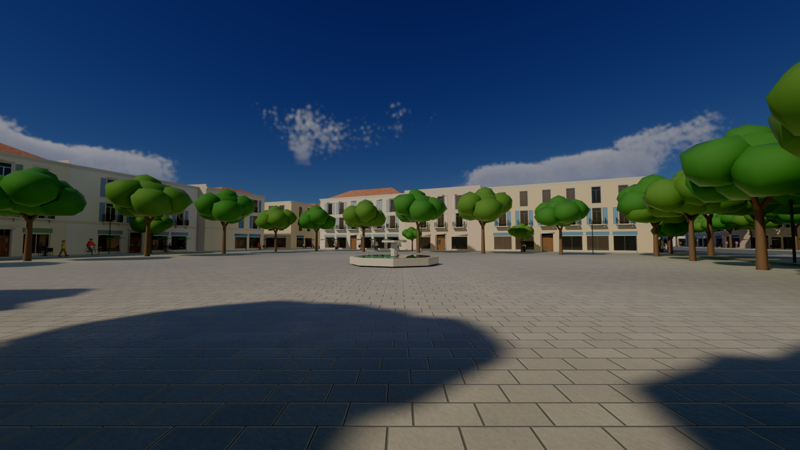
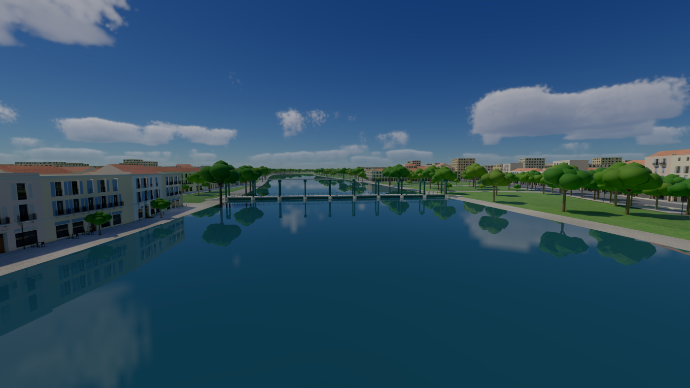
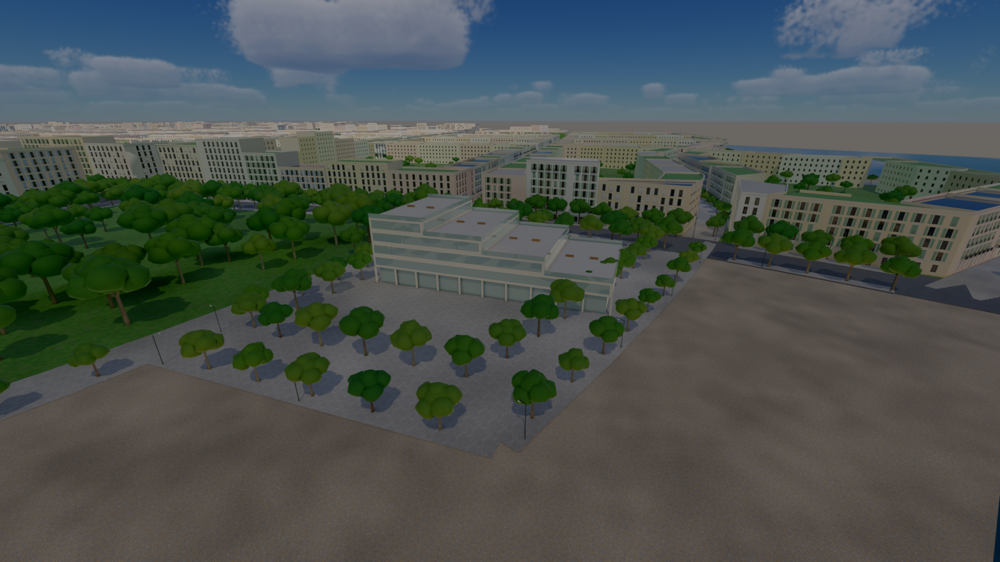

# City plan — a city's layout before any building (`forge-procgen::city`)

The first step of D-059: a city's plan made from a site and a parameter record, judged as a map
image before any building exists (`docs/research/city-generation.md`, "Recommendation for
Forge", stages 1–5, and its extension §7–§19). It is engine-generic. The example below is an
invented coastal city made for the engine's tests and docs.

```
cargo run --release -p city-map -- --size 4000 --scale 2 --out captures/city
```


*The example city at 4 m a pixel.*
- **Water:** the sea, a beach, a river with its quays.
- **Blocks by district:** an organic old town on the river, perimeter blocks round courtyards
  (the pale insides), a waterfront, an eco-quarter, courtyard blocks.
- **Parks:** a river park, and the parks the 3-30-300 rule added.
- **Streets:** traced as streamlines of a tensor field. Eight bridges.
- **Transit:** two tram lines with their stops, a boat crossing.
- **Landmarks:** two red diamonds.

## What it does

| Stage | How | Module |
|---|---|---|
| Districts | each land cell to the anchor nearest relative to its radius, edges roughened by noise | `city::district_field` |
| Street pattern | a tensor field: a grid per district at its angle, rings at radial squares, the water's tangents near the coast and rivers (Chen et al. 2008) | `city::tensor` |
| Streets | main roads traced first (bridging rivers up to 260 m), then streets at each district's spacing; each stops half a block short of a parallel street, and its end joins the nearest street ahead | `city::streets` |
| Road graph | streets cut where they cross or meet, ends snapped, dead ends under 60 m pruned; blocks as the graph's bounded faces | `city::graph` |
| Blocks | quays where a face holds water; parks from park districts, then from the 3-30-300 rule (a park of 1 ha within 300 m of every built block); squares: the built block nearest each built district's centre and each landmark, and small ones through old towns 180 m apart (`add_squares`); once the streets' profiles are known, a buildable outline per block on each street's building line (`geom::inset_by`) and a courtyard a building's depth inside it | `city::blocks` |
| Lots | recursive splits across each piece's long axis (Vanegas et al. 2012); only the pieces on a street are kept where a block has a courtyard | `city::blocks` |
| Forest | ground above a height or steeper than a slope goes to the first reserve district (a real site's hills) | `city::district_field` |
| Transit | tram lines by the shortest path through their waypoints, main roads preferred (a waypoint far from any main road snaps to the nearest street); stops every 450 m moved to nearby junctions; lines added until a target share of blocks has a stop within 400 m (`transit::cover`); boat crossings where a river runs long without a bridge; street profiles between building lines (tram avenue 24 m with 6 m pavements, avenue 18 m with 6 m pavements (5 until the owner found the trees too close to the windows), shared street 10 m, pedestrian 8 m, path 4 m: narrowed on 2026-10-11 after the owner found too much road, the default height-to-width ratio raised from 1.5 to 1.75 to keep the homes) | `city::transit` |
| Masses | each lot's building: strips of its district's building depth along each street the lot fronts (lots are cut inside the block's building lines, half each street's profile width from its centreline); floors from the district's range, capped by the style bible's height-to-width ratio on the street it fronts; green, solar or terrace roofs | `city::mass` |
| Style bible | one TOML record of the city's rules (height to street width, green roofs, green area per block, park and stop reach, the streets' share, per-district floors, lots, spacing, building depth, tiled roofs and walls), put into the plan's parameters and measured by a checker that names what fails | `city::bible` |
| Trees | rows along the streets by profile (on avenues one a side by the kerb, 0.8 m into the pavement, in slots every 8 m that alternate with the lamps, so a tree every 16 m; one down the middle of shared streets every 14 m and of lanes every 18 m), each crown keeping 2.5 m from the building line, none within 10 m of a junction; a jittered grid in parks (13 m, a little over half filled), on the quays (14 m, under half) and in courtyards (16 m, half). None within 3 m of a lamp or 4 m of a river's water, and the parks', quays' and courtyards' none within 1.5 m of a road or path (the owner saw trees on the water, the roads and the paths, and a few too many). The demo keeps them 6 m clear of the tram stops | `city::trees` |
| Lamps | along every street by profile: on avenues in the kerb rows' free slots between the trees, a lamp every 16 m a side, staggered, 8 m tall with two arms (over the carriageway and over the pavement), lit only underneath; one side of shared streets every 30 m, lanes and paths lower, at the pavement's edge; none in a junction (within its widest street's half width and 4 m) and no two within 10 m (two streets' lamps stood side by side in the corners, the owner's second walk): where step 5's lights will stand | `city::lamps` |
| Maps and numbers | a small rasteriser: the plan (with the districts', landmarks' and lines' names in the engine's font, kept from overlapping), a checks map (blocks by what they lack), an oblique massing view of any window; the plan's numbers and its digest | `city::map` |

Everything is a pure function of the site and the parameters. Costs are integers in the
router, and `forge_core::dmath` does the trigonometry. Two runs give the same digest (D-016).

## Numbers (the example, 4 km, release build, one thread)

| | |
|---|---|
| Land | 14.3 km² |
| Main roads / streets | 59 km / 149 km, 8 bridges |
| Built blocks / parks / squares | 667 (mean 1.66 ha) / 48 / 12 |
| Lots / blocks with a courtyard | 11 224 / 605 |
| Parks' share of the land | 10.5 % |
| Built blocks with a 1 ha park within 300 m | 100 % |
| Built blocks within 400 m of a tram stop | 45 % (two lines, no line added) |
| Streets' share of the land | 18.0 % |
| Tram lines | 7.8 km, 19 stops |
| Masses / floor area | 12 614 / 19.0 km² (13 ms; floors capped by street width) |

| Stage | Time |
|---|---|
| districts | 2.3 ms |
| tensor field | 7.5 ms |
| main roads | 2.3 ms |
| streets | 8.6 ms |
| road graph and faces | 10.3 ms |
| blocks and parks | 5.5 ms |
| transit | 0.2 ms |
| courtyards and lots | 5.8 ms |
| **the whole plan** | **≈ 42 ms** |

## Tests

`cargo test -p forge-procgen city`:
- the example has streets, bridges, blocks, parks, lots and trams;
- no block's reference point is in the water;
- every built block has its park within reach;
- the plan is the same every time;
- no two roads cross except at a node;
- lots sit inside their blocks;
- added lines raise the stop coverage by over 20 points;
- masses stand inside their blocks and outside their courtyards.

## The style bible's checks (the example)

```
ok   height at most the street's width times the ratio: 1.000
ok   green roofs' share: 0.507 (limit 0.500)
FAIL built blocks at their green area: 0.788 (limit 1.000); 143 failing, e.g. block 10: 0.06, …
ok   built blocks with a park within reach: 1.000
FAIL built blocks within 400 m of a tram stop: 0.454 (limit 0.900)
ok   streets' share of the land at most: 0.215 (limit 0.250)
```

The old town's small blocks have no room for a courtyard, so they miss the green area; the
example adds no tram lines, so it misses the stops. A city's own bible and its added lines
(`max_extra_lines`) close those.

## Massing


*A kilometre round the example's centre, seen obliquely from the south: perimeter blocks of
4–8 floors round their courtyards, green, solar and terrace roofs, the river and a bridge, two
tram lines.*

**Superblocks and open blocks (both off in the example).** Where the traced streets run far
apart, a block's courtyard became a park of a hectare or more, and its fronts ran for hundreds
of metres. The owner found the courtyards unrealistically large, and the long rows of big
buildings too close, on their second walk (2026-10-11). A plan can now set two options:
- `CityParams::max_block`: a built block longer than this many times its district's street
  spacing gets a shared street across its middle, again until none is (four rounds at most).
  In the private sandbox, at 1.6: 2 148 → 2 764 built blocks, the mean 1.67 → 1.31 ha, homes
  919 k → 1.07 M people with the open blocks below.
- `DistrictSpec::gaps` (open blocks, Portzamparc's *îlot ouvert*): a lot between a block's
  corners left as a garden at the district's share, and wherever a block's front has run
  `DistrictSpec::run` (120 m when not given) since the last gap; never two side by side. Under
  60 m a corner lot may be a gap too: separate buildings round a shared green rather than a
  ring (the owner's photos of open blocks: open, organic, not oppressive). Light, views and
  people reach the courtyard, the walls beside a gap get windows, and in 3D a paved path runs
  from each gap to the court's middle. It is paved with the block's forecourt as one surface off
  the streets. Drawn over the paving, it began on the street's centreline, lay across the
  carriageway on some seeds, and showed as a patch on the pavement (the owner). Test:
  `the_court_paths_are_paved_with_the_forecourts_off_the_carriageways`, four seeds. The sandbox
  opens its modern districts (runs of 35–55 m, gaps 10–25 %) and keeps its centre and old town closed: about
  1.05 M people (977 k once the stair cores took their floor, step 3).

**Footprints.** A footprint's corner sharper than 55° is chamfered where its wedge is 6 m
wide, or at 0.45 of its shorter side: a building came to a point at a block's sharp corner by
a bridge (the owner: an impossible building). Each footprint is then cleaned of repeated and
collinear points within a centimetre (`geom::clean`): ear clipping stalled on them, and 1 372
roofs lost big triangles (the owner saw them). Tests: `no_building_comes_to_a_point`,
`every_footprint_triangulates_whole`.

## In 3D

```
cargo run --release -p city-plan
```


*The example city's masses, trees, gardens, parks, streets, tram tracks and river, drawn by
city-blocks' renderer (sky, clouds, ray-traced soft shadows, probes, TAA) through its scene
interface.* `demos/city-plan` turns any plan and its masses into meshes in tiles of 250 m: the
site's land and water as runs of cells, blocks and street ribbons, walls and roofs (green,
solar, terrace). The rivers are smooth strips along their centrelines; the sea and lagoons come
from the site's cells. A private sandbox hands its own plan to `PlanScenario::new`.

| | |
|---|---|
| Meshes / triangles / trees | 484 / 720 k (309 k before the afternoon of 2026-10-11: dropped kerbs, paved corners, quay walls, the rivers' banks) / 27 379 instances of one tree (36 717 before the avenues' trees alternated with lamps) |
| Built and cooked | 1.3 s |
| GPU frame at 2800 × 1575, this view | 3.84 ms (3.33 without trees or facade textures) |
| p50 / p99 frame | 3.67 / 7.28 ms |


*35 m up: the walls' window bays and shopfronts are two generated textures
(`forge_render::textures::facade` and `shopfront`) read through the walls' coordinates, a shop
band on the ground floor along avenues and lanes, window bays above, four render tints of the
palette chosen by lot. Whole bays only, centred: the wall left at each end, and all of a wall
shorter than a bay, is plain plaster (the end's part of a bay put a window and its shutter at
the corner, the owner); walls onto a neighbour's lot are plain too. Variety in the facades
themselves comes with D-039's modules.*


*At eye height on the river avenue (`--street`), late afternoon and midnight: buildings behind raised
pavements with kerbs, shopfronts and shuttered window bays, a row of plane-like trees each side,
tram tracks, the tree-lined quay and the river; at night the shopfronts and windows glow (lamps
stand along the streets, their heads in the crowns, and light nothing yet: step 5). Next at this
height: finer trees, street furniture, the modules (#247).*


*Midnight (`--time-of-day 1.5`), 35 m up: about 40 % of the open windows lit, warm or cool, and the
shopfronts, from emissive maps beside the facade textures. Left, metered; middle, a fixed EV 3;
right, without the probes. The probes take the windows' light into the city many times over
(the walls and courtyards glow as by day), so night views run with `--no-probes` until step 5
gives the renderer emissive light in absolute units and the probes take it right (#254). The
emissive is scaled by the frame's reference illuminance for a run held at one time of day: a
stopgap.*

## Buildings from the grammar and the kit (D-039, #247)

```
cargo run --release -p city-plan -- --street --detail 450
cargo run --release -p city-plan -- --rules my-style.rules   # another style set's rules
```


*Within `--detail` metres of the view (450 here), each mass is built from the first style set's
rules and kit; beyond, it stays a textured box. Top left, a lane at 16:40: French windows with
louvred shutters, balconies on consoles with wrought-iron railings on the first floor,
shopfronts with fascias, a string course over the ground floor, the cornice, sun shadows
across it all. Top right, the same lane at night, lit windows, without the probes (#254).
Bottom left, the river avenue's shops, entrances and awnings. Bottom right, from 60 m: the
kit's quay front, the textured masses behind.*

Three stages, each generic:
- **`forge_procgen::city::facades`, the component split.** Each mass's walls become faces that
  look onto:
  - the **street**: outside the wall is street, up to the building line;
  - the **courtyard**: the wall looks into its own lot or block;
  - a **party wall**: a neighbour's lot lies against it.

  Walls between two pieces of one lot are inside the building and get no face, if the lot's
  other pieces cover them all along: each wall is probed at five points. A single probe at
  its middle dropped 816 of 2 627 walls covered only in part, and the courtyards saw into
  the buildings, their window frames floating (the owner's second walk). A wall with another
  lot's building within 2.5 m is a party wall, blank, whatever lies between: a slit between two
  buildings had windows facing a wall a metre away. A street face
  knows the corners it turns, and each building's longest street face holds its entrance.
  `city-map` draws the split as `faces-centre.png`.
- **`forge_procgen::grammar`, a split grammar** with CGA's operators (Müller et al. 2006):
  - scopes split along x or y into parts sized absolute, relative (`'0.5`) or floating (`~1`),
    which may name an attribute;
  - repeats `{ ... }*`, whose members know their index, count, first, last and middle;
  - conditions on the context (`[street && level.index == 0]`);
  - weighted choices, per building or per attribute;
  - `let` values each building draws from its seed;
  - a text form with line-numbered errors.
- **`forge_geom::modules`, the kit:** wall, party wall, string course, cornice, parapet, French
  window (with or without shutters, a quarter of them closed), low window, courtyard window, balcony, entrance, shopfront
  with or without an awning (its valance 2.3 m up, so walkers pass under it). Each module is a small part program of boxes and quads with one
  section layout, so eight material groups dress any of them: four shutter colours, each with
  dark and lit glass (each window its own mix of dark glass and curtains). Walls, bands and
  cornices change size with every scope and are merged into
  the tiles; openings repeat at a few sizes and are instanced.

The engine's example style set is `crates/forge-procgen/src/city/mediterranean.rules`, about
fifty lines. Each building picks its bay (2.8–3.4 m), its balconies, its shutters and whether its
top floor is an attic storey of small windows, and
neighbours differ.

| The kit within 450 m of the avenue view (example city) | |
|---|---|
| Buildings / faces / terminals | 1 021 / 4 466 / 198 335 |
| Instances / unique modules | 35 985 / 32 (9.8 M instanced triangles; four terrace layouts a width) |
| Merged triangles added (walls, bands, cornices) | 416 k |
| Derived and assembled | 80 ms (one thread) |
| Longest run of one opening along a floor of a street front | 10 |
| GPU frame at 2800 × 1575, this view, best of 3 | 3.78 ms (3.42 ms with `--detail 0`) |
| Scene built and cooked | 2.79 s (2.35 s) |


*The component split round the example's centre: street faces red, courtyard faces blue, party
walls grey, entrances as dots, corners in yellow.*

**Perimeter blocks, closed.** The first street views showed the avenues lined with gardens and
the backs of buildings. Lots were cut from the block's outline on the streets' centrelines, so
a lot on a 28 m avenue kept a metre or two behind the building line, and the courtyard's
convex hull ate the buildings along concave sides. Now:
- each block gets a buildable outline, moved in to each street's building line
  (`geom::inset_by`);
- lots are cut from that outline;
- every lot is built as strips of its district's building depth along each street it fronts:
  a lot between two streets has two fronts, and a corner lot wraps its corner;
- the courtyard is the buildable outline moved in by that depth.

The blocks close round their courtyards and the avenues are lined on both sides:
- masses: 12 935 (was 14 807);
- floors: 18.3 km² (was 20.5, now one building deep rather than up to 20 m);
- blocks with a courtyard: 602 (was 563);
- blocks under their green area: 83 (was 143).

**No slivers.** One mass in 17 was a slab 2–4 m thick, a blank party wall seen from the street.
Two causes:
- **Short street edges set far back.** Where a short edge between two wide streets turned over
  when moved to its building line, the block fell back to a uniform inset by its narrowest
  street. Its lots along the wide street then kept up to 11 m of street, leaving a 2–3 m
  building. The building lines now drop each edge the move turns over
  (`geom::inset_by_collapsing`, the straight skeleton's edge event).
- **Corner lots.** A corner lot a little deeper than its first strip left a sliver along its
  second street. The first strip now takes that sliver in. A sliver it cannot take joins
  another strip of its lot where the two make a convex piece, or is dropped.

No building is now under 4 m thick:
- masses: 12 373 (was 12 877);
- floors: 18.4 km² (was 18.3);
- lots: 10 985 (was 11 048).

An empty lot is a garden, not a neighbour: a wall onto one is a court face with windows.

**The trees, sized to their streets.** Trimmed street trees of 9–12 m line the avenues, 7–10 m trees
the shared streets and 5–7 m trees the lanes. Each instance is scaled by its own crown
across and its height up. The one model is a trunk forking into three limbs under a crown
of seven smooth lumps (about 620 triangles), so the crowns no longer hide the facades from
the pavement.

The rows stood 2.5 m from the building lines, and their crowns went into the facades (the
owner's first walk, 2026-10-11). An avenue's trees now stand by the kerb, 0.8 m into the
pavement, and shared streets and lanes have theirs down the middle, off the walkers' lines.
Each crown keeps 2.5 m from the building line (`trees::CROWN_CLEAR`), the avenues' pavements
are 6 m and their crowns' radii 2.4–3.2 m: 4 m from the facades, radii of up to 4.8 m reached
within half a metre of the windows (the owner: no one living there would want that).

**The riverbanks and the shore.** The site's water mask is 10 m cells, and drawn as cells every
quay and beach was a staircase (the owner's plan view). The shore is now one smooth line
(`city::shore::Shore`): the sea's and the lagoons' cells blurred over two cells (a 5-tap tent),
the rivers measured from their centrelines, one wetness per sample whose half-way contour,
bilinear between the samples, is the shore. The ground's squares the shore crosses are cut
along it (marching squares; where two opposite corners are wet the water joins across), the
rest drawn whole in runs. The map draws its water the same way, and its beaches 40 m from the
sea by a chamfer distance field. Artificial edges (a quay wall, a building in the water) may
keep straight, stepped lines later; the natural shore is smooth.

The sea, the lagoons and the rivers share one level, 0.6 m under the ground; the river lay over
the ground and met the harbour 0.6 m higher, a dark step between the two waters (the owner's
second walk). For the ground the rivers' beds are widened by three quarters of a cell each side,
so no land juts into them. Along each bank a stone wall drops to 1.2 m under the ground, and a
stone promenade 13 m wide follows the river over the widened bed; where a street runs by the
river, the street lies over it. The promenade is laid on land only, by the smooth shore the
ground follows (its land edge and middle out of the open water): where the river runs into the
harbour it floated over the open water. Testing its river edge too, half wet on the shore, or
the sea's cells, which reach past the drawn shore, dropped it by a bridge (the owner: a missing
pavement next to the bridge). It runs in stretches of 60 m or more: a shorter one stood alone
by a lawn's bank. Stone quay walls drop the same way along the shore.
A quay's land is lawn under its trees, the dry squares and pieces inside it. The harbour's
water itself is still a flat mirror: the island's FFT sea is the next step.

## Buildings carry their structure (D-060, step 1: #264)

`city::structure` gives every mass its structure, as data the next steps build on (the façade
kit reading the walls, collision, interiors, destruction):

- **Eras.** Each district's buildings have an era, with the research note's dimensions
  (`docs/research/building-structure.md` §5): old stone (the old towns and villages), the 1800s
  (the centres and seafronts), modern (the rest).

  | Metres | Old stone | 1800s | Modern |
  |---|---|---|---|
  | Façade / party (shared) / rear wall | 0.60 / 0.50 / 0.45 | 0.45 / 0.40 / 0.30 | 0.35 / 0.20 / 0.35 |
  | Slab | 0.30 | 0.30 | 0.27 |
  | Ground storey, shops / homes | 3.6 / 3.6 | 4.2 / 4.2 | 4.2 / 3.0 |
  | Upper storeys | 3.2, 3.1, 3.0, then 2.9 | a noble 3.4, 3.1, 2.9, an attic of 2.8 | 2.8 |
  | Window bay / window | 3.3 / 1.0 | 3.0 / 1.2 | 2.7 / 1.4 |

- **Storeys.** A mass's storeys come from its era, and its height is their sum (`Mass::storeys`):
  the street's ratio caps how many fit (`StyleBible::max_floors`). The grammar's `ground` and
  `floor` follow each mass. A modern block now fits more storeys of 2.8 m under the same
  height: in the sandbox's city the floors went from 67.5 to 77.5 km² gross.
- **Walls.** Each footprint edge is a wall with its thickness inwards and its role (street,
  court, party, inside the building). It is probed every 0.5 m, 0.75 m out (another mass) and
  2.5 m out (another building that close leaves a slit), and each storey keeps the stretches
  nothing stands against: a lower neighbour covers only the storeys below its roof.
- **Openings** go on those stretches only, bays centred, so they line up storey over storey and
  no window is cut by a neighbour (the owner: "not realistic at all"). Shopfronts on lively
  ground floors, windows elsewhere, the doors (1.2 m, step-free) where the stair cores stand
  (below), or in the middle of the longest street stretch.
  - **Room for the shutters.** Each window keeps room either side for its shutters folded back,
    half its width beyond a 0.15 m surround.
    - A pier of 0.4 m of wall remains between a shutter and a corner or a stretch's end; the
      bays keep half a window and the pier off the ends.
    - 0.1 m remains between two neighbours' shutters.
    - Windows narrow (by the 10 cm) to fit, those the doors and the cores gave back too
      (`structure::fit_shutters`).
    - Before, a shutter wrapped round a building's corner (the owner), and the 2.7 m bays'
      1.4 m windows had their shutters over each other.
    - Test `shutters_fold_back_clear_of_corners_and_of_each_other`: 815 267 windows in the
      example, none within the pier, none over a neighbour (3 and 161 before).
- **Courts.** A passage of 3.0 by 3.6 m runs through one building of each block whose court no
  gap reaches, on its street and court walls (the owner: a door into every inner court). The
  sandbox: 2 082 of 2 087 courts reached, 201 by a passage.
- **Areas.** Gross to the outer faces; net inside the walls (a party wall counts half), less the
  stair cores below on every storey, less the partitions and flues (5–10 %, the 1800s' with
  their service stairs). Net over gross on the example: modern 0.777, the 1800s 0.732, old stone
  0.655. The note expected about 0.82 modern and 0.70–0.75 old stone, but without lifts: here
  every building of four storeys or more has one (the owner's accessibility), where old houses
  rarely do. With the stairs counted as a flat 12–24 m² a storey and one lift a building, it
  read 0.828, 0.809 and 0.722.
- **The population** counts homes from net area at INSEE's 32.4 m² a person, jobs at 25 m²: the
  sandbox's city housed 1 301 827 people at step 1 (1 048 538 before); about 977 k today, after
  the open blocks, the narrower streets and the cores.
- **Cost:** 0.62 s for the sandbox's 39 048 masses at step 1 (3.4 M openings); 2.25 s today for
  its 31 538 (3.1 M openings) with the reach check and the cores.

### Stair cores (D-060, step 3)

`city::cores` puts the stairs and lifts in, by the French rules (the research note's §1):

- **The core.** Behind a street door: a hall 1.50 m wide, where a wheelchair turns, and the
  landing on every storey, where the flats' doors open. A dog-leg stair beside it: flights 1.00 m
  between handrails, risers of 17 cm at most on 28 cm goings (2h + g between 0.61 and 0.62 m,
  Blondel's comfortable stair), a landing as wide as a flight at each end. Its length follows the
  tallest storey: 4.6 m for 2.8 m storeys, 5.8 m under a 4.2 m shop. From four storeys (R+3) a
  lift: a type 2 car (1.10 × 1.40 m) in a 1.60 × 1.90 m shaft. The lift stands beside the hall
  (6.0 m along the street), or on a floor under 150 m² behind it (4.4 m).
- **How many.** One every 20 m of street front, and enough that every floor lies within about 25 m
  of a landing. A wing under 100 m² beside another mass of its building is reached from that
  one's core.
- **Where.** On a ground bay of the street walls nearest each core's share of the front, else
  anywhere along an open stretch, else on a court wall. The core must fit inside the walls and
  stand clear of the others. Its door replaces the openings there. The shopfronts its walls
  stand behind become windows, so no shop window shows a stair. A court passage keeps its
  stretch: a core in its way moves aside (it took the only place, and courts went unreached). A
  core whose door opens onto a court no one reaches is dropped.
- **On the roof.** Under a garden or a terrace, the core climbs on to the roof. A head house
  2.7 m tall stands over it, with a door out from the hall (the owner: a garden on the roof
  means a way up). Every lift's overrun rises 1.2 m over the roof or the head house. Under a
  pitched roof nothing shows.
- **Checks** (`every_building_has_stairs_and_lifts_that_fit_and_reach_its_floors`), on the
  example:
  - 15 502 cores, 15 171 with a lift, 10 294 up to the roof;
  - each core's door is in its hall, on its wall's ground storey, and the core lies inside the
    walls;
  - 11 of 11 614 masses that need a core have none: slivers;
  - 117 of 12 613 upper masses lie more than 25 m from a landing at a far corner.
- **The sandbox:**
  - 41 041 cores, 39 748 with a lift, 29 252 up to the roof;
  - 201 passages, 2 082 of 2 087 courts reached;
  - no door unreached on foot;
  - 48.0 km² net of 61.7 gross (0.78, 0.83 before): homes for about 977 k people (1 045 k
    before);
  - the structure in 2.25 s (2.08 s before).

### Flats and shops (D-060, step 3)

`city::units` cuts each storey into units round its cores, the French way, two to four homes a
landing:

- **Territories.** Each core serves the floor nearer to it than to any other core, cut by the
  bisectors between their middles. Cores on a corner's two walls share the floor too.
- **The landing.** Behind the core a lobby 1.40 m deep continues the hall, and the doors open
  there:
  - on each side of the core, a flat runs through from the street to the court, with two
    aspects;
  - behind the lobby, where the building is deep enough (25 m² or more), a smaller flat looks
    onto the court;
  - a side too big for one flat (over 110 m² net) gets a corridor continuing the lobby, with
    single-aspect flats either side, drawn from the French mix of new homes (T1 10 %, T2 25 %,
    T3 38 %, T4 22 %, T5 5 % at 30, 46, 66, 86 and 100 m²) and 3.6 m wide at least;
  - a narrow house's compact core serves one flat a storey;
  - a unit under 25 m² joins its nearest neighbour.
- **Uses.** A lively ground storey holds shops, entered from the street. A unit with no window on
  its storey is a store room. A home's main rooms follow its net area (under 40 m² a T1, 56 a
  T2, 76 a T3, 93 a T4, then T5).
- **Checks:**
  - **Areas** (`every_floor_is_cut_into_homes_that_add_up_and_open_on_a_landing`): the units and
    landings add up to the net area within 5 % in all 12 610 masses with storeys. 19 of 229 174
    homes have their door more than 0.6 m from their landing.
  - **The walk** (`people_reach_every_home_from_the_street_by_stairs_and_lift`): people go from
    the street, on foot to the core's door (the reach check), up its stairs, and from R+3 by
    lift, to every home's door. None is stranded. 5 424 homes sit in small wings reached
    through their building's other mass.
- **The example:** 229 174 homes, 98 277 of them through flats; T1 16 %, T2 31 %, T3 26 %, T4
  13 %, T5 13 %. There are more large flats than in the new-build mix: the centres' and the
  waterfront's 14–16 m deep buildings make big through flats, as 1800s blocks have. Also 8 955
  shops and 4 634 store rooms.
- **The sandbox:** 673 593 homes, 38 % of them through flats; T1 16 %, T2 34 %, T3 25 %, T4
  13 %, T5 12 %. Also 19 640 shops and 25 374 store rooms. The structure takes 2.9 s with the
  units (2.25 s without).

### Rooms behind the windows (D-060, step 3)

The kit's glass shows a room behind it, seen from outside (interior mapping, Van Dongen 2008;
`interior_room` in `shaders/meshlet.slang`). A material row with `RenderLayer::interior` set
traces the view ray into a box in the window's own space: 4 m wide, 3.5 m high and 4.5 m deep,
the glass on its front face, one box per cell when the glass is wider or taller (a shopfront's).
The ray leaves the box by a wall, the floor, the ceiling or the back wall:

- walls in one of four colours (cream, grey-blue, sand, sage), a floor of dark wood, oak or
  tiles, a white ceiling, each window's own draw;
- a picture on the back wall, a door in one side wall, a low piece of furniture (a sofa, a
  sideboard) against the back, which the ray can meet first;
- the depths darker, and net curtains on 45 % of the windows, from sheer to drawn.

No geometry is added: the glass's shading does it all. By day the room takes a third of the
daylight that falls on the window, and the curtains, at the glass, all of it: a room as bright
as the wall outside matched the walls from the air, and the facades lost their windows (a real
room gets a few per cent; a third keeps it in sight from the street). At night a lit row's room
takes 4 % of the row's luminance (3–8 cd/m²).
The flat glow was too strong and all alike (the owner): at the full value the lit panes were
white, and at 4 % the walls sit a stop or two over the night's grey and the room shows. The
textured boxes beyond the kit light their windows to match (2.5 % of the glow, was 15 %: the far
city shone white over the kit's rooms). Where a pixel covers more than 6 cm of the room its
edges would flicker as the room moves behind the glass, so the room fades into its mean colour
by 25 cm. A turn of 2.5 pixels a frame shows the same shimmer as without the fade (138 695 and
138 629 pixels over ten frames): a turn does not move the room behind the glass, so this
measures the facades, not the rooms.

The rooms stay outside views: the doors are never see-through (Celsys's claims, D-060), and
going inside builds the real rooms.

Next in step 3: which upper floors are offices and which homes, so the population counts by
home (673 593 homes at the French 2.2 people a household would be 1.48 M; the net-area count
says 977 k with a third of the floors not homes). Then the rooms lit by their residents, and
going inside.

## Trams on their timetables (#253)

```
cargo run --release -p city-plan -- --street --tram=X,Z,LEAD   # a tram passes (X, Z) LEAD s in
```


*A five-section tram on the river avenue from the pavement and from 40 m up (a stop's platform
and shelter beyond it), and a lane's café terraces: white bodies in
the line's colour, articulated round the curve, on the right-hand track.*
- **The timetable** (`forge_sim::transit`) runs vehicles out along their line and back:
  - each leg from stop to stop on a trapezoidal profile (50 km/h at most, 1.1 m/s²);
  - 25 s at each stop, 3 minutes at each end, a vehicle every 6 minutes;
  - a run's place is a pure function of the time (GTFS's model of trips and frequencies), so a
    server, its clients and every stop display compute the same tram from nothing sent.
- **The model** (`forge_geom::vehicles`) is a part program like the kit's: five sections of
  6.4 m (two cabs with raked windscreens, three passenger sections), glazed doors, the livery's
  stripe, roof pods, bellows between sections. It takes its power from the ground, as in
  Bordeaux and Nice, so the streets have no overhead wires. Inside: a low floor 25 cm over the
  rails, level with the platforms; hollow sides; facing pairs of seats by the windows; a
  ceiling 2.25 m up. It was a solid body to 1.05 m with no inside faces, and the owner found
  it small.
- **Riding:** C boards the tram section nearest the camera (within 10 m), standing in its
  aisle and facing the way it runs; C again gets off on the platform's side, walking again if
  the rider walked. `--ride SECONDS` boards the nearest tram anywhere that far into a scripted
  run.
- **In the scene,** each line gets two tracks 3.2 m apart, one each way. Each section is a
  mover set every frame by its two ends on the track (the bogie points), so a tram bends
  through curves.
- **Stops and turns** (2026-10-15). A tram stands with its middle at its stop both ways, so the
  two platforms face each other. Before each end's platform, a crossover takes a tram coming in
  across to the track it leaves by: an S-curve 30 m long, its rails drawn 3 mm over the straight
  ones. The tram then turns where it stands.
  - Before this, a tram turning at an end jumped 3.2 m across and a whole tram's length along:
    its front stood at the stop, and the other way's platform lay beyond it.
  - Test `trams_turn_where_they_stand_having_crossed_over_on_the_way_in`: over whole cycles, no
    section moves more than a quarter second at the cruise allows (3.8 m on the outer track of
    an 18 m curve).
- **Crossover pairs along the lines:** about every 3 km, two crossovers one each way, 10 m
  apart. A tram can pass a broken-down one on the other track and come back. They stand on
  straight track on land, clear of the junctions and of the stops' platforms and ramps.
  - The example has 6 on 26 km of line over three seeds; the sandbox 18.
  - The trams don't take them yet.
  - Test `crossover_pairs_stand_every_few_kilometres_clear_of_stops_and_junctions`.
  - Tail tracks are next (`research/transit-and-vehicles.md` §10).
- **Tram depots** (`city::tram_depot`, 2026-10-15; the owner asked for depots for maintenance
  and stabling). About one for three lines, 2–4 for a network of 5–8, near a line's end where
  a tram avenue's block holds a yard of 6 trams or more behind its building line. Industrial
  land comes first, and the depots stand 1.5 km apart.
  - **The link:** a single track leaves the line's near track on an S-curve (25 m curves). It
    rises up the verge on a ramp from the carriageway to the walking level, so the footway it
    crosses stays level, and becomes the yard's first track.
  - **The yard:** parallel stabling tracks 4.6 m apart, in asphalt behind a low wall along the
    street. The next two tracks leave the first on S-curves; the deeper ones turn off a 45°
    ladder on 20 m curves. Each place is a tram and 5 m (38 m).
  - **The hall:** over the three deepest tracks' far ends, 50 m long and 9 m high, open towards
    the yard, with solar panels on its roof.
  - **The trams kept:** two places in three hold a tram in its line's livery, standing; the
    lines' timetables run round the clock, so none goes in or out yet.
  - Only the lots under a yard lose their buildings, and the depot's block has no court
    gardens. Stops keep off the links as they keep off junctions.
  - The example has one depot of 8–13 trams in each of three seeds; the sandbox has 4,
    keeping 42 trams.
  - Tests:
    - `a_depot_s_tracks_curve_no_tighter_than_a_tram_turns_and_hold_its_places`;
    - `tram_depots_stand_behind_the_building_lines_near_the_lines_ends`;
    - `a_depot_s_trams_stand_on_its_tracks_in_their_places`.

The example's two lines run 10 trams.

Lines share their tracks where they share an avenue, and nothing yet keeps their trams apart.
Lines ending at one hub stood their trams on the same spot for their three-minute turns. Each
further line ending within 30 m of another's terminus now ends 45 m before it, along its own
track. The log counts the trams of two lines within 30 m on one track, every 5 s over a game
hour:
- a 21-line city: 685 such pairs, down from 985;
- the example: 4.

The rest are trams turning at a terminus that another line runs through, and chance meetings
on shared avenues. Spacing trams on a shared track needs the lines' timetables planned
together (holding at stops, as real networks do).

**River shuttles** (Nantes' Navibus, smaller): an electric boat for about twenty people
(`vehicles::shuttle_boat`: a hull with bows at both ends, a glazed cabin under a solar roof, ramps
at both ends) runs out and back at each of the plan's boat crossings. It uses the same
timetable as the trams, with two stops at the water's edges: 3.5 m/s at most, 45 s at each
landing. `--clock SECONDS` sets the service's clock for a capture.


*The example's crossing from mid-river: the shuttle by its north landing.*

**Street furniture** (`forge_geom::furniture`) in the kit's section layout:
- **café terraces:** round tables in two staggered rows, a little off their places and turned
  their own ways, two to four bistro chairs round each, a parasol over every other table. There
  are four layouts a width, chosen by the shopfront, so neighbours differ (the owner asked for
  several tables round each café, not aligned, a bit organic). They stand within 2.65 m of the
  wall, before a third of the kit's shopfronts on the avenues' pavements and in the lanes,
  and two thirds of those facing a square, a park or a quay. They are coloured as the
  building's awnings.
- **Which ground floors are shops** (`Mass::active`, redone 2026-10-15). The owner: not every
  ground floor on a pavement is a shop or a café; shops go on the main roads, near the sights,
  in the centre, along the coast and the rivers. `research/ground-floors.md` gives the model, all
  its numbers estimates calibrated on Paris and Barcelona.
  - **A chance by street:**
    - a central tram avenue 0.9, another 0.65;
    - a central taxi road 0.75, another 0.35;
    - an old town's lane 0.55, another pedestrian street 0.1;
    - a shared street 0.35 in the old towns, 0.12 elsewhere.
  - **Or by what it faces:** a square 0.9 in the centre and 0.6 elsewhere; the water 0.8 and
    0.4; a park 0.35.
  - **The neighbourhood's parades:** at least 0.5 within 400 m of each district's heart.
  - **Then:**
    - ×0.4 in industrial districts;
    - less far from the centre (×0.8 at 3 km, ×0.6 past 5 km);
    - +0.15 within 100 m of a tram stop (+0.07 within 250 m);
    - +0.15 near a sight;
    - at most 0.95.
  - **Parades, not scatter:** the draw is shared by stretches of 120 m of a street (70 %), a
    little by the lot.
  - **The example:**
    - 22 % of the ground floors are active, 96 % along the tram avenues and 13 % along the shared
      streets;
    - an active building's neighbour is active 65 % of the time;
    - 30.9 shopfronts per 1 000 people (Paris 28, Barcelona 37);
    - the old rule made every avenue, lane and open front shops.
  - **Tests:** `shops_gather_where_people_pass_and_leave_most_ground_floors_homes` and
    `a_city_has_about_as_many_shops_as_a_real_one`.
- **What the homes keep on the ground** (`city::gardens`, 2026-10-15; the research's §4.6–4.8).
  All of it is the generator's data, at the walking level and step-free; the scene draws it.
  - **The courts' paths** (2026-10-15, after the owner's review): one network round each
    court's middle. The owner: close paths should first join the paths round the garden, like
    a hub; separate ones side by side waste the ground.
    - The middle is the kitchen garden in its paved ring 1.8 m wide, or a round paved place
      7 m across in the courts without one.
    - A path comes in from each gap between the buildings and each passage (2.4 m wide), and
      from each court door (1.8 m). Each runs straight out past the private gardens, then to the
      nearest point of the network laid so far, the nearest entrances first. A path goes to
      the middle itself where joining would turn it more than 75° away from it.
    - In the example, 3.9 % of the paths' length lies within 4 m of another path, away from
      the junctions, against 50.7 % when each ran to the middle. They are about a quarter as
      long.
    - They are paved with the forecourt, one surface.
  - **The garden flats** (the *rez-de-jardin*): 8 m of a court wall each, laid out between the
    doors and passages, where the ground is open court or the building's own lot.
    - Half have a private garden 4.5 m deep: a terrace of 2.5 m before the flat, a lawn, a
      hedge of 1.4 m between neighbours, and a hedge of 0.8 m along the court with a 1.2 m gate
      and a paved way to it.
    - The others have a terrace of 1.8 m between two short hedges.
    - Each opens onto its terrace through a glazed sliding bay to the floor (the owner's
      "baie vitrée"): up to 2.4 m wide, its threshold flush. It is the style's `GardenBay`, the
      kit's `bay` module, with no shutters.
  - **Planters** 0.9 m deep and 0.45 m tall, against the facades of the homes on streets 8 m wide
    or more. They are broken 0.8 m either side of each door and passage, and none stand before
    a shop. The footway keeps 2.6 m on an avenue, and the walkers pass 3 m out.
  - **A shared kitchen garden** in each green court of 600 m² or more, on paved ground at the
    court's middle, where its paths meet, else as near it as fits on its sunniest (north)
    side, clear of the private gardens. It has eight beds (four where only those fit),
    1.2 × 4 m and 0.7 m tall for a seated gardener, on paths of 1.4 m.
  - **The gaps between the buildings** (open blocks) get a low hedge (0.8 m) along their street
    side, just behind the 2 m paved forecourt, broken a metre either side of the court's
    paths. They showed a plain lawn; the owner said a gap would "match the sidewalk or have a
    decoration".
    - With open blocks on, the example has 3 091 such hedges in 1 770 gaps, none in a building
      or on a path; the sandbox has 16 476.
    - Test `open_blocks_gaps_are_hedged_behind_their_forecourts_but_where_their_paths_go_in`.
  - **The walker** walks round the planters, hedges and beds. No tree stands on a path, a
    terrace, a hedge or a bed.
  - **Plants:** within 400 m of the kit's centre, shrubs every metre in the planters and two
    rows of vegetables every 0.8 m in the beds. They are small trees sunk in their boxes to their
    crowns' middles.
    - The boxes' flat green tops read as carpet; standing on them, the plants showed their
      trunks like bonsais.
    - Out to 1.2 km, a pixel or two each, they speckled the facades' feet from the air.
    - The sandbox has 4 226; its planters' view takes 2.40 ms GPU.
  - **The example:**
    - 8 880 court-side flats, 4 464 with a garden, every one with its glazed bay;
    - 400 kitchen gardens of 3 200 beds;
    - 20 377 planters (two gave way to a door's path round a building's corner);
    - none of the 15 701 street doors and passages and none of the 9 544 shopfronts behind a
      planter;
    - no court door or passage opening into a garden.
  - **Tests:** `court_gardens_keep_clear_of_the_buildings_the_paths_and_the_doors`,
    `court_paths_join_round_the_middle_instead_of_running_side_by_side` and
    `planters_line_the_homes_on_the_streets_and_leave_their_doors_clear`.
- **tram stops:** a 36 m boarding area by each track, level with the trams' floor (28 cm over
  the road), from the tram's side across the carriageway to the kerb and half a metre into the
  pavement (3.55 m on a tram avenue, `boarding_deep`), and a glass shelter with a bench and a
  lit totem. Its screen shows the next tram, amber on black: "Due", "1 min" to "14 min", or
  "15+ min", from `Timetable::next_arrival`. The plates are one atlas row each
  (`signs::screen_plate`), twelve of each kept as movers and set each frame on the totems within
  150 m of the camera, nearest first (the owner asked for the screens).
  Ramps of 1 in 12 run down to the road at each end, and along its back down to the pavement,
  so someone on the pavement rolls onto it anywhere: the platform was first reached by a 28 cm
  step, then stood 0.75 m off the kerb with the road between (the owner: not accessible). The
  bikes' strip by the kerb runs over it behind the shelter, at its height, as a cycle track
  crosses a stop's boarding area in Dutch and German streets; it was a 0.75 m channel. Each stop
  stands at the nearest place along its route where its platforms and ramps, 37.4 m either way,
  are clear of every junction and on straight track, so the whole tram stands level with the
  platform (searched 400 m either way in 2.5 m steps, 60 m apart at least). Snapped to a
  junction, they stood across the crossings and bikes rode through them; set in the middle of
  the stretch between junctions, some still jutted into the crossroad or lay on a curve (the
  owner).
- **tram lines** turn on arcs: each line is simplified to 0.5 m, then every corner is rounded to
  18 m, about a low-floor tram's tightest in the street (`geom::fillet`, `transit::TRAM_RADIUS`).
  The tracks turned at right angles in the junctions.
- **benches** keep 2.2 m clear of the trunks (the owner saw a tree through one).
- **chess tables** (`furniture::chess_table`): four round the fountain of each square of
  0.15 ha or more without a landmark, 9 m from its middle on the diagonals. Each is a stone
  pedestal table with an inlaid board in stone and wood, close in tone so it does not shimmer,
  and two stools. Its players sit as the terraces' guests do. Round a game being played, two to
  five people stand and watch, a step back on the players' sides (the owner: a few play, more
  watch, some pass by).
- **fingerposts** (`signs.rs`; the owner got lost on their second walk): at each junction where
  two avenues meet, within the kit's reach, a dark pole by the kerb just past the dropped kerb,
  clear of the trunks. Up to three blue blades, each pointing the way to one of the nearest
  landmarks or built districts' centres (200 m to 4 km, at least 35° apart). Each carries its
  name in white, read from its left end on both faces, from one 1024² atlas of names drawn
  with the engine's JetBrains Mono (16 rows). 23 in the sandbox's kilometre round the harbour.
- **the street ground as one map** (D-061, `city::ground`; the owner, 2026-10-14: "a lot of
  bugs" in the roads and pavements). Every surface of the streets is drawn once, at one level.
  The old pieces were stacked a centimetre apart (0.16, 0.17, 0.18, 0.30) and patched case by
  case: paved corners, swaps, straight bands, bend wedges, square borders, aprons.
  - **Sections:** a street's cross-section is data (`Profile::section`: footway, verge, cycle,
    drive, tracks, shared), so its width, carriageway and pavements are sums of its strips.
  - **Streets:** each street is its centreline stroked to its width, and its carriageway to the
    carriageway's width (`i_overlay`, integer mode). Arms end flat at their junctions, a mitre
    fills a reflex gap, and dead ends are round. The union is the street ground.
  - **Corners:** between two driven arms the kerb turns on 6 m, shorter where an arm is short.
    Where a tram turns, the carriageway takes in its swept path (the outer track, half a car and
    0.5 m: `transit::SWEPT`), so the kerb keeps clear of it.
  - **Crossings:** a zebra 4 m wide on each driven arm of every junction, a metre past its corner
    or past a pedestrian way's mouth. A dropped kerb at each end slopes 1.6 m (1 in 12, #263) down
    to a 1 cm lip, its sides flared at 1 in 12 too, so there is no edge to step or roll over (the
    owner: "gentle slopes all around"): 862 crossings and 1 724 dropped kerbs in the example.
  - **Raised tables** on the taxi roads (the owner's go): a crossing over an avenue without trams lies
    at the walking level from kerb to kerb, flat for a wheelchair, and taxis take a ramp of 1.5 m
    up and down either side (14 cm, walking pace). Tram avenues keep dropped kerbs: rails take no
    table. A kerb's face drops to nothing along a table. Test
    `a_taxi_road_s_crossings_are_raised_tables_flush_with_the_pavements`.
  - **Pedestrian streets:** the shared streets are for people only (bikes, deliveries at set
    hours, no taxis; the owner). A row of bollards closes each walking way's mouth onto a road,
    1.5 m behind its building line, 1.5 m apart at most (`furniture::bollard`, a steel post with a
    pale band), and no café terrace stands within 8 m of them.
  - **Taxi stands** (`city::taxi`, the owner's model: automated taxis booked from a communicator,
    waiting at stands when idle). A lay-by 14 m long and 2.5 m deep cut into a taxi road's verge at
    the carriageway's level, its ends splayed, and a lit totem behind it (`furniture::taxi_totem`).
    Only on avenues without trams, so no platform meets one. They go first by the tram stops and
    squares (within 150 m), then wherever a built block is left without one within 300 m, 200 m
    apart at least. Trees and lamps keep out of the lay-bys. The example has 81 (15 of 610 built
    blocks are farther than 300 m: no taxi road near them), the sandbox 189. Test
    `taxis_wait_within_a_short_walk_of_every_block`.
  - **The taxi fleet** (`forge_sim::taxi`, the owner's model: like Uber or inDrive, with no
    drivers). The taxi roads make a two-way network. Each stand has two bays.
    - **Trams first** (the owner: not everybody takes a taxi, and it has to be useful to the one
      who does):
      - the trips by tram or taxi are 0.68 a person a day (D-059's shares: of some 2.8 trips,
        22 % by tram, 2 % by taxi), over a daily profile with morning and evening peaks;
      - a trip goes by tram when a line stops within 400 m of both ends, or a line near one end
        meets one near the other (stops within 150 m: one change);
      - of the trips the trams do not serve, a share books a taxi, set so that taxis carry 0.056
        trips a person a day; the rest walk, cycle or change more;
      - trips shorter than 700 m walk.
    - **Bookings:** places weighted by floor area (built blocks) or 5 000 m² (squares).
    - **Fleet size:** three trips a taxi in the busiest hour. One taxi for 90 trips a day left
      527 bookings waiting at 9:00 (402 s on average).
    - **Dispatch:** the nearest free taxi by road (Dijkstra in millimetres):
      1. it drives to the booking, waits 25 s while the passenger gets in;
      2. carries them, waits 25 s again;
      3. returns to the nearest stand with a free bay.
    - **Busy hours:** the hour's rate is above 1.3 times the day's mean. The taxis behind a
      stand's first leave to cruise round the busy places, one at a time as the road clears.
    - **Traffic:**
      - 8.3 m/s (30 km/h), 1.5 m/s² to start;
      - each taxi follows the one ahead in its lane along its route (the Intelligent Driver
        Model: 2 m standing, 1.2 s at speed, looking 60 m ahead);
      - one taxi at a time crosses a junction, and only with room past it; the others wait at a
        stop line 10 m before its node, behind the crossings (after 20 s they go anyway: no two
        queues wait on each other for ever);
      - pick-ups and stands keep 15 m from junctions;
      - a taxi pulling out from the kerb goes before one standing level with it;
      - a taxi stops with its front 3 m short of anyone on foot on the carriageway ahead (within
        3.2 m of the road's centreline: crossing at a zebra or a junction), the people drawn
        round the camera (`Fleet::set_people`). Test
        `a_taxi_stops_for_someone_crossing_and_goes_on_once_they_are_over`.
      - the walkers cross the streets on the zebras: at a junction, each driven street on the
        way's right that has one is crossed on it, along the pavement to its near end and back
        from its far end, at the road's level between the kerbs (or the table's); they crossed
        in the junction's middle, where the taxis drive. Test
        `walkers_cross_the_side_street_on_its_zebra`.
    - **Where each cab stands:**
      - in its lane, 1.5 m right of the centreline;
      - at the kerb, 2.3 m right, while it picks up or sets down;
      - waiting: in its lay-by, two bays;
      - parked: in a bay of its depot's deck, seen through the fins.
    - **The vehicles** (`vehicles::taxi_cab`, `taxi_shuttle`): ivory bodies, dark glass and an
      amber band, drawn as movers after the trams.
      - A cab for four, 3.6 × 1.8 × 1.65 m: most trips.
      - A shuttle for eight with a ramp, 5.0 × 2.0 × 2.2 m: 5 % of the fleet, one a depot at
        least (26 in the example).
      - A booking is for a party: one in 68 %, two in 20 %, three in 6 %, four in 3 %, five to
        eight in 3 % *(estimates)*.
      - A group goes to the nearest free shuttle. It waits without holding up the bookings
        behind it. The lanes' gaps take each vehicle's own length. Test
        `groups_ride_in_the_shuttles`.
    - **Depots** (`city::taxi::depots`, `forge_geom::depot`): the parking decks where the taxis
      no stand holds wait and charge, one for 25 stands (the example 4, the sandbox 9).
      - **Sites:** behind the building line of a taxi road, 48 by 32 m in a built block.
        - Clearances: 13 m from the block's other streets, 45 m from junctions, 40 m from
          stands, 150 m from the landmarks.
        - Each cluster of stands takes its nearest site, an industrial district's counted 800 m
          nearer; depots stand 1 km apart.
        - Their blocks hold no flats and no court paths.
      - **The deck** (redone 2026-10-15). The owner asked whether the cabs could drive in, about
        the door's height and the ramps, and how car parks keep the flows in and out apart. The
        first deck had no ramps, a column in its way in, and 2.1 m under its lintel. The new
        deck follows the usual practice (`docs/research/transit-and-vehicles.md` §9):
        - **Split levels:** the front half's floors at 0, 3 and 6 m, the back half's 1.5 m
          higher. Ramps of 1.5 m over 10 m (1 in 6.7) in the side strips join each half to the
          other's next floors.
        - **One way round:** the front aisle runs east and the back aisle west. Each strip has
          an up lane and a down lane, so no ramp is shared both ways.
        - **In and out apart:** the way in at the front's middle passes every floor's bays going
          up. The way out leaves at the front's west corner, at the foot of the last down lane.
          Each has its own one-lane driveway.
        - **Clear ways:** columns stand 7.5 m apart, only between bays, at the strips' edges and
          in the facades. Each level has 2.7 m clear, and the way in's fascia 2.3 m.
        - **People:** a stair and lift core in the front's east corner opens onto the pavement
          for the staff who keep the chargers and the cabs. The fleet would stop its cabs on a
          floor they work (ISO 23374); that is not simulated.
        - **Dress:** timber fins every half metre, concrete slabs, upstands round the ramps and
          the half-level edges, solar panels over both roofs.
        - **Room:** 177 bays, 15 to a row, four rows to a level of both halves.
      - **The driveways** climb the 2.5 m verge from the carriageway (ramps flared at their
        sides), then cross the footway at the walking level: nobody walking along steps down.
      - **The sim:**
        - the taxis past the stands' bays start parked, shared out by room;
        - a free taxi goes to a stand with a bay free within 1.5 km, else to the nearest depot
          with room;
        - every 30 s the depots send one to each stand short of taxis (all its bays at a quiet
          hour, one at a busy one);
        - at busy hours they call their taxis out, one at a time;
        - a cab drives through the deck in 45 s, in to its bay or out from it, and leaves 4 s
          after the one before;
        - an arriving taxi takes its stand's first free bay (counting the waiting ones put two
          in one bay).
      - **In the scene:** each parked cab keeps its own bay until it has driven out. Entering or
        leaving, it follows the deck's way (`depot::way_in`, `way_out`): up the driveway, round
        the floors the one way they run, nose into its bay, backing out of it.
    - **Numbers:**
      - the example: 511 taxis, 349 of them parked in 4 depots at 4:00, 336 an hour on, none out
        of place. From 8:00, at 9:02: 2 646 trips by tram, 1 372 by taxi, none waiting, a mean
        wait of 40 s, no taxi stuck;
      - the sandbox: 1 727 taxis in 9 depots; the trams serve half of the trips by tram or taxi,
        17 % of the rest book a taxi.
    - **Not yet:**
      - batteries and charging times;
      - shared rides.
    - **Tests:**
      - `waiting_taxis_stand_in_their_lay_bys_and_moving_ones_on_the_roads`: each on a
        carriageway or its depot's deck, none drawn one on another, at the start and an hour on;
      - `taxi_depots_stand_behind_the_building_lines_with_level_footways` and
        `the_taxis_no_stand_holds_wait_in_the_depots_and_refill_the_stands`;
      - `forge_geom::depot`'s: 177 bays clear of the columns, every bay reached one way round
        and left by the way out, no step over 1.5 m nor slope over 1 in 6.25;
        `the_plans_depots_are_the_decks_drawn`;
      - `at_the_morning_peak_the_taxis_keep_moving`: none stuck, a mean wait under 2 minutes,
        the trams carrying more than the taxis;
      - `forge-sim`'s tests: fetch-carry-return, determinism, busy-hour cruising, routes that
        follow the roads, a taxi stopping behind one standing, no two overlapping in a lane
        (6 122 pairs, the closest 2.0 m apart, 6 pulling out), one at a time in a junction
        (19 463 samples, none shared), and trips one tram line serves taking the tram.
  - **No hairlines:** the junctions' pieces (corner wedges, gap mitres) reach 0.3 m into the
    strips they join, and the carriageway's gaps close among the driven arms only (a pedestrian
    street's mouth between an avenue's arms left a sliver of pavement on the asphalt).
  - **One pattern across the tiles:** the ground's rows are projected from the scene frame
    (`RenderLayer::world_projected`), not from each 250 m tile mesh's origin. A pavement polygon
    kept in the next tile's mesh showed as a lighter band: its brightness noise (and the grass's
    hex tiles, offset per instance) started from another origin (the owner).
  - **One walking level** (0.30): pavements, shared and pedestrian streets, paths, squares,
    gardens and courts. Only the avenues' carriageways lie lower (0.16, a 14 cm kerb). A
    pedestrian way meeting an avenue runs on across its pavement (a continuous footway), and
    the doors' and shopfronts' sills all stand at the walking level (`structure::outside`).
  - **Faces:** a kerb's face along each carriageway, following a dropped kerb's slope, the
    ramps' sides, and a face down from the street ground's edge to the open ground (none over
    the water, where the bridges' sides stand).
  - **Blocks:** what is left of each face off the streets (`GroundMap::off_streets`). Their building
    lines are the pavements' real back edge, so every street front stands on it. Moved in by a
    width read from the nearest street, they missed it here and there, a strip of garden between
    the paving and the wall (the owner: "buildings have no foundations"). A built block's ground
    is paved 2 m deep along its streets (`GroundMap::forecourt`), its gardens behind: plain grass
    had met the pavement in the gaps between the buildings.
  - **Checks:** `the_street_ground_is_one_map_with_every_surface_once` (the example's 0.403 km² of
    carriageway and 2.047 km² of walking ground, none of it both), and the crossroads' and
    pedestrian street's unit tests in `city::ground`. The map takes 0.1 s for the example.
- **the network cleaned before it is drawn** (D-061, the owner: "junctions, road intersections
  and bridges are still a mess"; the map drew the network faithfully, and the network was the
  mess).
  - **Counted** (`graph::defects`): close junctions, short streets, sharp meetings, nodes on the
    water, bridges close together, doubled streets.
  - **Junctions:** those within 20 m, or joined by a street shorter than that, become one
    (`graph::tidy`). The groups are bounded (every member within 20 m of the middle), nearest
    pairs first; joined unbounded, junctions chained across a dense grid and its streets
    collapsed. Each street's moved end is cut back by twice the move and 5 m, and runs straight
    on to the new junction.
  - **Streets dropped:** of two drawn twice between the same junctions, of two leaving a node
    within 25°, and of two running doubled side by side, the lesser goes.
  - **Bridges planned first** (`streets::bridge_sites`): one every 450 m along each river
    between built districts, square to it at its narrowest within 80 m. Main roads cross only
    there, arriving within 12 m of its axis and 25° of its way. A site no road took gets one
    straight on inland along its axis to the first street on either side, a T-junction there.
  - **The sandbox:** close junctions 353 → 0, short streets 342 → 0, sharp meetings 81 → 0,
    doubled streets 22 → 3, nodes on the water 1 → 0, close bridges 2 → 0, 12 bridges; the
    homes unchanged (about 980 k people). Test: `the_network_has_one_place_for_each_junction`.
  - **Checked over seeds** (the owner: "or else it will just go back if we change a param or the
    seed"): `the_rules_hold_on_other_seeds` builds the example city on four seeds, and the
    sandbox's `tests/seeds.rs` the real site on three. Each must have no network defect, every
    street polygon covered by its triangles, and every door and court reached on foot. The real
    site's seeds first showed what the example's did not:
    - junctions straightened last came close again (straightening now runs first);
    - narrow loops of one street traced up and back (two streets between the same junctions
      under 25 m apart are one);
    - streets judged at their width before a tram widened them into one another (judged at a
      tram avenue's 24 m);
    - a court with no wall stretch facing one (passages may run slant);
    - a street door onto a pocket the block's buildings close (back to a window when its
      building keeps another door).
- **quays, promenades and the seafront** (D-061). With no street along a bank, the land between
  the last street and the water was no block at all: bare ground with streets crossing it (the
  owner's "gigantic paved areas").
  - **Quays** (`streets::quay_lines`): a pedestrian walk along each river bank through the built
    districts, 6 m from the water's edge.
  - **Seafront** (`streets::coast_lines`): a promenade along the sea's and the lagoons' shores,
    by marching squares on the distance to the sea. It runs 34 m inland, a beach before it (6 m in
    the industrial quay).
  - Both close the faces into blocks and are pedestrian whatever their district.
  - **Promenades** (`streets::promenades`): 13 m along each river bank on land. They are walking
    ground in the street map, so they meet the quays and streets with no step. They had been drawn
    apart at 5 cm, a 25 cm edge (the owner: "avoid step and edge for accessibility, think
    wheelchair all the time"). Their edge over the water gets the bank's stone wall and
    balustrade.
  - **Blocks and quay lawns** lie at the walking level, cut round the streets, the walks and the
    rivers' water. A park had covered a river's strip by the mouth.
  - **The promenade follows the real bank.** Where the land starts within 12 m of the river's
    strip, it covers the edge cells as an embankment from the strip itself. Farther off (at a
    mouth), it starts at the bank. It needs no open sea under it and its back on land.
  - **Quays share the promenade's line.** Its runs break where the setback jumps, and the
    backtracks are dropped.
  - **Mouth fixes.** All strokes join round. A mitre at a near reversal shot out as a walled spike
    in the water at the mouth (the owner).
  - **The rivers' water** is drawn from the same strokes, tile by tile. Strips between two offset
    lines can fold.
  - **The shore** counts the rivers' cells as well as their strip. Past the strip, at a mouth,
    river cells had been dry.
  - **The sandbox's site** opens its land by two cells (`Site::open_land`, after
    `Site::clear_slivers`), so no spit thinner than about 40 m is left.
- **the city's outer limit** (`CityParams::reach`): land farther than `reach` radii from every district's
  anchor stays countryside, with no streets or blocks (main roads still cross it). Every land
  cell had taken its nearest district however far: islands of city grew wherever the hills left
  room, with empty ground nearer in (the owner). The sandbox uses 1.5, with denser districts
  and hillside quarters on the south bank's gentler slopes to keep its million. Courtyards under
  100 m² are none: the block is built through, as such light wells had no passage to them.
  Tram lines end in the city: a line's end waypoint out in the countryside moves in along it to
  where the built districts begin, or goes (lines drawn to the frame's edges ran on into empty
  land, the owner).
- **open land as nature:** the ground outside the city is a dry, olive scrub. The reserves and
  any land outside every block carry a loose wood: a jittered grid of 16 m, under half filled, 8 m
  clear of the streets. They were gravel, which the owner took for paving.
- **tram alignments** (`transit::alignment`): the route straightened to within 1.5 m of its
  streets, then each corner rounded, a junction's turn on 18 m and a gentle bend on a longer arc
  (up to 120 m). Each little jog had been rounded on its own into a run of S-bends (the owner:
  "trams wouldn't make a series of small undulating turns").
- **one track, one stop, where lines share a street:**
  - **Tracks** (`transit::share_tracks`): each line in turn is drawn onto the alignments of the
    lines before it wherever it runs beside one within 3 m, the same way or the other. It moves
    in full within 1.5 m and blends off to 3 m, so a line leaves the trunk on a curve. Only the
    first line draws the shared rails. In the sandbox, 96 % of the shared stretches now lie
    within 5 cm (56 % before), and the rest are the turnouts. Each line had laid its own rails
    beside the other's, up to a metre or more apart.
  - **Stops:** a line takes a stop the lines before it placed on its track within 150 m, and
    each platform is drawn once. Several lines' stops stood one over another (the owner).
  - **Placement:** stops keep clear of a junction's corners and crossings (a platform's ramp
    met a zebra) and are never on a bridge. A stop with no clean place within 400 m is dropped.
- **the tiles' LOD** weighs normals (`CookOptions { normal_weight: 2.0 }`): at the coarser levels
  a pavement's kerb and back faces folded into its top, long tilted triangles where two paving
  patterns seemed to blend on the pavements and the bridges (the owner guessed an LOD issue).
- **bridges:** a stone parapet a metre over the pavement along both edges, 0.35 m thick, and
  the deck's side below it down to the water; the walker walks against the parapets. The
  pavements stopped at a bare edge over the river (the owner: the bridges' pavements looked
  broken). The parapets stand wherever the street ground's own edge borders the water as drawn
  (a river's strip or the smooth shore's open water), so they follow the deck to the banks and
  a quay street's edge over the water too (D-061). Run along the bridges' centre lines' sides,
  they went on past a bridge's end into the junction at its head, a wedge on the quay (the
  owner); cut by the site's cells, they first ran over the land, then stopped short.
- **street-workout parks:** one in each park of a hectare or more, 14 by 10 m on a rubber
  floor:
  - pull-up bars at three heights, monkey bars, parallel bars, a dip station;
  - wall bars, push-up handles, an inclined sit-up bench.

  The park's trees keep clear of it. There are no playgrounds: the owner wants no children in
  the cities.

## Squares (#245)



*Left: a square by the river avenue at 18:00, from the pavement, paved in limestone, its
fountain in the middle, an alley of planes round it (each tree in its own tones), shops round
it. Right: the market hall on its square under the planes, benches round it.* Squares come from
three rules:
- the block nearest each built district's centre and each landmark becomes a square (within
  150 m, at most 1 ha), unless one already opens within 120 m;
- so do the old towns' blocks of 600–3 000 m² that stand 180 m from any other square: their
  small squares;
- slivers too small to build on.

Squares are paved, with a row of trees every 10 m, 3 m inside their building lines. Those of
0.5 ha or more get a second row 11 m further in, an alley of planes (a Provençal *cours*). A
fountain stands in the middle of those of 0.15 ha or more (`furniture::fountain`), grander on
grander squares, and benches stand every 15 m inside the trees, facing the middle
(`furniture::bench`). Squares of 1.5 ha or more are gardens: a lawn in the middle, 14 m inside
their building lines, a paved border round it under the trees. The example has 12 squares,
slivers included.

**Water mirrors** (2026-10-15; the owner: "water mirrors as in Nantes"). Two centimetres of still
water over dark granite, level with the paving, as in Bordeaux's (130 × 42 m) and Nantes'
mirrors. The sky and the facades show in it through the mirror rays. They go on the squares
without a landmark:
- every other square of 1.5 ha or more, in place of its lawn: up to 80 × 30 m;
- every third square of 0.15 ha or more, in place of its fountain: up to 30 × 9 m, 14 m inside
  the building lines from 0.5 ha and 8 m below, clear of the trees and the benches. The chess
  tables move out of the water.

The lawns and the mirrors are cut out of the paving (`GroundMap::off_streets_split`): one laid
2 cm over the other could fight it. The example's squares of 0.15 ha or more mostly hold its
landmarks; four seeds give one mirror. The test is
`water_mirrors_lie_level_in_their_squares_clear_of_the_trees_and_benches`.

**The landmarks** (`LandmarkKind`) get their own square: the built block of 0.15–3.5 ha
nearest their anchor becomes one. A crane gets none: it stands on a quay. Each then stands on the nearest square of 0.15 ha or more
within 160 m (`Landmark::square`). A terraced hall without one takes the nearest quay within
250 m. A gantry crane looks for a quay first, the nearest within 600 m, and a square after.
A weir bridge needs no block: it spans its river at its anchor. Five have models
(`forge_geom::landmarks`):
- **the market hall,** the iron and glass halls the Midi's old towns built on their squares:
  - a stone plinth, iron columns every bay on stone bases, girders at the eaves;
  - a pitched glass roof on iron rafters, with a glazed lantern along the ridge;
  - two rows of stalls under striped canvas, the sides left open;
- **the terraced hall,** a long, low civic hall whose roof steps down in four public terraces
  towards the nearest water, each step wrapped in a glazed band, glass balustrades and benches
  on the terraces, a glazed ground floor under a colonnade (the example's harbour house);
- **the gantry crane,** a shipyard crane kept: A-framed legs on rail bogies, the girder, a jib
  over the nearest water with its stays, the trolley, its cab and its hook. It is drawn only
  where it finds a site;
- **the pavilion,** a belvedere's domed rotunda on a stepped octagonal platform, eight
  columns, a green copper dome and its lantern, larger on larger squares;
- **the weir bridge,** square to the flow where the river passes nearest its anchor:
  - a stepped stone weir from bank to bank, its crest just above the water;
  - stone piers every 10 m or so carrying a railed footbridge 1.2 m up, a ramp down to each
    bank;
  - a sluice gate across each bay upstream, and over each pier a steel portal with its
    gate's hoist.

  The example has one upstream of the old town's bridge.



*The example's weir bridge seen from downstream, the old town on the left bank.*

Each stands inside its square's outer tree row (the inner row and, on a quay, the trees within
45 m give way), along the square's longest side, in its own material group, in place of the
fountain. The others are placed but not drawn yet.



*The example's harbour house on its square by the beach, its terraces stepping down towards
the water.*

## Tiled roofs in the old towns


*The old town on both banks from 90 m up: the terracotta roofs of a row share one ridge along
the street, stepping where the heights change; beyond it, the green, solar and terrace roofs.*
A district's share of tiled roofs is its kind's unless its style bible sets it
(`DistrictSpec::tiled_share`): 85 % in an old town, 90 % in a village, none elsewhere. The
bible's green-roof check counts the flat roofs only.

Each roof rises at about 29° from its street and court walls to a ridge, those edges moved in
as far as they go (the straight skeleton's roof for a convex footprint, near enough). A wall
onto a neighbour (`facades::edge_kinds`), across the main front and at most 18 m long, carries
a gable instead. So the houses of a row share one ridge, and a house taller than its neighbour
shows its gable above theirs. A free-standing building is hipped on every side. A roof stops
rising after an 8 m run (4.4 m up), its top then a terrace. The tiles are the brick courses
tinted terracotta.

## The people on foot (D-059's step 6, a proof of concept)

```
cargo run --release -p city-plan -- --street --people 16.3   # from 16:18
```


*Top: from 16:18, the park's visitors standing about it; at 08:12, the morning's cyclists in the
river avenue's lanes and walkers on its pavements. Bottom: at 20:00, a lane's café terraces; the
evening's walkers.* `--people HOUR` builds the plan's population from the masses
(`forge_sim::population`, 307 283 people, 2 s) and runs its day to that hour. Each frame:
- **who is drawn:** people within 220 m of the camera, as placeholder figures
  (`forge_geom::figures`: blocky, in eight palettes, walking, standing, riding a bike or
  seated). A walk is a 1.4 m gait cycle of eight poses: a left stride, a half stride, passing,
  a half, a right stride, a half, passing, a half, a new pose every 17.5 cm, each person at
  their own phase. Four poses held 0.7 m each read as jerky (the owner); skinned humans
  replace them with #251;
- **those out at a café:** seated at the kit's terraces. Each seat is taken in the share that
  the people out at the cafés within 300 m make of the seats there, up to nine in ten. The
  same seats stay taken while the share holds.
- **those on their way,** as the simulation's trip goes (`population::Trip::mode`):
  - on foot or by bike: the shortest way along the streets (A* on the road graph) from the
    street nearest their start to the street nearest their goal, at the pace their trip's time
    gives, walking on the pavement or riding in the carriageway's right lane, by the kerb and
    at the carriageway's level (they rode through the tram stops' platforms, 13 cm up). At a junction a
    walker goes on to the corner where the pavements' lines meet and crosses straight over,
    as at a crossing; they jumped up to 17 m from one side to the other before;
  - by tram: waiting on the platform nearest their start for the trip's first five minutes,
    until a tram of that platform's line stands there going its way: then they board.
    Aboard, they are not drawn yet (the trams' windows show no one).
- **those in a park:** they stand about it, kept 9 m inside its streets, spread over its own
  extent. Squares are not places people go and stand in: that filled one with a crowd, and the
  owner pointed out people would rather be at the cafés, the pubs and the tea rooms, or
  shopping. The squares have chess tables instead, with their players.

The drawn crowd runs on the real clock, a game second a second: at the game's three (an hour
in 20 real minutes, `population::GAME_SPEED`), its walkers would cross the screen at 4 m/s.
Near the player people walk at their real pace, which the owner found right. #251's humans
replace the figures.

**What a frame costs.**
- A scan of the population over 30 frames keeps who may be drawn round the camera (the
  reach plus 300 m) and who is at each place. Each frame draws from the last whole scan.
- Walking the million every frame took 77 ms on the CPU, about 15 frames a second (the
  owner's first walk). A street view with people now takes 2.3 ms a frame.
- **Who gets a slot.** A mesh (a palette in one pose) shows 60 figures. It shows the nearest
  of those it could, so a full mesh drops the farthest. Before, it dropped whoever the scan
  met last: in a busy street a walker ahead blinked in and out as their pose's mesh filled
  (the owner's second walk).
- **Motion vectors.** Someone keeps their slot while they stay in its mesh, and moves with it,
  so TAA and DLAA follow them. A slot that changes hands has no motion of its own that frame
  (`set_movers_still`): a walker's pose is another mesh every 0.7 m, and people come and go.
  The first fix gave every figure no motion of its own, only the camera's. A walker keeping
  pace ahead was then reprojected as the background and faded.

## Walking the streets (D-059's step 4)

```
cargo run --release -p city-plan -- --street        # then Enter: walk; Enter again: fly
cargo run --release -p city-plan -- --street --walk-start --walk=1.0,-1.4   # a scripted walk
```

Enter puts a Jolt character (1.8 m, the island's walker's) on the ground where the camera
stands, and the camera at its eyes, 1.65 m up. WASD walks along the view, Shift runs, and the
mouse turns the view. The masses round it are its walls: each footprint's convex hull raised to
its parapet, kept within 80 m as it goes. The ground is one slab at the streets' level, and the
pavements' 14 cm are stepped. A walk east into a lane's facade stops at its render.


*Three seconds up a lane at eye height, walked by the script: café terraces, a street tree, the
first floor's balconies.*

## Next (#245–#247)

- Squares at the radial districts' centres; the landmarks' sightlines.
- More checks on the checks map; a legend.
- The style bible's palette into the materials; more rules (cornice lines, opening rhythm) now
  that facades exist (#246).
- The kit, next (#247):
  - the 0.5 m module grid and its footprint checks;
  - a merged proxy per building (#38) in place of the textured boxes;
  - corner pieces and quoins;
  - roofs from the straight skeleton;
  - trims and materials of release quality (#249).
- Trees by species (vegetation-materials.md §1, the grower) in place of the one lumpy model.
