# City plan — a city's layout before any building (`forge-procgen::city`)

The first step of D-059: a city's plan made from a site and a parameter record, judged as a map
image before any building exists (`docs/research/city-generation.md`, "Recommendation for
Forge", stages 1–5, and its extension §7–§19). It is engine-generic. The example below is an
invented coastal city made for the engine's tests and docs.

```
cargo run --release -p city-map -- --size 4000 --scale 2 --out captures/city
```

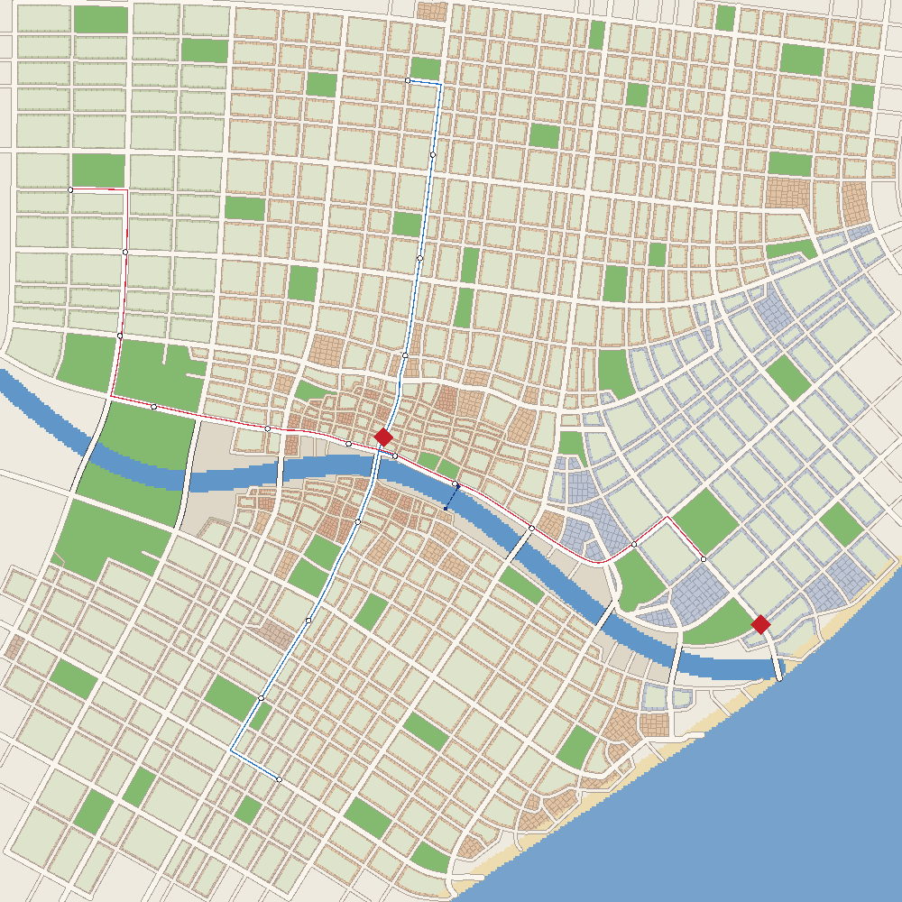

*The example city at 4 m a pixel.*
- **Water:** the sea, a beach, a river with its quays.
- **Blocks by district:** an organic old town on the river, perimeter blocks round courtyards
  (the pale insides), a waterfront, an eco-quarter, courtyard blocks.
- **Parks:** a river park, and the parks the 3-30-300 rule added.
- **Streets:** traced as streamlines of a tensor field. Eight bridges.
- **Transit:** two tram lines with their stops, a boat crossing.
- **Landmarks:** two red diamonds.

## What it does

| Stage | How | Module |
|---|---|---|
| Districts | each land cell to the anchor nearest relative to its radius, edges roughened by noise | `city::district_field` |
| Street pattern | a tensor field: a grid per district at its angle, rings at radial squares, the water's tangents near the coast and rivers (Chen et al. 2008) | `city::tensor` |
| Streets | main roads traced first (bridging rivers up to 260 m), then streets at each district's spacing; each stops half a block short of a parallel street, and its end joins the nearest street ahead | `city::streets` |
| Road graph | streets cut where they cross or meet, ends snapped, dead ends under 60 m pruned; blocks as the graph's bounded faces | `city::graph` |
| Blocks | quays where a face holds water; parks from park districts, then from the 3-30-300 rule (a park of 1 ha within 300 m of every built block); once the streets' profiles are known, a buildable outline per block on each street's building line (`geom::inset_by`) and a courtyard a building's depth inside it | `city::blocks` |
| Lots | recursive splits across each piece's long axis (Vanegas et al. 2012); only the pieces on a street are kept where a block has a courtyard | `city::blocks` |
| Forest | ground above a height or steeper than a slope goes to the first reserve district (a real site's hills) | `city::district_field` |
| Transit | tram lines by the shortest path through their waypoints, main roads preferred (a waypoint far from any main road snaps to the nearest street); stops every 450 m moved to nearby junctions; lines added until a target share of blocks has a stop within 400 m (`transit::cover`); boat crossings where a river runs long without a bridge; street profiles (tram avenue, avenue, shared, pedestrian, path) | `city::transit` |
| Masses | each lot's building: strips of its district's building depth along each street the lot fronts (lots are cut inside the block's building lines, half each street's profile width from its centreline); floors from the district's range, capped by the style bible's height-to-width ratio on the street it fronts; green, solar or terrace roofs | `city::mass` |
| Style bible | one TOML record of the city's rules (height to street width, green roofs, green area per block, park and stop reach, the streets' share, per-district floors, lots, spacing, building depth, tiled roofs and walls), put into the plan's parameters and measured by a checker that names what fails | `city::bible` |
| Trees | rows along the streets by profile (two on avenues every 9 m, one on shared streets every 11 m, every 18 m in lanes), none within 10 m of a junction; a jittered grid in parks (13 m, two thirds filled), on the quays (14 m, under half) and in courtyards (16 m, half) | `city::trees` |
| Lamps | along every street by profile (both sides of avenues every 28 m at 8 m, one side of shared streets every 30 m, lanes and paths lower), at the pavement's edge, none in junctions: where step 5's lights will stand | `city::lamps` |
| Maps and numbers | a small rasteriser: the plan (with the districts', landmarks' and lines' names in the engine's font, kept from overlapping), a checks map (blocks by what they lack), an oblique massing view of any window; the plan's numbers and its digest | `city::map` |

Everything is a pure function of the site and the parameters. Costs are integers in the
router, and `forge_core::dmath` does the trigonometry. Two runs give the same digest (D-016).

## Numbers (the example, 4 km, release build, one thread)

| | |
|---|---|
| Land | 14.3 km² |
| Main roads / streets | 59 km / 149 km, 8 bridges |
| Built blocks / parks | 674 (mean 1.66 ha) / 48 |
| Lots / blocks with a courtyard | 11 088 / 602 |
| Parks' share of the land | 10.5 % |
| Built blocks with a 1 ha park within 300 m | 100 % |
| Built blocks within 400 m of a tram stop | 45 % (two lines, no line added) |
| Streets' share of the land | 21.5 % |
| Tram lines | 7.8 km, 19 stops |
| Masses / floor area | 12 935 / 18.3 km² (12 ms; floors capped by street width) |

| Stage | Time |
|---|---|
| districts | 2.3 ms |
| tensor field | 7.5 ms |
| main roads | 2.3 ms |
| streets | 8.6 ms |
| road graph and faces | 10.3 ms |
| blocks and parks | 5.5 ms |
| transit | 0.2 ms |
| courtyards and lots | 5.8 ms |
| **the whole plan** | **≈ 42 ms** |

## Tests

`cargo test -p forge-procgen city`:
- the example has streets, bridges, blocks, parks, lots and trams;
- no block's reference point is in the water;
- every built block has its park within reach;
- the plan is the same every time;
- no two roads cross except at a node;
- lots sit inside their blocks;
- added lines raise the stop coverage by over 20 points;
- masses stand inside their blocks and outside their courtyards.

## The style bible's checks (the example)

```
ok   height at most the street's width times the ratio: 1.000
ok   green roofs' share: 0.507 (limit 0.500)
FAIL built blocks at their green area: 0.788 (limit 1.000); 143 failing, e.g. block 10: 0.06, …
ok   built blocks with a park within reach: 1.000
FAIL built blocks within 400 m of a tram stop: 0.454 (limit 0.900)
ok   streets' share of the land at most: 0.215 (limit 0.250)
```

The old town's small blocks have no room for a courtyard, so they miss the green area; the
example adds no tram lines, so it misses the stops. A city's own bible and its added lines
(`max_extra_lines`) close those.

## Massing

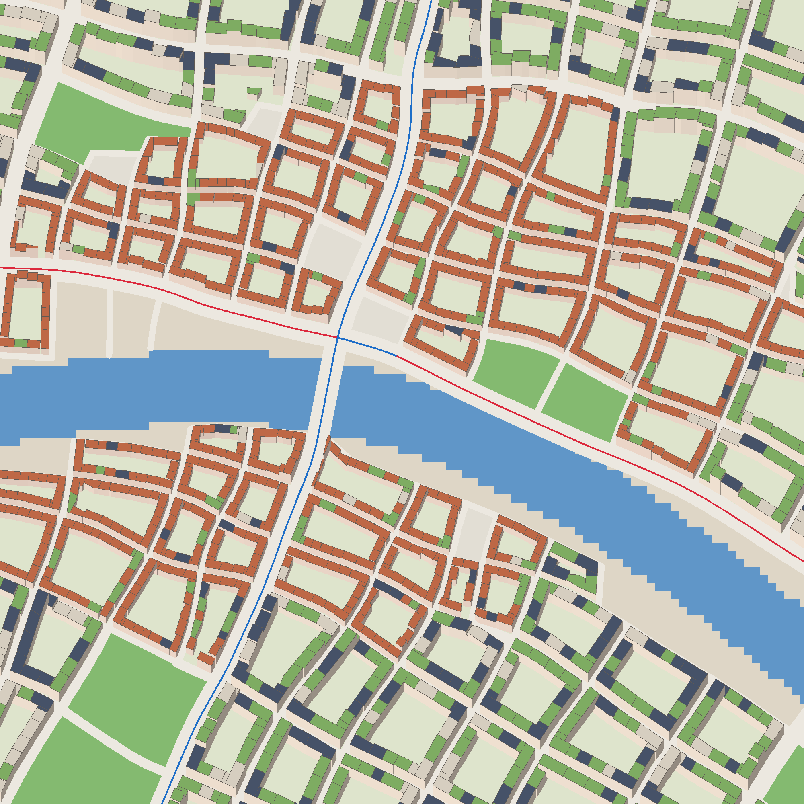

*A kilometre round the example's centre, seen obliquely from the south: perimeter blocks of
4–8 floors round their courtyards, green, solar and terrace roofs, the river and a bridge, two
tram lines.*
## In 3D

```
cargo run --release -p city-plan
```

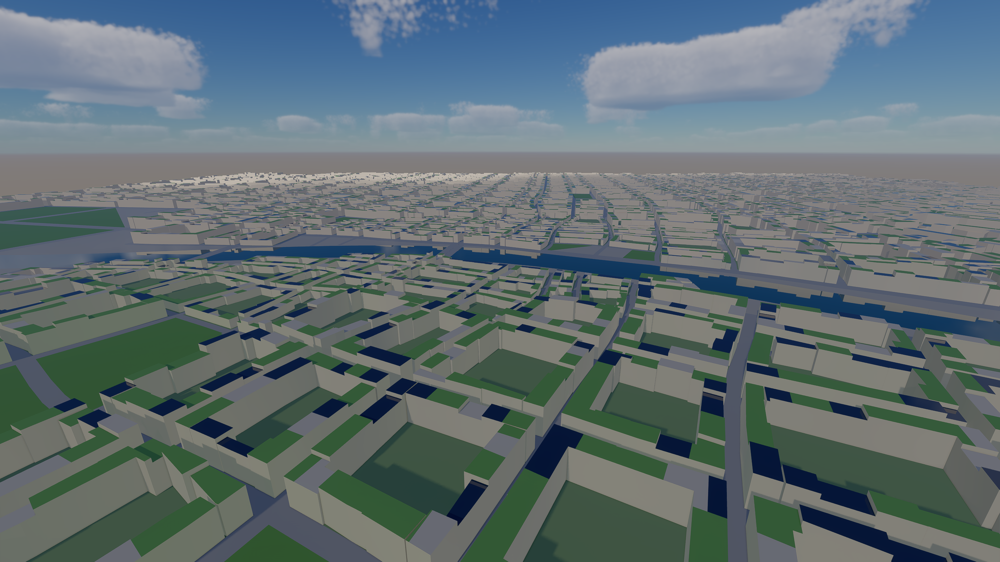

*The example city's masses, trees, gardens, parks, streets, tram tracks and river, drawn by
city-blocks' renderer (sky, clouds, ray-traced soft shadows, probes, TAA) through its scene
interface.* `demos/city-plan` turns any plan and its masses into meshes in tiles of 250 m: the
site's land and water as runs of cells, blocks and street ribbons, walls and roofs (green,
solar, terrace). The rivers are smooth strips along their centrelines; the sea and lagoons come
from the site's cells. A private sandbox hands its own plan to `PlanScenario::new`.

| | |
|---|---|
| Meshes / triangles / trees | 484 / 309 k / 36 717 instances of one tree |
| Built and cooked | 1.3 s |
| GPU frame at 2800 × 1575, this view | 3.84 ms (3.33 without trees or facade textures) |
| p50 / p99 frame | 3.67 / 7.28 ms |

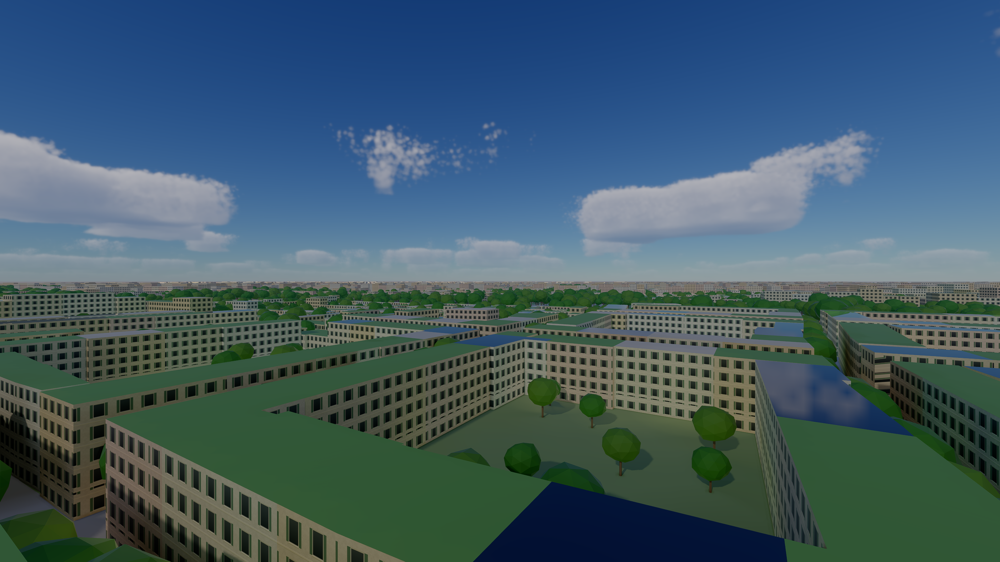

*35 m up: the walls' window bays and shopfronts are two generated textures
(`forge_render::textures::facade` and `shopfront`) read through the walls' coordinates, a shop
band on the ground floor along avenues and lanes, window bays above, four render tints of the
palette chosen by lot. Variety in the facades themselves comes with D-039's modules.*

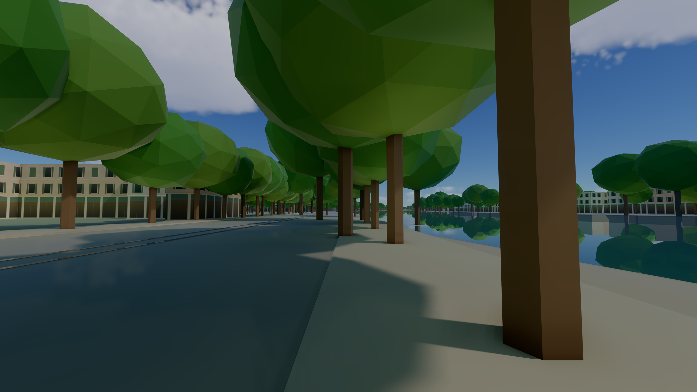

*At eye height on the river avenue (`--street`), late afternoon and midnight: buildings behind raised
pavements with kerbs, shopfronts and shuttered window bays, a row of plane-like trees each side,
tram tracks, the tree-lined quay and the river; at night the shopfronts and windows glow (lamps
stand along the streets, their heads in the crowns, and light nothing yet: step 5). Next at this
height: finer trees, street furniture, the modules (#247).*

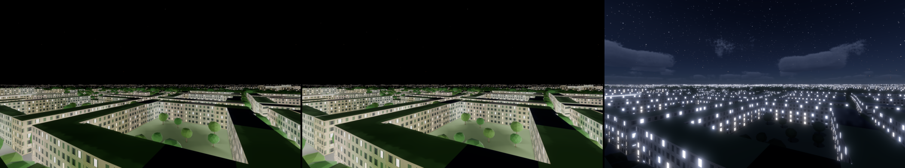

*Midnight (`--time-of-day 1.5`), 35 m up: about 40 % of the open windows lit, warm or cool, and the
shopfronts, from emissive maps beside the facade textures. Left, metered; middle, a fixed EV 3;
right, without the probes. The probes take the windows' light into the city many times over
(the walls and courtyards glow as by day), so night views run with `--no-probes` until step 5
gives the renderer emissive light in absolute units and the probes take it right (#254). The
emissive is scaled by the frame's reference illuminance for a run held at one time of day: a
stopgap.*

## Buildings from the grammar and the kit (D-039, #247)

```
cargo run --release -p city-plan -- --street --detail 450
cargo run --release -p city-plan -- --rules my-style.rules   # another style set's rules
```

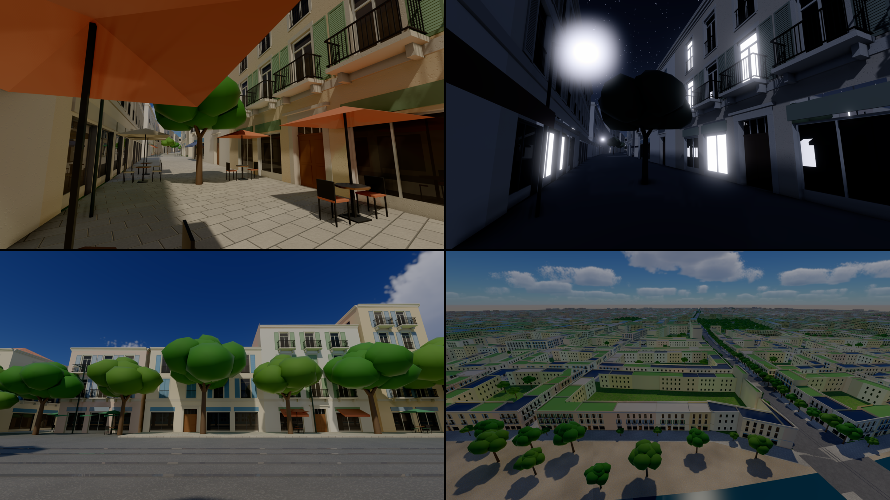

*Within `--detail` metres of the view (450 here), each mass is built from the first style set's
rules and kit; beyond, it stays a textured box. Top left, a lane at 16:40: French windows with
louvred shutters, balconies on consoles with wrought-iron railings on the first floor,
shopfronts with fascias, a string course over the ground floor, the cornice, sun shadows
across it all. Top right, the same lane at night, lit windows, without the probes (#254).
Bottom left, the river avenue's shops, entrances and awnings. Bottom right, from 60 m: the
kit's quay front, the textured masses behind.*

Three stages, each generic:
- **`forge_procgen::city::facades`, the component split.** Each mass's walls become faces that
  look onto:
  - the **street**: outside the wall is street, up to the building line;
  - the **courtyard**: the wall looks into its own lot or block;
  - a **party wall**: a neighbour's lot lies against it.

  Walls between two pieces of one lot are inside the building and get no face. A street face
  knows the corners it turns, and each building's longest street face holds its entrance.
  `city-map` draws the split as `faces-centre.png`.
- **`forge_procgen::grammar`, a split grammar** with CGA's operators (Müller et al. 2006):
  - scopes split along x or y into parts sized absolute, relative (`'0.5`) or floating (`~1`),
    which may name an attribute;
  - repeats `{ ... }*`, whose members know their index, count, first, last and middle;
  - conditions on the context (`[street && level.index == 0]`);
  - weighted choices, per building or per attribute;
  - `let` values each building draws from its seed;
  - a text form with line-numbered errors.
- **`forge_geom::modules`, the kit:** wall, party wall, string course, cornice, parapet, French
  window (with or without shutters, a quarter of them closed), low window, courtyard window, balcony, entrance, shopfront
  with or without an awning. Each module is a small part program of boxes and quads with one
  section layout, so eight material groups dress any of them: four shutter colours, each with
  dark and lit glass (each window its own mix of dark glass and curtains). Walls, bands and
  cornices change size with every scope and are merged into
  the tiles; openings repeat at a few sizes and are instanced.

The engine's example style set is `crates/forge-procgen/src/city/mediterranean.rules`, about
fifty lines. Each building picks its bay (2.8–3.4 m), its balconies and its shutters, and
neighbours differ.

| The kit within 450 m of the avenue view (example city) | |
|---|---|
| Buildings / faces / terminals | 1 116 / 4 719 / 171 494 |
| Instances / unique modules | 29 600 / 14 (8.2 M instanced triangles) |
| Merged triangles added (walls, bands, cornices) | 383 k |
| Derived and assembled | 75 ms (one thread) |
| Longest run of one opening along a floor of a street front | 11 |
| GPU frame at 2800 × 1575, this view, best of 3 | 3.78 ms (3.42 ms with `--detail 0`) |
| Scene built and cooked | 2.79 s (2.35 s) |

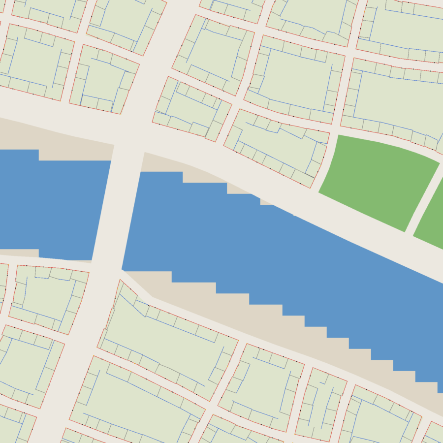

*The component split round the example's centre: street faces red, courtyard faces blue, party
walls grey, entrances as dots, corners in yellow.*

**Perimeter blocks, closed.** The first street views showed the avenues lined with gardens and
the backs of buildings. Lots were cut from the block's outline on the streets' centrelines, so
a lot on a 28 m avenue kept a metre or two behind the building line, and the courtyard's
convex hull ate the buildings along concave sides. Now:
- each block gets a buildable outline, moved in to each street's building line
  (`geom::inset_by`);
- lots are cut from that outline;
- every lot is built as strips of its district's building depth along each street it fronts:
  a lot between two streets has two fronts, and a corner lot wraps its corner;
- the courtyard is the buildable outline moved in by that depth.

The blocks close round their courtyards and the avenues are lined on both sides:
- masses: 12 935 (was 14 807);
- floors: 18.3 km² (was 20.5, now one building deep rather than up to 20 m);
- blocks with a courtyard: 602 (was 563);
- blocks under their green area: 83 (was 143).

**The trees, sized to their streets.** Mature planes of 11–15 m line the avenues, 7–10 m trees
the shared streets and 5–7 m trees the lanes. Each instance is scaled by its own crown
across and its height up. The one model is a trunk forking into three limbs under a crown
of seven smooth lumps (about 620 triangles), so the crowns no longer hide the facades from
the pavement.

## Trams on their timetables (#253)

```
cargo run --release -p city-plan -- --street --tram=X,Z,LEAD   # a tram passes (X, Z) LEAD s in
```

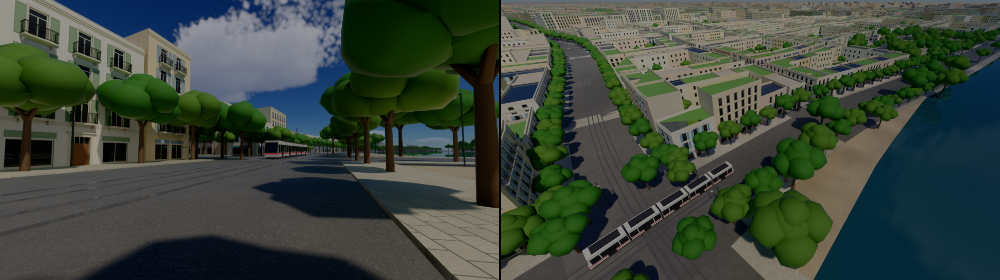

*A five-section tram on the river avenue from the pavement and from 40 m up (a stop's platform
and shelter beyond it), and a lane's café terraces: white bodies in
the line's colour, articulated round the curve, on the right-hand track.*
- **The timetable** (`forge_sim::transit`) runs vehicles out along their line and back:
  - each leg from stop to stop on a trapezoidal profile (50 km/h at most, 1.1 m/s²);
  - 25 s at each stop, 3 minutes at each end, a vehicle every 6 minutes;
  - a run's place is a pure function of the time (GTFS's model of trips and frequencies), so a
    server, its clients and every stop display compute the same tram from nothing sent.
- **The model** (`forge_geom::vehicles`) is a part program like the kit's: five sections of
  6.4 m (two cabs with raked windscreens, three passenger sections), glazed doors, the livery's
  stripe, roof pods, bellows between sections. It takes its power from the ground, as in
  Bordeaux and Nice, so the streets have no overhead wires.
- **In the scene,** each line gets two tracks 3.2 m apart, one each way. Each section is a
  mover set every frame by its two ends on the track (the bogie points), so a tram bends
  through curves.

The example's two lines run 10 trams.

**River shuttles** (Nantes' Navibus, smaller): an electric boat for about twenty people
(`vehicles::shuttle_boat`: a hull with bows at both ends, a glazed cabin under a solar roof, ramps
at both ends) runs out and back at each of the plan's boat crossings. It uses the same
timetable as the trams, with two stops at the water's edges: 3.5 m/s at most, 45 s at each
landing. `--clock SECONDS` sets the service's clock for a capture.

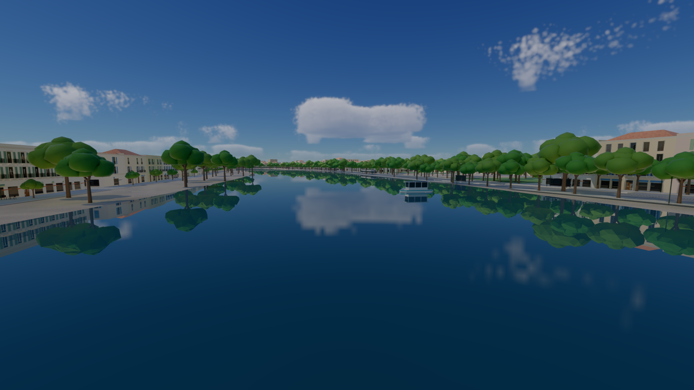

*The example's crossing from mid-river: the shuttle by its north landing.*

**Street furniture** (`forge_geom::furniture`) in the kit's section layout:
- **café terraces:** tables a pace and a half apart, bistro chairs, market parasols. They stand
  before a third of the kit's shopfronts on the avenues' pavements and in the lanes, coloured as
  the building's awnings.
- **tram stops:** a 36 m platform level with the trams' floor by each track, and a glass
  shelter with a bench and a lit totem for the next trams' times.

## Tiled roofs in the old towns

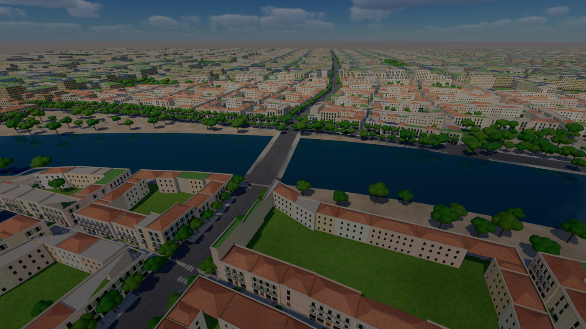

*The old town on both banks from 90 m up: terracotta roofs hipped from every side; beyond it,
the green, solar and terrace roofs.* A district's share of tiled roofs is its kind's unless its
style bible sets it (`DistrictSpec::tiled_share`): 85 % in an old town, 90 % in a village, none
elsewhere. The bible's green-roof check counts the flat roofs only. Each roof rises at about 29°
from every edge to a ridge, the footprint moved in as far as it goes. That is the straight
skeleton's roof for a convex footprint, near enough. The tiles are the brick courses tinted
terracotta. Each lot hips its own roof, so a row's roofs read stepped; continuous ridges along
a row come with the straight skeleton (#247).

## The people on foot (D-059's step 6, a proof of concept)

```
cargo run --release -p city-plan -- --street --people 16.3   # from 16:18
```

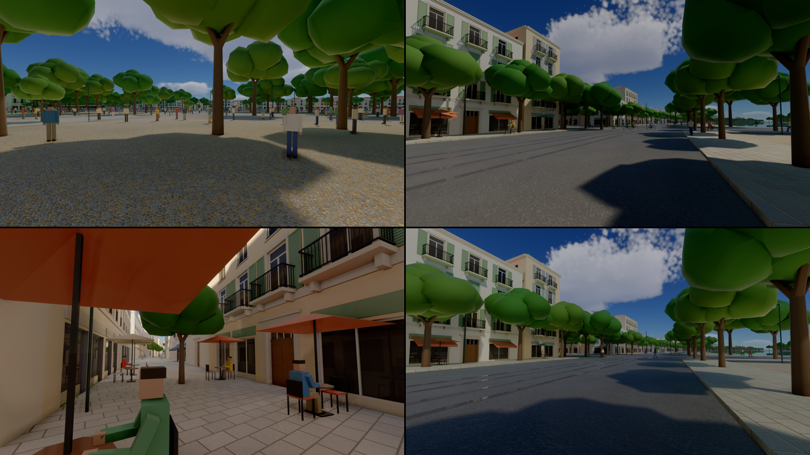

*From 16:18, the park's visitors standing about it; at 08:12, the morning's cyclists in the
river avenue's lanes and walkers on its pavements.* `--people HOUR` builds the plan's population
from the masses (`forge_sim::population`, 295 789 people, 2 s) and runs its day to that hour.
Each frame:
- **who is drawn:** people within 220 m of the camera, as placeholder figures
  (`forge_geom::figures`: blocky, in eight palettes, walking, standing or riding a bike);
- **those on their way:** each goes the shortest way along the streets (A* on the road graph)
  from the street nearest their start to the street nearest their goal, at the pace their
  trip's time gives: on the pavement up to 2.2 m/s, by bike in the carriageway's right lane up
  to 6.5 m/s;
- **those in a park:** they stand about it, kept 9 m inside its streets.

Faster trips ride the trams and are not drawn yet. The drawn crowd runs on the real
clock, a game second a second: at the game's four, its walkers would cross the screen at
5 m/s, and how the two clocks meet near the player is D-059's open question. #251's humans
replace the figures.

## Walking the streets (D-059's step 4)

```
cargo run --release -p city-plan -- --street        # then Enter: walk; Enter again: fly
cargo run --release -p city-plan -- --street --walk-start --walk=1.0,-1.4   # a scripted walk
```

Enter puts a Jolt character (1.8 m, the island's walker's) on the ground where the camera
stands, and the camera at its eyes, 1.65 m up. WASD walks along the view, Shift runs, and the
mouse turns the view. The masses round it are its walls: each footprint's convex hull raised to
its parapet, kept within 80 m as it goes. The ground is one slab at the streets' level, and the
pavements' 14 cm are stepped. A walk east into a lane's facade stops at its render.

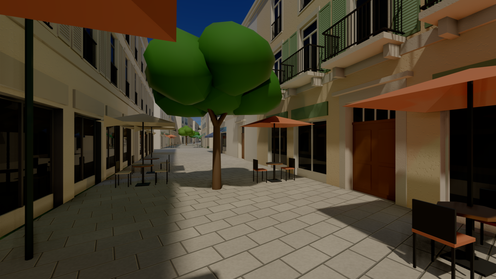

*Three seconds up a lane at eye height, walked by the script: café terraces, a street tree, the
first floor's balconies.*

## Next (#245–#247)

- Squares at the radial districts' centres; the landmarks' sightlines.
- More checks on the checks map; a legend.
- The style bible's palette into the materials; more rules (cornice lines, opening rhythm) now
  that facades exist (#246).
- The kit, next (#247):
  - the 0.5 m module grid and its footprint checks;
  - a merged proxy per building (#38) in place of the textured boxes;
  - corner pieces and quoins;
  - roofs from the straight skeleton;
  - trims and materials of release quality (#249).
- Trees by species (vegetation-materials.md §1, the grower) in place of the one lumpy model.
