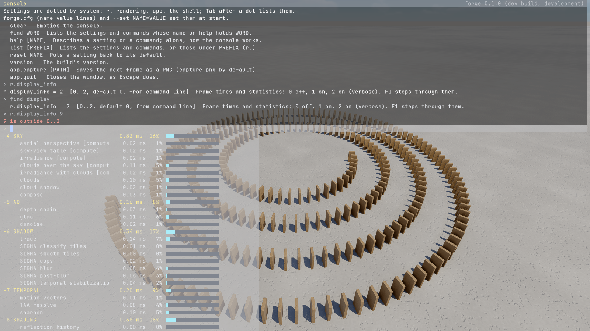
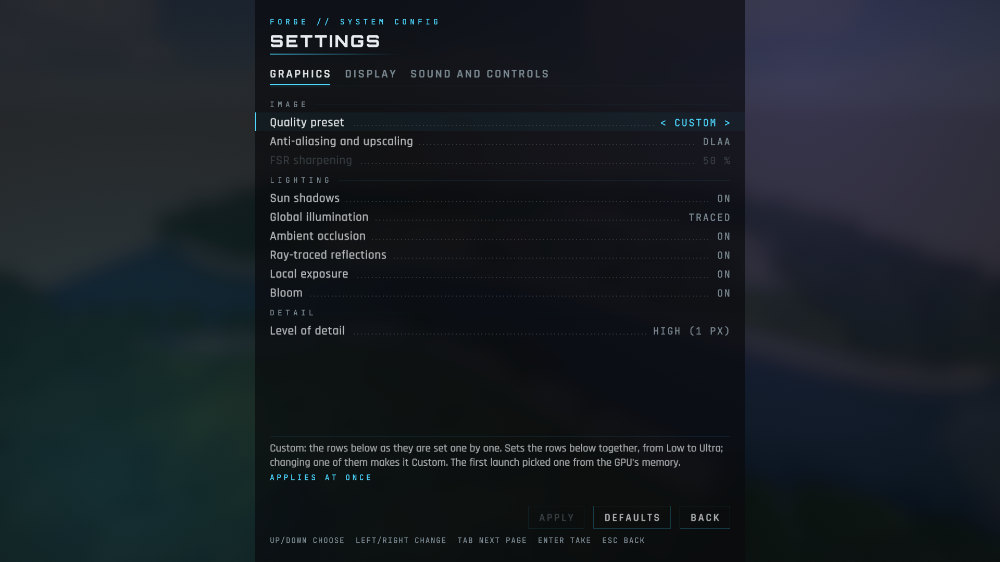
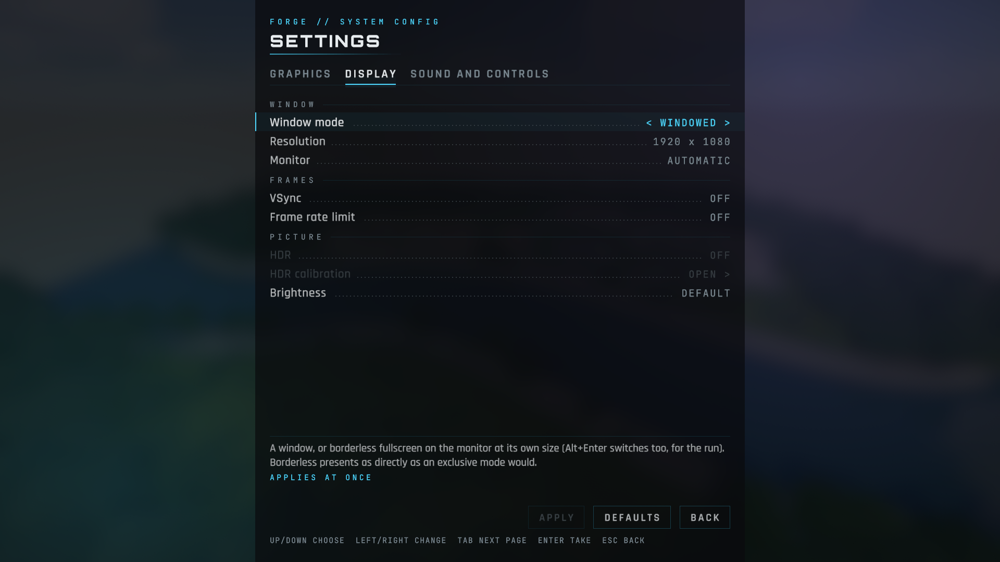
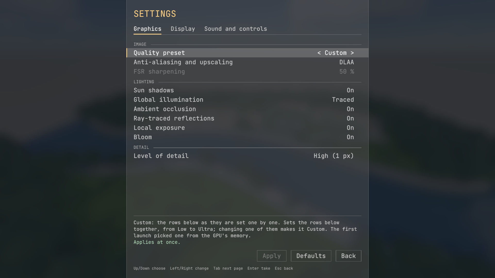

# The developer console and the settings (every demo, D-069)

Run any demo, then press the key under Esc (² on an AZERTY keyboard, ` on QWERTY). Decision:
[D-069](../DECISIONS.md) (#278). Research: [research/dev-console.md](../research/dev-console.md).



*The physics lab's dominoes with `--set app.console=1 --set r.display_info=2 --exec help
--exec r.display_info --exec "find display" --exec "r.display_info 9"`: the console's help,
a setting shown, found by a word, and a value out of range refused in red.*

## Settings

A setting is a console variable with a dotted name by system (`r.` rendering, `app.` the shell),
a type, a default, a range and a line of help. The engine and each demo register theirs; the
systems read them every frame, so a change applies at once.

A value comes from, each over the one before:
1. its default;
2. `forge.cfg` in the working directory (or `--cfg PATH`, or `FORGE_CFG`): one `name value` a
   line, `#` or `//` comments, edited by hand;
3. `--set NAME=VALUE` on the command line (repeatable);
4. the console, for the run only: nothing typed there is saved.

Names are lower case, in any case typed. A name that no setting has is reported once the demo is
ready (`r.typo (command line): no such setting`), in the log and the console; a scripted run (a
frame limit) fails on a misspelled `--set` rather than capture the wrong thing. Settings read at
start (marked "at start") take `forge.cfg` or `--set`, not the console. `--exec LINE`
(repeatable) runs console lines once the demo is ready, as if typed: with `--set app.console=1`,
a scripted capture shows the console, as above.

`forge.cfg` is the owner's own file: git ignores it, and the scripts (`tools/verify.sh`,
`captures.sh`, `map-check.sh`, `timings.sh` and the others that run demos) export
`FORGE_CFG=none`, so it never changes a check or an accepted image. `--no-cfg` reads no file
either.

## The console

- `NAME VALUE` (or `NAME=VALUE`) sets a setting; `NAME` alone shows it, with its range, its
  default and where its value came from.
- **Tab** completes a name as far as the names that fit agree, then a choice's value; once that
  cannot grow, each Tab steps to the next name that fits (**Shift+Tab** back), as Doom 3 and
  Readline do. The names that fit show under the line as it is typed, up to ten, with their
  values and help; the one Tab stands on is marked. When no name starts with what is typed, the
  names with a dotted part starting so come first (`probe` finds `gi.probe_spacing`), then those
  holding it anywhere.
- **Up** and **Down** recall the lines typed before. The history is kept between interactive
  runs (`%LOCALAPPDATA%/forge/console_history.txt`); the values are not.
- **PageUp** and **PageDown** scroll the log; **Ctrl+L** empties it; **Ctrl+U** the line.
- **Esc** or the key under Esc closes it. While it is open, the demo gets no keys.

The console's own commands: `help [NAME]` (or `NAME ?`), `find WORD` (names and help holding the
word), `list [PREFIX]`, `changed` (the settings not at their default, and where their values
came from), `reset NAME`, `toggle NAME` (flips an on/off setting, steps a choice or a small
number), `cycle NAME VALUE VALUE...` (steps through the values given, back to the first after the
last: `cycle r.aa dlaa fsr off`), `bind`, `unbind`, `binds` (below), `version`, `clear`. A
change says what the value was: `r.display_info = 2 (was 1)`.

## Keys

The keys are the game's (the owner, 2026-10-17: "let the keys free to be used for the user in game
interaction like F for interacting with doors"). The developer's switches are settings and
commands, set from the console; `bind` puts one on a key.

**The shell keeps four:**
- the key under Esc: the console;
- Esc: closes the console, else opens the game's menu (resume, settings, quit; #352);
- F1: steps `r.display_info` (off, on, verbose);
- Alt+Enter: borderless fullscreen on the window's monitor, and back to the window as it was (its place, its size, maximised or not), the console open or not (`app.fullscreen` too).

**The game's keys** are the demos' own:
- **Moving the camera:** right mouse to look; the wheel sets the speed, Shift moves five times faster, Ctrl twenty-five.
  - The keys are read by their place on the keyboard, not by their letters.
  - On AZERTY: Z forward, S back, Q and D sideways, A down, E up.
  - On QWERTY the same places: W, S, A, D, Q, E.
- **Walking and acting:**
  - the island: Enter walks, Space jumps;
  - the physics lab: Space jumps, throws or lets go, X throws, Enter starts the scene over, C chases, the arrows drive and fly;
  - the city plan: Enter walks the streets, C boards a tram.

**`bind KEY LINE`** runs a console line when the key is pressed with the console closed. Use `;` between several commands; quotes round the line are dropped.
- **Feedback:** what the line prints shows for three seconds at the bottom left.
- **`bind KEY` alone** shows the key's line; `unbind KEY` frees it; `binds` lists them.
- **Naming a key:**
  - a key that types a character is named by what it types in the keyboard's layout: `t`, `z`, `²`, `&` (AZERTY's 1);
  - any other key by its name: `f5`, `tab`, `space`, `enter`, `pageup`, `up`, `numpad1`.
  - the mouse's buttons: `mouse1` the left, `mouse2` the right, `mouse3` the middle, `mouse4` and `mouse5` the sides.
  - The key under Esc, Esc and F1 stay the shell's.
- **The game's mouse look** (`app.mouse_look`, e.g. `bind m toggle app.mouse_look`): the cursor captured and hidden, the view turning with no button held, and the right button the game's (aiming). Esc opens the game's menu and lets the mouse go; closing the menu takes it back. Out of the window (Alt+Tab, another window clicked) the cursor is the system's again, free and shown, and the mouse's motion turns nothing; back in the window, the game takes it again.
- **The game's menu** (#352, Esc or `app.menu`): Resume, Settings and Quit, on a frosted glass over the whole window (#377: the frame blurred and mostly a dark tint; the game's HUD hidden under it), shown with `app.hud 0` too. `app.menu graphics`, `app.menu display` and `app.menu sound` open its settings on that page.
  - **Keys** (by their place on the keyboard; QWERTY's names, Z, Q, S, D and A, E on AZERTY): Up and Down (or W and S) choose, Left and Right (or A and D) change a setting, Enter or Space takes, Tab or E (PageDown) turns to the next page and Q (PageUp) to the previous one, Esc goes back (on the first page: back to the game).
  - **The mouse:** hovering chooses; a click takes an entry, a page or a button and steps a setting forward, a right click steps it back.
  - **The settings' pages** (#377, the owner, 2026-10-31): Graphics, Display, and Sound and controls. Each row shows its value between arrows; a value the machine or the demo lacks is greyed, with why. The lines under the list say what the row does and whether it applies at once or after a restart (a setting read at start: saved for the next one). Changes wait for Apply; Defaults puts the page back to its defaults; Back with changes asks first: Apply, Discard or Cancel.
  - **Graphics:** the quality preset (`r.preset`: custom, low, medium, high, ultra, a patch over how small DLSS and FSR render, the ambient occlusion, the mirror reflections, the local exposure and the detail error; changing one of those puts it back to custom), anti-aliasing and upscaling (`r.aa`, `r.dlss.mode`, `r.fsr.mode`: off, DLAA where DLSS runs, DLSS's and FSR's modes in the demos that upscale (the asteroids and the galleries), FSR's native AA), FSR's sharpening, the sun's shadows (`r.shadows`), the global illumination (`r.gi.trace`, `r.gi.cache`: probes, traced, traced with SHaRC indoors), the ambient occlusion, the ray-traced reflections, the local exposure, the bloom and the level of detail (`r.lod.error`), those the demo registered.
  - **Display:** the window mode (`app.window`: windowed or borderless fullscreen), its size when windowed (`app.window.width`, `app.window.height`), the monitor (`app.monitor`: 0 automatic, the first that is not the main one; `FORGE_MONITOR` wins), VSync (`app.vsync`), the frame-rate limit (`app.fps_max`, 0 none; interactive runs only), HDR (`app.hdr.mode`, where Windows shows the display in HDR) and its calibration, and the brightness (`r.brightness`: up to two stops either way on the metered exposure).
  - **Sound and controls:** the volume (`snd.volume`), the ambience (`snd.ambience`, #357), the mouse look (`app.mouse_look`) and the frame info (`r.display_info`).
  - **What the menu changes is the user's** (`Source::User`) and is written to `settings/user.cfg` (`FORGE_SETTINGS_DIR` moves it), read at the next start before `forge.cfg` and `--set`, which override it. A choice stays in the file while `forge.cfg` or `--set` overrides it, or a demo does not have it; Defaults removes it. A scripted run (a frame limit or a capture) never reads or writes the file, whatever `FORGE_CFG` says; `FORGE_CFG=none` and `--no-cfg` keep it out of any run (#377).
  - **The first launch** on a machine (no `user.cfg` yet, an interactive run) looks at the GPU's memory, whether it runs DLSS and the monitor, picks the preset (12 GB and more ultra, 8 GB high, 5 GB medium, less low) and borderless fullscreen at the monitor's own size, writes them to the file with what it saw as its first lines, and logs it.
  - **Its look** (`app.menu_theme`, #377): **carbon**, the default, the owner's streaming overlays' (dark, ion blue and amber; Orbitron for the titles, Rajdhani for the labels, tabs and buttons, JetBrains Mono for the values; the titles, tabs, values and buttons in capitals, dotted leaders from a label to its value, a change waiting for Apply in amber; the glass tinted with their glows and vignette), or **base**, the first one (one monospaced face, grey and orange, the glass's plain tint).
  - **A solo game holds behind it:** its update sees no time pass (`Context::paused`; the demos stepping at a fixed rate of their own skip their steps), so the simulation, the particles and the scene's clocks stop, and the sound fades out over a quarter of a second, and back in on resume. A networked game (`Demo::networked`: the physics lab with `--net`) runs on behind it.

  

  

  

  *The village paused behind the settings, on its frosted glass, at 1080p (`city-plan --village 600 --exec "app.menu graphics"`, then `display`, then the graphics page with `--set app.menu_theme=base`).*

- **How long binds last:**
  - typed in the console, for the run, as every console change;
  - as lines in `forge.cfg`, every run, run once the demo is ready.
- **A bound key wins:** its press does not reach the demo.
- **Shipped games:** a bind reaches only what the console reaches (below).

The owner's file could hold the old keys, on keys of their choice, for example:

```
# forge.cfg: the keys of before D-069's key map, on the function keys
bind f5 cycle r.aa dlaa fsr off
bind f7 toggle r.tonemap
bind f8 toggle r.exposure.local
bind f9 camera.where
bind f10 toggle r.ao
bind f11 toggle r.show.gi
bind f12 app.capture
```

`cycle` keeps a key to the values listed: `toggle r.aa` also steps through `dlss`, which a demo
that does not upscale shows as `dlaa`, so one press of four would change nothing.

**What the keys did before, and what sets it now:**

| Key | Galleries | Asteroids | Planet | Meshlets |
|---|---|---|---|---|
| T | `r.aa` (`r.taa.sharpen` until D-070 removed TAA) | `r.aa` | `r.aa` | |
| U | `r.show.gi` | `r.aa`, `r.dlss.mode`, `r.fsr.mode` | | |
| G | `r.tonemap` | `r.tonemap` | `r.tonemap` | `r.tonemap` |
| B | `r.bloom` | `r.bloom` | | |
| X | `r.exposure.local` | `r.show.culled` | `r.show.culled` | |
| N | `r.ao` | `r.ao` | `r.ao` | |
| P | `r.probes` | `asteroids.paused` | `planet.paused` | |
| I | `r.sky_light` | | | |
| Z | `r.sun.disc` | `r.sun.disc` | | |
| J | `r.shadows` | `r.shadows` | `r.shadows` | |
| F | `r.reflections.sky` | | | `meshlets.freeze` |
| Y | `r.reflections.rays` | `r.translucency` | | |
| O | `r.cull.occlusion` | `r.cull.occlusion` | `r.cull.occlusion` | `r.cull.occlusion` |
| C | | `r.cull.cone` | `r.cull.cone` | `r.cull.cone` |
| V | `r.show.ao` | `asteroids.dust` | | `r.cull.frustum` |
| L | `r.lod` | `r.lod` | | `r.lod` |
| M, K, H | `r.show.meshlets`, `r.show.lod`, `r.show.raster` | the same | M, K | the same |
| R | `r.sw_raster` | `r.sw_raster` | | `r.sw_raster` |
| Tab | `r.show.wireframe` | `r.show.wireframe` | `r.show.wireframe` | `r.show.wireframe` |
| `[`, `]` | `r.lod.error` (half, double) | `r.lod.error` | `r.lod.error` | `r.lod.error` |
| `-`, `=` | | `r.exposure.compensation` | `r.exposure.compensation` | |
| 1, 2, 3 | `r.show.liquid` (the tank) | | | |
| `.` | `r.sky.real` (at night) | | | |
| F6 | `r.shadows.denoiser` | | | |
| F9 | `camera.where` | | | |
| F2 to F5 | `app.hdr`, `app.hdr.peak`, `app.hdr.false_colours`, `app.calibrate` (every demo) | | | |
| 1 to 9 (overlay) | `app.profile.group N` (every demo) | | | |

## What is registered so far

The shell's, in every demo:

| Name | What | Values | In a shipped game |
|---|---|---|---|
| `r.display_info` | the profile overlay (F1 steps through it); off at start unless `--overlay` | 0 off, 1 on, 2 on (verbose) | yes |
| `app.console` | the console shown | 0, 1 | yes |
| `app.capture [PATH]` | command: saves the next frame as a PNG | | no |
| `app.quit` | command: closes the window | | yes |
| `app.fullscreen` | command: borderless fullscreen, and back to the window as it was (Alt+Enter) | | yes |
| `app.menu [PAGE]` | command: the game's menu, or its settings on that page (#377) | graphics, display, sound | yes |
| `app.window` | the window mode (D-081), followed live | windowed, fullscreen | yes |
| `app.window.width`, `app.window.height` | the window's size when windowed (#377), followed live; a resize by hand sets them for the run | 64..16384 | the demo's |
| `app.monitor` | the monitor the window opens and moves to (#377); `FORGE_MONITOR` wins at start | 0 automatic (the first that is not the main one), 1.. | 0 |
| `app.vsync` | presents wait for the display's refresh (#377); off presents as fast as the display takes (mailbox); scripted runs present uncapped | 0, 1 | `--vsync`'s |
| `app.fps_max` | the frame-rate limit of an interactive run (#377) | 0 none, 1..1000 | 0 |
| `app.hdr.mode` | the output (#377; `app.hdr` switches too); HDR10 and scRGB where Windows shows the display in HDR; `FORGE_HDR` wins | off, hdr10, scrgb, offscreen | the demo's |
| `snd.volume` | the sound's master level (#318), in runs that open the device (interactive ones only) | 0 to 1 (0 silent) | yes |
| `snd.ambience` | the ambience's level under the master (#357): the beds and the perched birds | 0 to 1 | yes |
| `app.menu_theme` | the game's menu's look (#377): carbon (the owner's streaming overlays') or base (the first one, plainer) | carbon, base | yes |
| `app.hud` | the game's HUD (#328: the quads it pushes into `Context::hud`, drawn after the frame and under this overlay, pass `app/hud`); 0 for a capture without it | 0, 1 | yes |
| `app.hdr`, `app.hdr.peak`, `app.hdr.false_colours` | commands: the HDR output on or off, the next peak, the preview's false colours | | no |
| `app.calibrate` | command: the HDR calibration pages, in an HDR mode | | no |
| `app.profile.group N` | command: folds or shows the overlay's group N | 1 to 9 | no |

The renderer's (`forge_render::settings`: one name, range and help whichever demo registers
them). The galleries (city-blocks, the island, the physics lab, the city plan) have them all. A
flag the demo still takes (`--no-ao`, `--tonemap aces`) sets the same setting, shown as "from
command line": `--no-ao` and `--set r.ao=0` give the same image to the pixel.

| Name | What | Values | Gallery default |
|---|---|---|---|
| `r.aa` | anti-aliasing | off, dlaa, dlss, fsr | dlaa where it runs, else fsr |
| `r.dlss.mode` | how much smaller DLSS renders under `r.aa dlss` (#377); FSR's mode where DLSS cannot run | quality, balanced, performance, ultra-performance | quality |
| `r.fsr.mode` | how much smaller FSR renders under `r.aa fsr` (#377) | native, quality (1.5 × smaller), balanced (1.7), performance (2), ultra-performance (3) | native |
| `r.fsr.sharpen`, `r.fsr.sharpness` | RCAS over FSR's image (D-070), and how strong on AMD's scale | 0, 1; 0..1 | 1; 0.5 |
| `r.tonemap` | the tone curve | agx, agx-punchy, aces, neutral, aces2, aces-narkowicz, aces2-analytic, lut (a scene's grading table, D-100) | agx-punchy |
| `r.bloom`, `r.bloom.strength` | bloom, its share of the image | 0, 1; 0..1 | 1; 0.04 |
| `r.exposure.local` | local exposure, D-067 | off, on, view | off |
| `r.brightness` | the player's brightness (#377): stops added to the metered exposure's compensation (a fixed exposure stays as set); the asteroids and the planet have it too | -2..2 | 0 |
| `r.exposure.speed_brighten`, `r.exposure.speed_darken` | how fast the automatic exposure follows a darker scene (into a dark room) and a brighter one (out into the sun), per second: most of the way in about 2 / speed seconds (#336) | 0.05..20 | 0.8; 1.5 |
| `r.exposure.shade_adapt` | by day, outdoors, how far the automatic exposure follows a scene darker than a sunlit street (a wood): 1 all the way, the wood as bright as the street; less keeps it darker and the sky between its leaves blue. A room adapts fully, whatever it says (D-093) | 0..1 | 1; the village 0.25 |
| `r.ao`, `r.ao.radius` | ambient occlusion, its reach | 0, 1; 0.05..16 m | 1; 1.5 m |
| `r.ao.contact` | the ambient occlusion's reach under D-088's traced bounce: the contacts its denoiser blurs, the bounce's rays seeing the rest | 0.05..16 m | 0.6 m |
| `r.gi.cube_ambient` | with no probes, a room's ambient light from its reflection cube, and a street's from cubes made where the camera has been, else the open sky's (D-108; needs the cubes) | 0, 1 | 1 |
| `r.gi.screen`, `r.gi.screen_radius`, `r.gi.screen_slices` | without rays, the near light from the screen over the ambient light (D-108): on or off, how far a surface lights another, metres, and the slices per pixel | 0, 1; 0.25 to 8; 1 to 4 | 1 without rays; 2; 2 |
| `r.ao.ignore_nearer` | what the ambient occlusion leaves out near the camera: a first-person weapon or hands cast no dark halo on the wall behind them (#337) | 0..2 m | 0 |
| `r.ao.material` | how a material's occlusion map joins GTAO on the sky's and the probes' light: their product, or their minimum, which does not darken twice a crevice both see (D-107) | multiply, min | min |
| `r.pom` | relief inside surfaces from their height maps; rows without one are not touched (D-107) | 0, 1 | 1 |
| `r.pom.steps`, `r.pom.shadow_steps` | the most steps of the relief's march along the view, and along the sun and the strongest lamp (0: no self-shadow) | 4..64; 0..16 | 32; 8 |
| `r.pom.fade` | the height map's level of detail the relief starts to fade at (0: a texel a pixel), gone two levels on | -2..8 | 0.5 |
| `r.pom.scale` | every row's relief depth times this (0: flat, for comparing) | 0..4 | 1 |
| `r.micro.ao` | how much of its micro-shadow an occlusion map casts on the sun's and the lamps' light (D-107) | 0..1 | 0 |
| `r.micro.bump` | a mapped normal's terminator softened against its surface's (D-107) | 0, 1 | 1 |
| `r.probes` | the probes' diffuse light | 0, 1 | 1 |
| `r.sky_light` | the sky's light | 0, 1 | 1 |
| `r.shadows` | the sun's ray-traced shadows | 0, 1 | 1 |
| `r.shadows.mode` | the sun's shadow by rays or by the cached shadow rings (D-108), which need no ray | rays, rings | rays, or rings on a device without ray queries |
| `r.shadows.budget` | rings: rectangles a frame may draw for moves and changes | 0 to 32 | 6 |
| `r.shadows.lod` | rings: the casters' LOD error, texels | 0.25 to 8 | 1 |
| `r.shadows.search_taps`, `r.shadows.filter_taps` | rings: taps of the blocker search and of the filter (the filter without a denoiser) | 1 to 64 | 12, 12 |
| `r.shadows.max_radius`, `r.shadows.search_reach` | rings: the widest filter, texels, and how far along the sun the search looks, metres | 1 to 64, 1 to 1000 | 24, 64 |
| `r.shadows.bias`, `r.shadows.normal_offset` | rings: depth bias and normal offset, texels | 0 to 16 | 1.5, 2 |
| `r.shadows.contact`, `r.shadows.contact_steps` | rings: a short march through the depth buffer for what they are too coarse for, its steps | 0, 1; 1 to 32 | 0; 8 |
| `r.shadows.contact_reach`, `r.shadows.contact_thickness`, `r.shadows.contact_far` | rings: the march's length in the ring's texels, how far behind what the depth buffer shows a step counts, metres, and how far from the camera it goes on, metres | 0.5 to 32, 0.01 to 4, 1 to 1000 | 3, 0.25, 100 |
| `r.shadows.atlas`, `r.shadows.atlas_budget`, `r.shadows.atlas_movers` | rings: the lamps' shadows through an atlas, the faces a frame may draw, and those it may lay again with movers | 0, 1; 0 to 32; 0 to 32 | 1; 6; 8 |
| `r.shadows.denoiser` | their denoiser, where there is one | sigma, ffx, none | sigma where NRD is, else ffx |
| `r.shadows.history` | the frames SIGMA steadies the shadows over: fewer keep a moving caster's shadow from trailing behind it (#337), more steady a still penumbra | 0..7 | 7 |
| `r.reflections.sky`, `r.reflections.rays` | the sky's reflection, mirror rays | 0, 1 | 1, 1 |
| `r.reflections.motion` | the smooth surfaces' motion vectors moved towards what they reflect, so the upscaler follows the reflections (off: the surfaces) | 0, 1 | 1 |
| `r.reflections.decals` | mirror rays from the surfaces decals make smooth, a puddle on rough ground (off: their sky's light alone; #395) | 0, 1 | 1 |
| `r.reflections.mode` | the smooth surfaces' reflections by rays, or from the screen (D-108), which needs none | rays, screen | rays, or screen on a device without ray queries |
| `r.reflections.screen_steps`, `r.reflections.thickness` | screen reflections: the most steps a ray takes, and how far behind a surface it may be and meet it, metres | 8 to 256, 0.02 to 8 | 64, 0.6 |
| `r.reflections.cubes`, `r.reflections.cube_budget` | screen reflections: a miss reads the scene's reflection cubes (they need `r.shadows.mode rings`), and the faces a frame may draw | 0, 1; 0 to 6 | 1; 1 |
| `r.sun.disc` | the sun's disc at its true size | 0, 1 | 1 |
| `r.sky.real` | at night, the catalogue's stars and the Moon's albedo (D-046), where the night has them | 0, 1 | 0 |
| `r.cull.occlusion` | occlusion culling | 0, 1 | 1 |
| `r.lod`, `r.lod.error` | level of detail, its error in pixels | 0, 1; 0.125..16 | 1; 1 |
| `r.sw_raster` | the software rasteriser | off, auto, on | auto |
| `r.show.*` | debug views: `meshlets`, `lod`, `raster`, `ao`, `gi`, `culled`, `regions`, `wireframe` | 0, 1 | 0 |
| `r.show.liquid` | the tank's water, where there is one (#156) | look, speed, landing | look |
| `camera.where` | command: where the camera is, as `--view` takes it | | |

The asteroids, the planet and the meshlets bench take the same names for what they have, with
their own defaults where their scenes want another look, and add:

| Demo | Its own defaults | Added |
|---|---|---|
| asteroids | `r.tonemap aces` (its toe keeps space black), `r.sun.disc 0` (hard shadows), `r.ao.radius 2` | `r.exposure.compensation`, `r.translucency`, `r.cull.cone`, `asteroids.dust`, `asteroids.paused` |
| planet | `r.aa dlaa` where it runs, as the galleries (since 2026-10-17) | `r.exposure.compensation`, `r.cull.cone`, `planet.paused` |
| meshlets | `r.show.meshlets 1` | `r.cull.cone`, `r.cull.frustum`, `meshlets.freeze` (the culling camera held where it stands) |

## Shipped games

A game built with forge-app's `shipping` feature keeps the console but only the settings marked
for release: they show information and give no advantage (the frame times and statistics, as
Star Citizen's `r_displayInfo`; the build's version in the console's header). Every other
setting keeps its default and is neither listed nor set, from the console, `forge.cfg` or the
command line: its name answers as unknown, so the build does not even show which names exist.
The research (`dev-console.md` §8) adds what a shipped game needs beyond this: the code that
would help a player (free camera, debug views, captures) compiled out, and "information" kept to
the machine, the build and the session, never the world (positions, hidden objects). The version reads `forge 0.1.0 (COMMIT, release)` when the build is given
`FORGE_BUILD_COMMIT`, else `dev build`.
