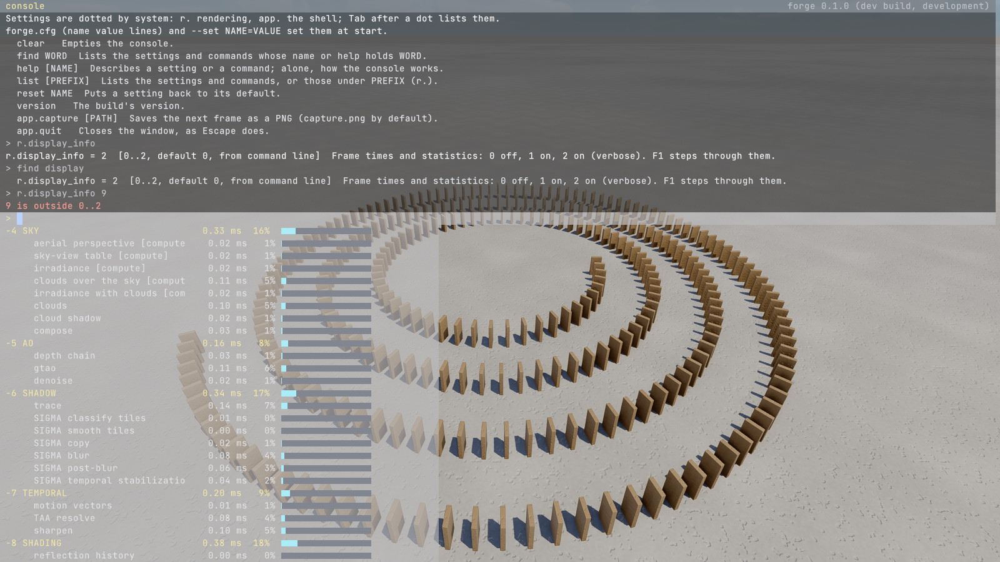

# The developer console and the settings (every demo, D-069)

Run any demo, then press the key under Esc (² on an AZERTY keyboard, ` on QWERTY). Decision:
[D-069](../DECISIONS.md) (#278). Research: [research/dev-console.md](../research/dev-console.md).



*The physics lab's dominoes with `--set app.console=1 --set r.display_info=2 --exec help
--exec r.display_info --exec "find display" --exec "r.display_info 9"`: the console's help,
a setting shown, found by a word, and a value out of range refused in red.*

## Settings

A setting is a console variable with a dotted name by system (`r.` rendering, `app.` the shell),
a type, a default, a range and a line of help. The engine and each demo register theirs; the
systems read them every frame, so a change applies at once.

A value comes from, each over the one before:
1. its default;
2. `forge.cfg` in the working directory (or `--cfg PATH`, or `FORGE_CFG`): one `name value` a
   line, `#` or `//` comments, edited by hand;
3. `--set NAME=VALUE` on the command line (repeatable);
4. the console, for the run only: nothing typed there is saved.

Names are lower case, in any case typed. A name that no setting has is reported once the demo is
ready (`r.typo (command line): no such setting`), in the log and the console; a scripted run (a
frame limit) fails on a misspelled `--set` rather than capture the wrong thing. Settings read at
start (marked "at start") take `forge.cfg` or `--set`, not the console. `--exec LINE`
(repeatable) runs console lines once the demo is ready, as if typed: with `--set app.console=1`,
a scripted capture shows the console, as above.

`forge.cfg` is the owner's own file: git ignores it, and the scripts (`tools/verify.sh`,
`captures.sh`, `map-check.sh`, `timings.sh` and the others that run demos) export
`FORGE_CFG=none`, so it never changes a check or an accepted image. `--no-cfg` reads no file
either.

## The console

- `NAME VALUE` (or `NAME=VALUE`) sets a setting; `NAME` alone shows it, with its range, its
  default and where its value came from.
- **Tab** completes a name as far as the names that fit agree, then a choice's value; once that
  cannot grow, each Tab steps to the next name that fits (**Shift+Tab** back), as Doom 3 and
  Readline do. The names that fit show under the line as it is typed, up to ten, with their
  values and help; the one Tab stands on is marked. When no name starts with what is typed, the
  names with a dotted part starting so come first (`probe` finds `gi.probe_spacing`), then those
  holding it anywhere.
- **Up** and **Down** recall the lines typed before. The history is kept between interactive
  runs (`%LOCALAPPDATA%/forge/console_history.txt`); the values are not.
- **PageUp** and **PageDown** scroll the log; **Ctrl+L** empties it; **Ctrl+U** the line.
- **Esc** or the key under Esc closes it. While it is open, the demo gets no keys.

The console's own commands: `help [NAME]` (or `NAME ?`), `find WORD` (names and help holding the
word), `list [PREFIX]`, `changed` (the settings not at their default, and where their values
came from), `reset NAME`, `toggle NAME` (flips an on/off setting, steps a choice or a small
number), `cycle NAME VALUE VALUE...` (steps through the values given, back to the first after the
last: `cycle r.aa dlaa fsr off`), `bind`, `unbind`, `binds` (below), `version`, `clear`. A
change says what the value was: `r.display_info = 2 (was 1)`.

## Keys

The keys are the game's (the owner, 2026-10-17: "let the keys free to be used for the user in game
interaction like F for interacting with doors"). The developer's switches are settings and
commands, set from the console; `bind` puts one on a key.

**The shell keeps four:**
- the key under Esc: the console;
- Esc: closes the console, else the window;
- F1: steps `r.display_info` (off, on, verbose);
- Alt+Enter: fullscreen and back.

**The game's keys** are the demos' own:
- **Moving the camera:** right mouse to look; the wheel sets the speed, Shift moves five times faster, Ctrl twenty-five.
  - The keys are read by their place on the keyboard, not by their letters.
  - On AZERTY: Z forward, S back, Q and D sideways, A down, E up.
  - On QWERTY the same places: W, S, A, D, Q, E.
- **Walking and acting:**
  - the island: Enter walks, Space jumps;
  - the physics lab: Space jumps, throws or lets go, X throws, Enter starts the scene over, C chases, the arrows drive and fly;
  - the city plan: Enter walks the streets, C boards a tram.

**`bind KEY LINE`** runs a console line when the key is pressed with the console closed. Use `;` between several commands; quotes round the line are dropped.
- **Feedback:** what the line prints shows for three seconds at the bottom left.
- **`bind KEY` alone** shows the key's line; `unbind KEY` frees it; `binds` lists them.
- **Naming a key:**
  - a key that types a character is named by what it types in the keyboard's layout: `t`, `z`, `²`, `&` (AZERTY's 1);
  - any other key by its name: `f5`, `tab`, `space`, `enter`, `pageup`, `up`, `numpad1`.
  - the mouse's buttons: `mouse1` the left, `mouse2` the right, `mouse3` the middle, `mouse4` and `mouse5` the sides.
  - The key under Esc, Esc and F1 stay the shell's.
- **The game's mouse look** (`app.mouse_look`, e.g. `bind m toggle app.mouse_look`): the cursor captured and hidden, the view turning with no button held, and the right button the game's (aiming). Esc lets the mouse go first, and a second Esc quits.
- **How long binds last:**
  - typed in the console, for the run, as every console change;
  - as lines in `forge.cfg`, every run, run once the demo is ready.
- **A bound key wins:** its press does not reach the demo.
- **Shipped games:** a bind reaches only what the console reaches (below).

The owner's file could hold the old keys, on keys of their choice, for example:

```
# forge.cfg: the keys of before D-069's key map, on the function keys
bind f5 cycle r.aa dlaa fsr off
bind f7 toggle r.tonemap
bind f8 toggle r.exposure.local
bind f9 camera.where
bind f10 toggle r.ao
bind f11 toggle r.show.gi
bind f12 app.capture
```

`cycle` keeps a key to the values listed: `toggle r.aa` also steps through `dlss`, which a demo
that does not upscale shows as `dlaa`, so one press of four would change nothing.

**What the keys did before, and what sets it now:**

| Key | Galleries | Asteroids | Planet | Meshlets |
|---|---|---|---|---|
| T | `r.aa` (`r.taa.sharpen` until D-070 removed TAA) | `r.aa` | `r.aa` | |
| U | `r.show.gi` | `r.aa`, `r.dlss.mode`, `r.fsr.mode` | | |
| G | `r.tonemap` | `r.tonemap` | `r.tonemap` | `r.tonemap` |
| B | `r.bloom` | `r.bloom` | | |
| X | `r.exposure.local` | `r.show.culled` | `r.show.culled` | |
| N | `r.ao` | `r.ao` | `r.ao` | |
| P | `r.probes` | `asteroids.paused` | `planet.paused` | |
| I | `r.sky_light` | | | |
| Z | `r.sun.disc` | `r.sun.disc` | | |
| J | `r.shadows` | `r.shadows` | `r.shadows` | |
| F | `r.reflections.sky` | | | `meshlets.freeze` |
| Y | `r.reflections.rays` | `r.translucency` | | |
| O | `r.cull.occlusion` | `r.cull.occlusion` | `r.cull.occlusion` | `r.cull.occlusion` |
| C | | `r.cull.cone` | `r.cull.cone` | `r.cull.cone` |
| V | `r.show.ao` | `asteroids.dust` | | `r.cull.frustum` |
| L | `r.lod` | `r.lod` | | `r.lod` |
| M, K, H | `r.show.meshlets`, `r.show.lod`, `r.show.raster` | the same | M, K | the same |
| R | `r.sw_raster` | `r.sw_raster` | | `r.sw_raster` |
| Tab | `r.show.wireframe` | `r.show.wireframe` | `r.show.wireframe` | `r.show.wireframe` |
| `[`, `]` | `r.lod.error` (half, double) | `r.lod.error` | `r.lod.error` | `r.lod.error` |
| `-`, `=` | | `r.exposure.compensation` | `r.exposure.compensation` | |
| 1, 2, 3 | `r.show.liquid` (the tank) | | | |
| `.` | `r.sky.real` (at night) | | | |
| F6 | `r.shadows.denoiser` | | | |
| F9 | `camera.where` | | | |
| F2 to F5 | `app.hdr`, `app.hdr.peak`, `app.hdr.false_colours`, `app.calibrate` (every demo) | | | |
| 1 to 9 (overlay) | `app.profile.group N` (every demo) | | | |

## What is registered so far

The shell's, in every demo:

| Name | What | Values | In a shipped game |
|---|---|---|---|
| `r.display_info` | the profile overlay (F1 steps through it); off at start unless `--overlay` | 0 off, 1 on, 2 on (verbose) | yes |
| `app.console` | the console shown | 0, 1 | yes |
| `app.capture [PATH]` | command: saves the next frame as a PNG | | no |
| `app.quit` | command: closes the window | | yes |
| `app.hdr`, `app.hdr.peak`, `app.hdr.false_colours` | commands: the HDR output on or off, the next peak, the preview's false colours | | no |
| `app.calibrate` | command: the HDR calibration pages, in an HDR mode | | no |
| `app.profile.group N` | command: folds or shows the overlay's group N | 1 to 9 | no |

The renderer's (`forge_render::settings`: one name, range and help whichever demo registers
them). The galleries (city-blocks, the island, the physics lab, the city plan) have them all. A
flag the demo still takes (`--no-ao`, `--tonemap aces`) sets the same setting, shown as "from
command line": `--no-ao` and `--set r.ao=0` give the same image to the pixel.

| Name | What | Values | Gallery default |
|---|---|---|---|
| `r.aa` | anti-aliasing | off, dlaa, dlss, fsr | dlaa where it runs, else fsr |
| `r.fsr.sharpen`, `r.fsr.sharpness` | RCAS over FSR's image (D-070), and how strong on AMD's scale | 0, 1; 0..1 | 1; 0.5 |
| `r.tonemap` | the tone curve | agx, agx-punchy, aces, neutral, aces2, aces2-analytic | agx-punchy |
| `r.bloom`, `r.bloom.strength` | bloom, its share of the image | 0, 1; 0..1 | 1; 0.04 |
| `r.exposure.local` | local exposure, D-067 | off, on, view | off |
| `r.ao`, `r.ao.radius` | ambient occlusion, its reach | 0, 1; 0.05..16 m | 1; 1.5 m |
| `r.probes` | the probes' diffuse light | 0, 1 | 1 |
| `r.sky_light` | the sky's light | 0, 1 | 1 |
| `r.shadows` | the sun's ray-traced shadows | 0, 1 | 1 |
| `r.shadows.denoiser` | their denoiser, where there is one | sigma, ffx, none | sigma where NRD is, else ffx |
| `r.reflections.sky`, `r.reflections.rays` | the sky's reflection, mirror rays | 0, 1 | 1, 1 |
| `r.sun.disc` | the sun's disc at its true size | 0, 1 | 1 |
| `r.sky.real` | at night, the catalogue's stars and the Moon's albedo (D-046), where the night has them | 0, 1 | 0 |
| `r.cull.occlusion` | occlusion culling | 0, 1 | 1 |
| `r.lod`, `r.lod.error` | level of detail, its error in pixels | 0, 1; 0.125..16 | 1; 1 |
| `r.sw_raster` | the software rasteriser | off, auto, on | auto |
| `r.show.*` | debug views: `meshlets`, `lod`, `raster`, `ao`, `gi`, `culled`, `regions`, `wireframe` | 0, 1 | 0 |
| `r.show.liquid` | the tank's water, where there is one (#156) | look, speed, landing | look |
| `camera.where` | command: where the camera is, as `--view` takes it | | |

The asteroids, the planet and the meshlets bench take the same names for what they have, with
their own defaults where their scenes want another look, and add:

| Demo | Its own defaults | Added |
|---|---|---|
| asteroids | `r.tonemap aces` (its toe keeps space black), `r.sun.disc 0` (hard shadows), `r.ao.radius 2` | `r.dlss.mode`, `r.fsr.mode` (native, quality, balanced, performance, ultra-performance: FSR's sizes with `r.aa fsr`), `r.exposure.compensation`, `r.translucency`, `r.cull.cone`, `asteroids.dust`, `asteroids.paused` |
| planet | `r.aa dlaa` where it runs, as the galleries (since 2026-10-17) | `r.exposure.compensation`, `r.cull.cone`, `planet.paused` |
| meshlets | `r.show.meshlets 1` | `r.cull.cone`, `r.cull.frustum`, `meshlets.freeze` (the culling camera held where it stands) |

## Shipped games

A game built with forge-app's `shipping` feature keeps the console but only the settings marked
for release: they show information and give no advantage (the frame times and statistics, as
Star Citizen's `r_displayInfo`; the build's version in the console's header). Every other
setting keeps its default and is neither listed nor set, from the console, `forge.cfg` or the
command line: its name answers as unknown, so the build does not even show which names exist.
The research (`dev-console.md` §8) adds what a shipped game needs beyond this: the code that
would help a player (free camera, debug views, captures) compiled out, and "information" kept to
the machine, the build and the session, never the world (positions, hidden objects). The version reads `forge 0.1.0 (COMMIT, release)` when the build is given
`FORGE_BUILD_COMMIT`, else `dev build`.
