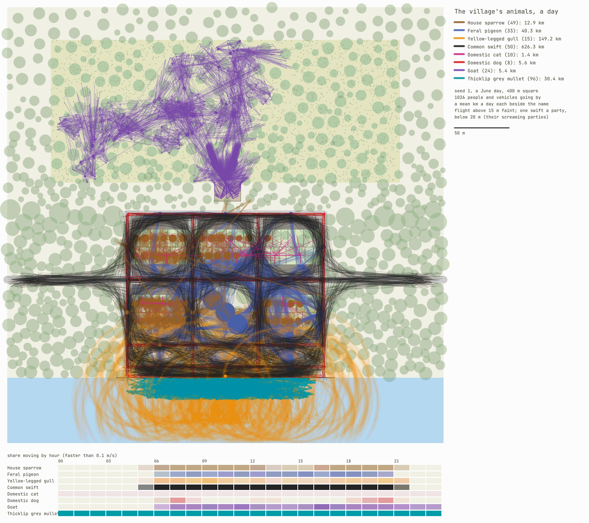
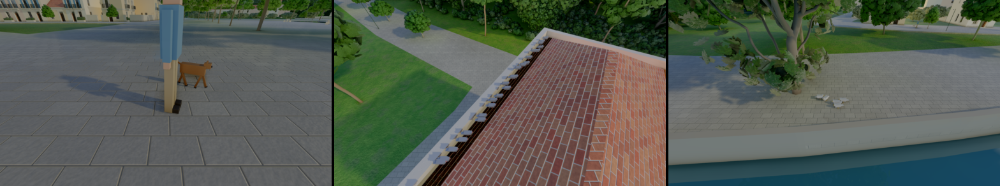

# Fauna — the village's animals as behaviour (`forge-fauna`)

The fauna's simulation side (#269 point 3, a parallel session of D-062 off the GPU): house
sparrows, feral pigeons, yellow-legged gulls and common swifts, cats, dogs with their owners, a
herd of goats on the hillside and schools of mullet along the quay, each with its day by the hour,
moving together and fleeing people, vehicles, dogs and cats at their species' distances. Stepped
at a fixed rate like `forge-sim`'s population and deterministic by seed; tested headless and drawn
on the CPU. Their bodies and their animation stay with the renderer's session. The research is
`docs/research/fauna.md`.

```
cargo run --release -p forge-fauna --bin fauna-day -- --out reports/2026-10-16
```



*`reports/2026-10-16/fauna-day.png`: the example place, 400 m square, seed 1, a June day with
1 026 people and vehicles going by; each animal's path sampled every 2 s, by species. Flight above
15 m is drawn faintly (the gulls' soaring rings over the harbour); one swift a party is drawn,
below 20 m (their screaming parties down the streets: aloft they cover the map all day). Below,
the share of each species moving faster than 0.1 m/s, hour by hour.* The goats fan out from their
fold's gate onto the hill and browse across it; the sparrows (brown) keep to the gardens and the
square, the pigeons (blue) to the square and its roofs, the cats (magenta) to their gardens and
walls, the dogs (red) to the streets at their walking hours, the mullet (teal) to the quay.

## What it does

| Part | How | Module |
|---|---|---|
| Species | a TOML record each (`data/fauna.toml`), sources beside the numbers: body, group sizes, walking, cruising and fleeing speeds, turn and climb, neighbours and separation, the distance it flees a person, a vehicle (at a 50 km/h limit), a dog, a cat, its range, a leash, the share of its distance at which it walks away first | `species` |
| Plan | buildings (footprints, eaves), walls, gardens with their houses, squares, the street graph with its limits, the water and its quay, a pasture and its fold, `forge-flora`'s trees and the shrubs a herd browses; derived: resting places (the longest free eave of each house, two nest cavities under free eaves, tree crowns, wall tops, bollards on the quay, the sea off it) and feeding places (gardens, squares, streets' edges, the quay); lookup grids for buildings and walls | `plan` |
| Example | 400 m square: five blocks of terraced houses (6–9.5 m fronts, two or three storeys) with gardens and walls behind, a square, a road through, a harbour front and a quay on the sea to the south, a hill rising 0.3 m a metre to the north with a pasture and a fold; its trees and shrubs placed by `forge_flora::place` (holm oaks on the square, an olive in a quarter of the gardens, the wild layers on the hill) | `Parts::example` |
| Passers | people walking 3–10 streets at 1.1–1.5 m/s and vehicles along the roads at 90 % of the limit, by the hour (few at night, the morning, noon, the evening stroll); each a pure function of the time | `passers` |
| Groups | a flock, a herd, a school, a cat, a dog with its owner: its activity, where, until when, chosen by the hour and by turns (feed, rest), each place among the five nearest, a feeding place only where no threat is within the species' distance | `sim` |
| Flight | Couzin's zones over the seven (four for gulls) nearest groupmates; a cruise speed relaxed to, a turn and a climb it cannot exceed; to a perch it comes down from 2 m above; a look-ahead of 0.8 s against buildings and walls that takes the first flyable way past, and the step it can actually turn to checked again | `sim::fly`, `sim::avoid` |
| Walkers | cats in their yards (the gardens seen from their own, wall tops, places along their front, in and out by a flap or the door), dogs about their owners on a 1.8 m leash, goats browsing shrub to shrub inside their fence with a body's length between them, mullet schooling in the harbour's water within 40 m of the quay | `sim` |
| Fleeing | each animal on or near the ground checks the threats in its 3×3 cells of 24 m: under its distance (0.6 of it for a threat that is not coming at it, 0.53 of it for a town's birds, scaled by a street's limit for a vehicle) its whole group flees: birds to a perch at least 15 m off and further from the threat, a cat to a wall top or indoors, a herd 20 m away inside its fence, a school 8 m out and down | `sim::flee` |
| Determinism | every choice a hash of the group's seed and a counter, the arithmetic IEEE-exact or `forge_core::dmath`, a fixed order; an FNV-1a digest of positions and modes | `sim` |
| Map | the plan from above, the paths by species, a legend with each species' mean distance a day, the hours strip; PNG with `forge-flora`'s canvas, posterized | `map`, `bin/fauna-day` |

## Numbers (release build, one thread, seed 1)

A day of the example (285 animals, 1 026 passers):

| Species | Animals | km a day (mean) | Hours out of sight | Flights from threats |
|---|---|---|---|---|
| House sparrow | 49 | 12.9 | 0 | 380 |
| Feral pigeon | 33 | 40.3 | 0 | 97 |
| Yellow-legged gull | 15 | 149 | 0 | 86 |
| Common swift | 50 | 626 | 7.9 (nests) | 0 |
| Domestic cat | 10 | 1.4 | 16.2 (indoors) | 77 |
| Domestic dog | 8 | 5.6 | 22.7 (indoors) | 0 |
| Goat | 24 | 5.4 | 0 | 46 |
| Thicklip grey mullet | 96 | 30.4 | 0 | 39 |

Flights by threat: people 480, vehicles 46, dogs 133, cats 66 (a flight is counted once for the
animal that saw the threat; its group goes with it). Flyers in a wall or a roof: 0. The cats are
out 7.8 hours and walk 1.4 km (the Danish median: 5 h and 2.4 km); the goats walk 5.4 km (4.3–7.4
km on Mediterranean ranges). The swifts fly at 10 m/s for about sixteen hours; the gulls soar.

| | |
|---|---|
| The plan with its trees and shrubs placed | 107–153 ms |
| A day, 285 animals | 38–41 s of steps: 44–48 µs a step, 155–167 ns an animal |
| An evening hour from 18:00 (parties, walks, the busiest) | 285 animals: 50–76 µs a step; 1 211: 259–352 µs; 4 820: 1.1–1.2 ms (176–291 ns an animal) |

At 10 steps a second the village's animals take about 0.5 ms of one core a game second, 4 820
animals about 12 ms. The times were taken while other sessions built on the same 8-core CPU; they
vary by a third between runs.

## Tests

`cargo test --release -p forge-fauna` (7 tests, about 10 s):
- the species file reads, its numbers in range, the sparrow's 10 m;
- the example plan has every kind of resting and feeding place, nests on nine houses in ten and
  never inside a wall, the shrubs in the pasture, the fold opening onto it, `push_out` out of a
  house;
- the same seed gives the same animals to the bit after 20 minutes of the village with its
  passers, another seed others;
- flight distances on direct approaches: sparrows, pigeons, a gull on the quay, goats (a person
  and a dog), mullet (a person along the quay's edge), sparrows and a car at 30 km/h: each group
  flees within one step of its distance (10, 3, 9, 4, 20, 3 and 3.6 m), and no member then lets
  the threat within 95 % of its distance without fleeing; a cat on its street goes in when a dog
  comes at 12 m;
- flocks hold together and clear the walls: an evening of six flocks of sparrows, three of pigeons,
  four swifts' parties and two of gulls with the passers: every flock aloft within 30 m of its
  middle (swifts 45, gulls 60), no bird ever inside a building or a wall, no contact;
- a day keeps each animal in its habitat: goats in the pasture and the fold, mullet in the water
  within 40 m of the quay and 0.15–4 m down, cats within 80 m of their door and never inside a
  wall, dogs within their leash and never in a house or the water, sparrows near their colony,
  walkers never inside a house, flyers never in a wall; at 2:00 swifts in their nests, sparrows
  at roost, the herd in its fold, dogs indoors; at 11:00 swifts aloft and the herd out; a goat
  walks 3–8 km, a cat is out 2–12 h and walks under 5 km, a dog is walked half an hour to three
  hours.

## The hook for the village and the city

`forge-fauna` reads a `plan::Parts`; the coordinating session fills one from the first map's
village (`forge-procgen::city::village`) or the city's plan, in their own crate (this session does
not touch them):
- `buildings`: each house's footprint (its mass's lot), its eave height and its door;
- `walls`: `CityPlan::walls` (garden walls, the gates left open) and the fold's;
- `gardens`: the gardens (`city::gardens`) with their house's index; `squares`: the squares and
  parks;
- `nodes` and `streets`: the street graph, each street's limit from its road class (pedestrian
  lanes 0);
- `water` and `quay`: the shore's water polygons and its quays' edges;
- `trees` and `shrubs`: `forge_flora::place::place`'s plants (D-063's hook), the canopy as trees,
  the understorey in a pasture as browse;
- `pasture` and `fold`: on the village's hillside, where the map wants its herd;
- the population's walkers and the traffic as `Disturber`s each step, the player among them.

## In the first map's village (`city-plan --village 600`, 2026-10-23; on by default since 2026-10-24)

The hook above, built for the village (`demos/city-plan/src/fauna.rs`), and the bodies drawn:
- **The parts:**
  - each house's footprint, its eaves at its mass's height, its door just outside its core's
    front door (or 0.6 m out of its footprint's first edge);
  - the garden walls (`CityPlan::walls`);
  - each house's garden: its lot behind the house's back wall;
  - the squares and greens;
  - the street graph cut into straight pieces of 12 m at most, main roads limited to 30 km/h and
    the lanes the people's;
  - the street and garden trees and the forest's plants within about 55 m of the houses;
  - the river and the sea as the site's wet cells, a rectangle a row's run of them;
  - the quay: the bank's land cells within 60 m of a house, the longest run of them chained
    along the bank.
- **No pasture yet, and no fish drawn:** the goats wait for a hillside. The mullet would swim
  under a surface that hides them, so they stay out too.
  - The village keeps 6 flocks of sparrows, 2 of pigeons, 3 parties of swifts, 3 flocks of
    gulls, 10 cats and 8 dogs with their owners: 165 to 193 animals by seed.
  - Their day follows the scene's sun, up from 6:00 to 18:00 (`hour_of_day`). They start
    40 game minutes before the run's hour (`WARM_UP`): a cat stays in 20 to 60 minutes at the
    start, and a run that began with them showed none.
- **Stepped** at the fauna's 10 Hz in the scene's update, drawn between their last two steps.
  The player and the pursuers are the people they flee, their velocities from where they stood
  the frame before.
- **The bodies** (`forge_geom::animals`), blocky placeholders like the people's figures, at each
  species' length:
  - a bird folded (perched, hopping, afloat on the water's surface) or with its wings up, level
    or down, beating at 6 to 12 Hz in flight;
  - a cat or a dog in three strides by the distance it walked, or lying when it rests;
  - the dogs' owners in the crowd's walking figures;
  - three cats' coats and two dogs'.
- **Drawn as movers:** a block of slots per species, coat and pose. Each animal keeps its slot
  in every block, so its motion vectors hold while it keeps a pose, and a slot is still on the
  frame its animal changes pose.
- **The log names a view of each species' first group out of doors** ("the village's
  feral-pigeon: --view=…").

**Numbers** (600 m, 1600 × 900, DLAA, the green at 07:48, two runs each way):
- the frame 5.43 → 5.64 ms on average (GPU 5.45 → 5.69 ms);
- the simulation under 0.1 ms of one core a frame (forge-fauna's 155–291 ns an animal a step).

**Test:** `the_village_animals_keep_out_of_its_walls` runs the village's animals 20 minutes from
18:00 after their warm-up. No flyer ends a step in a wall, a roof or the ground; none on foot
stands in a house; all stay on the plan; the same seed gives the same digest.



*At 07:48: a dog walked by its owner across the square, pigeons along a house's eave, and gulls on
the riverside promenade.*

## Next

- The village's hillside and a pasture for the goats; fish drawn under a clear surface; the city's own animals (more pigeons and gulls, fewer goats).
- Bodies past the placeholders: modelled, skinned and animated, flapping and gliding by speed.
- Later: seasons (the swifts leave in August), weather (birds shelter in rain), a city's towers
  (a navigation volume for birds), the population's own dogs and cats.
