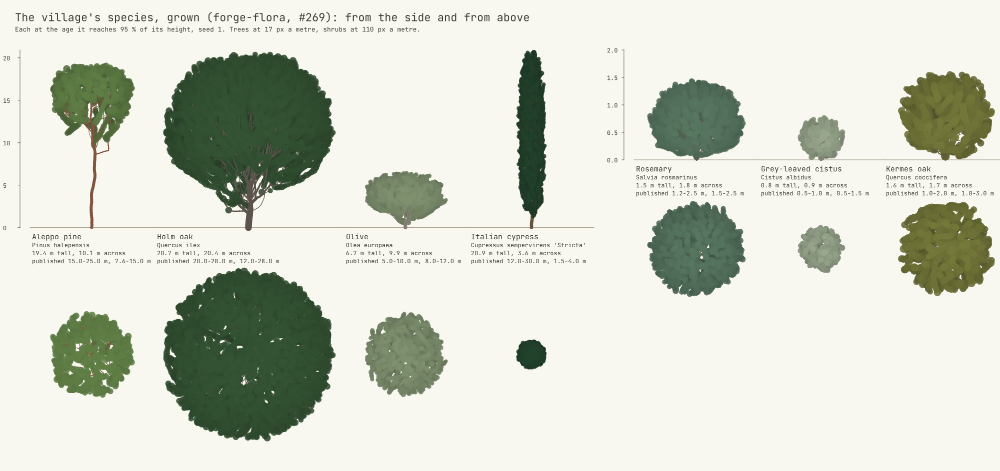
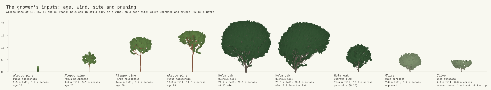
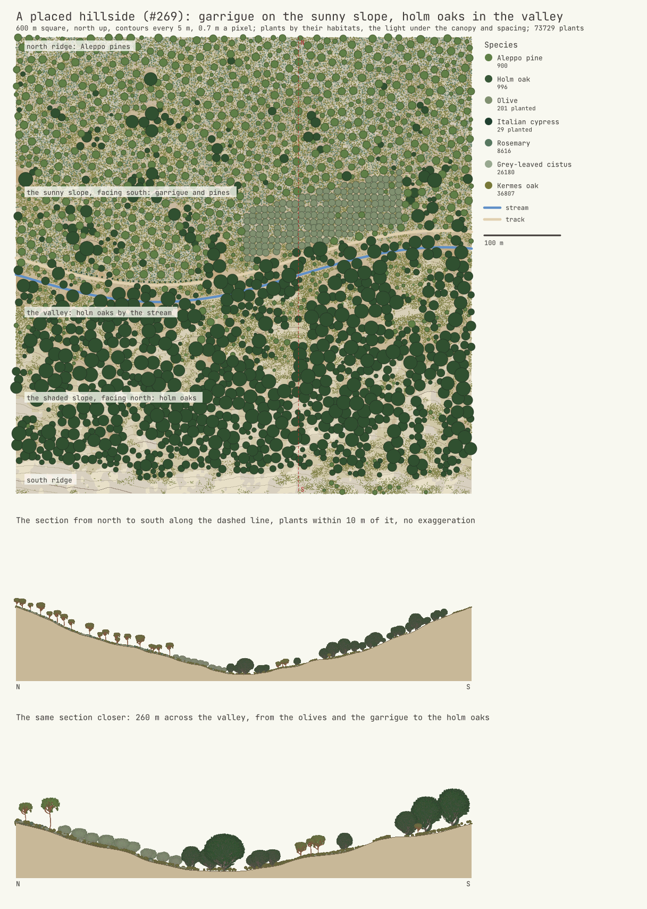

# Flora — plants grown as branch graphs and placed on the hills (`forge-flora`)

The flora's simulation side (#269, a parallel session of D-062 off the GPU): the Mediterranean
village's trees and shrubs (#266) grown from a species record and a seed into branch graphs with
radii and leaf clusters, then placed on a heightfield by their habitats, tested headless and drawn
on the CPU. Their rendering (D-013's ladder, wind) stays with the renderer's session. The research
is `docs/research/flora.md`; the decision is D-063, accepted by the owner on 2026-10-16.

```
cargo run --release -p forge-flora --bin flora-sheet -- --out reports/2026-10-16
```



*`reports/2026-10-16/flora-species.png`: each species at the age it reaches 95 % of its height,
seed 1, with its measured and published sizes. Trees at 17 px a metre, shrubs at 110.*



*`reports/2026-10-16/flora-inputs.png`: an Aleppo pine at 10, 25, 50 and 80 years; a holm oak in
still air, in a wind of 0.8 from the left, and on a poor site (0.25); an olive unpruned and pruned
to a vase (a 1 m trunk, topped at 4.5 m, an open centre of 0.8 m). 12 px a metre.*

## What it does

| Part | How | Module |
|---|---|---|
| Species | a TOML record each: the published height and spread with their sources, the age at 95 % of the height, the crown's envelope young and old (where it is widest, how full, its base), an internode, a branching angle and the phyllotaxis, the apical control λ, a tropism, a wander, the pipe model's exponent and tip radius, the leaf cluster's size, how long a branch may stay in the dark, and for shrubs the number of stems and their spread; the village's seven in `data/mediterranean.toml` | `species` |
| Growth | 14–28 cycles. Each cycle the crown's envelope grows one step along a Chapman–Richards curve to its size at the plant's age, from the young crown's shape to the grown one's, sheared downwind by the wind; markers inside it go to the nearest bud that sees them (90° cone, 5 internodes; Runions et al. 2007); the light is summed from the buds to the base and the vigour handed back up, the main axis taking `λQm / (λQm + (1−λ)Ql)` at each fork (Borchert and Honda 1984, as Pałubicki et al. 2009 use it); each bud grows ⌊vigour⌋ metamers (at most `max_shoot`) towards its free space, upwards by the tropism, downwind by the wind; markers within two internodes of new wood are taken | `grow` |
| Shedding | a branch whose subtree had no light for `shed_after` cycles is shed; a small branch (up to `limb_nodes`) below 0.8 of the crown's rising base is shed (self-pruning: the pine's clear bole), a limb is kept (the holm oak's low limbs); a leader waits for the crown to reach it | `grow` |
| Wood through wood | a new segment keeps 0.3 internode plus 1.5 times the other's radius from all wood more than four steps away along the graph; at each cycle's end, wood that has thickened into a neighbour breaks the thinner branch off and frees its space for the crown to grow back | `grow` |
| Radii | the pipe model: a tip's radius is the species' `tip_radius` (the wood behind one leaf cluster), a parent's to the power `n` is its children's summed (`n` 2.0–2.4) | `grow` |
| Pruning | a lifted crown (no branch from below a height), a topped crown, an open centre (the leader cut above the scaffold branches and the middle kept clear): the olive's vase | `grow::Pruning` |
| Leaves | a cluster on each node carrying at most `foliage_tips` twig tips: tufts at the branches' ends for the pine (2), sprays along the branches for the cypress (8) | `grow` |
| Graph | nodes with their parent, radius, branch order and whether they start a branch; leaf clusters with their node, direction and size; measures (height, crown width, branch count, base radius, wood length, crown centre) and checks (taper, crossings) | `graph` |
| Drawings | a rasteriser with coverage anti-aliasing: wood as capsules by their radii, leaves as discs shaded by depth, rulers and labels in the engine's font | `draw`, `bin/flora-sheet` |

Everything is a pure function of the species, the conditions and the seed: one random stream drawn
in a fixed order, `forge_core::dmath` for the powers, sines and logarithms (D-016).

## Numbers (release build, one thread, seed 1, the best of three)

| Species | Age | Nodes | Branches | Leaf clusters | Height | Spread | Trunk radius | Growth |
|---|---|---|---|---|---|---|---|---|
| Aleppo pine | 80 | 1 477 | 289 | 961 | 19.4 m | 10.1 m | 0.17 m | 12 ms |
| Holm oak | 150 | 8 405 | 1 100 | 6 670 | 20.7 m | 20.4 m | 0.39 m | 63 ms |
| Olive | 60 | 2 744 | 292 | 2 400 | 6.7 m | 9.9 m | 0.21 m | 15 ms |
| Italian cypress | 45 | 2 522 | 693 | 2 323 | 20.9 m | 3.6 m | 0.19 m | 18 ms |
| Rosemary | 8 | 2 983 | 506 | 2 462 | 1.5 m | 1.8 m | 0.018 m | 13 ms |
| Grey-leaved cistus | 8 | 958 | 204 | 823 | 0.8 m | 0.9 m | 0.011 m | 4 ms |
| Kermes oak | 30 | 1 438 | 187 | 1 240 | 1.6 m | 1.7 m | 0.015 m | 7 ms |

The times were taken while three other sessions built on the same 8-core CPU; they vary by a
third between runs. A village's few individuals per species and age (say eight each) grow in
under a second.

## Placement on a hillside



*`reports/2026-10-16/flora-hillside.png`: the example ground, 600 m square, an east–west valley
with its stream, the sunny (south-facing) slope to the north, the shaded one to the south. Each
plant's crown from above by species, then the section along the dashed line from north to south,
whole and closer, with the plants within 10 m of it drawn from grown individuals at their placed
size.* Aleppo pines and the garrigue (kermes oak, grey-leaved cistus, rosemary) hold the dry,
shallow, sunny ground; holm oaks the valley and the shaded slope; an olive grove (planted) on the
lower sunny slope; a cypress alley (planted) along the track.

| Part | How | Module |
|---|---|---|
| Ground | a square heightfield, `x` east and `y` south (north up on the maps); the example: a valley along a sine, slopes rising to the north faster than to the south, value noise for spurs and roughness | `place::Ground` |
| Fields | per sample: the slope; the heat, 0.5 on the flat, up to 1 on a steep south face and down to 0 on a steep north face; the moisture from the wetness index `ln(a / tan β)` (D8 drained areas) spread over 6 m, wetter in hollows and on shaded slopes; the soil's depth, thinner on ridges (the height above the mean within 40 m), steep and sun-baked ground, deeper where water gathers; all weights Forge's estimates | `place::Fields` |
| Habitats | per species in its TOML record: its layer (canopy or understorey), bands of soil, moisture, heat and slope where it does best (falling to nothing over a soft edge), the least light it stands, its spacing in summed crown radii, its abundance, its crown's opacity; the olive and the cypress only planted | `species`, `place::Habitat` |
| Planted rules | rows along a line every so many metres, offset to a side (the city's street trees, a cypress alley); groves on a jittered grid inside a polygon (parks, courtyards, an olive grove); lines kept clear (a stream, a track); a `keep_out` test from the caller (water, roads, buildings) | `place::Rule` |
| Wild layers | the canopy, then the understorey: one dart per cell (2.5 m, then 0.75 m) at a hashed place, taken in hashed priority order; kept by a coin weighted by the layer's best suitability there; its species drawn by suitability times abundance; its age 0.3–1.4 times the species' maturity, its size from the growth curve and the site's quality; refused where its own layer stands closer than the summed crowns times the closer-standing species' spacing, too close to the other layer's trunks, or in less light than it needs | `place::place` |
| Light | each canopy crown's shade a disc of 1.1 times its radius cast north by 0.4 of its height, stopping its opacity of the light (pine 0.55, holm oak 0.85): the holm oak (0.15) grows up under the pines, the garrigue's shrubs (0.65–0.7) and the pine (0.55) need open ground | `place` |
| Map | hillshade with the soil's tint, contours every 5 m, crowns by species, a legend, two sections | `map` |

**Numbers** (release build, one thread, the best of three):

| | |
|---|---|
| The 600 m example (0.36 km²) | 73 729 plants: 900 Aleppo pines, 996 holm oaks, 201 olives and 29 cypresses planted, 8 616 rosemary, 26 180 cistus, 36 807 kermes oaks |
| A square kilometre at 2 m (the example at 1 000 m) | the ground 39 ms, its fields 21 ms, the placement 1.1 s (1.1–1.9 s between runs while other sessions build), 266 143 plants, 160 000 and 1 776 889 darts |

The placement runs over a region at once and in one thread; regions are independent, so the
world's cells can be placed in parallel. It never follows the player (the patent noted in D-063).

## Tests

`cargo test --release -p forge-flora` (17 tests, about a second):
- growth: the branch count grows with age, each species at 20 %, 45 % and 100 % of its maturity;
  a child is never thicker than its parent, and the trunk is thicker than four tips (two seeds);
  no branch passes through another: no segment's axis inside another's wood, away from forks
  (four steps along the graph), two seeds; the same seed grows the same plant to the bit, another
  seed another; each species' height and spread fall in its published range, four seeds each; a
  wind of 0.8 moves the crown's centre downwind by over 8 % of the height (pine and oak); an olive
  lifted to 1 m, topped at 4.5 m and opened has no branch from below 1 m, nothing above 4.5 m but
  its leaves, and no wood in its open centre;
- placement, on a 400 m example: the fields read the ground (the north side faces south and the
  south side north, the valley's floor wetter and deeper-soiled than the ridge); the same seed
  places the same plants, another seed others; every pair keeps its spacing and nothing grows on
  the stream or the track; the garrigue's rosemary and cistus stand on hot ground (mean heat above
  0.6), the holm oaks on cool ground (below 0.5) and deeper soil than the pines (by 0.2), the pines
  higher in the relief, and by the stream oaks outnumber pines three to one; every shrub has the
  light it needs; the cypress row has a tree every 7 m and the olives stay in their grove.

## Next

- The hook for `forge-procgen::city::trees` (D-063, item 2): its forest from `place::place` over the
  site's heights, its settings as rows and groves with species.
- A few individuals per species cooked into D-053's derived cache.
- Point 3 of the issue: the fauna as behaviour (`forge-fauna`).
- For the renderer's session: meshes from the graph (generalised cylinders along the segments,
  leaf cards on the clusters), D-013's far bands from the same graph.
