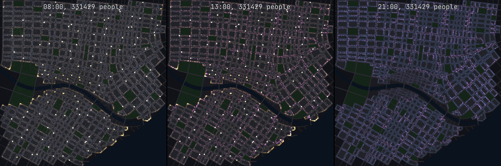

# Population — a city's people as records advanced by events (`forge-sim::population`)

D-059's step 8 begins (#250, `docs/research/population-simulation.md`, steps 1 and 2): everyone a
city's homes hold, each with a home, a role, work or a school, a personality and a seed, carried
through game days by a calendar of events, headless, on the CPU (D-016).

```
cargo run --release -p population-bench -- --days 2
```

## How it works

| Part | How |
|---|---|
| Places | from a city plan's masses: homes and jobs by floor area (two thirds homes at 40 m² a person, jobs at 30 m²), a school in every 120 buildings, active ground floors as shops, cafés and bars in turn, the parks (`places_from_buildings`) |
| People | everyone the homes hold; roles by a mix (45 % day workers, 3 % night workers, 9 % students, 15 % children, 28 % retired or at home); five personality traits of four bits; work at a distance drawn from an exponential of mean 2.5 km in a random direction (drawn again when it falls outside the city), school the nearest (`generate`) |
| Records | a structure of arrays, 36 bytes a person: home, anchor, role, personality, seed, where (a place or a trip, its origin and destination), since when, day, step |
| Days | never stored: each person's plan for a day is made again from their seed, role, personality and the day's number whenever an event needs it; weekdays and weekends differ; the conscientious rise earlier, the extraverted go out more and later |
| Events | a calendar ordered by (game second, person): an activity ends, a trip arrives; nobody is updated in between |
| Trips | timed by distance and mode: on foot under 1.2 km, by bike under 4 km for the open, by tram beyond (with a 5-minute wait); free flow, no congestion yet |

## Numbers (the example city, 4 km, release, one thread)

| | |
|---|---|
| Places | 28 425 |
| People | 295 789, 36 bytes each (10.6 MB) |
| Generation | 1.9 s |
| Events | 6.4 a person a day; 0.65 µs each |
| Two game days | 2.5 s |
| A game hour of 15 real minutes asks | 88 events a real second: 0.006 % of one core |
| Six workers (`population::Shards`) | the two days in 0.49 s, 5.0 times one, the same digest to the bit |

Where everyone is, by game hour (weekday, %):

| Hour | Home | Work or school | Shops | Cafés | Bars | Parks | Travelling |
|---|---|---|---|---|---|---|---|
| 03 | 100.0 | 0.0 | 0.0 | 0.0 | 0.0 | 0.0 | 0.0 |
| 08 | 42.3 | 43.9 | 0.0 | 0.0 | 0.0 | 0.0 | 13.7 |
| 11 | 26.0 | 68.9 | 4.6 | 0.0 | 0.0 | 0.0 | 0.5 |
| 13 | 31.1 | 55.5 | 0.0 | 13.4 | 0.0 | 0.0 | 0.0 |
| 16 | 18.5 | 68.9 | 1.0 | 2.1 | 0.0 | 8.2 | 1.3 |
| 18 | 60.7 | 14.9 | 4.3 | 5.3 | 4.1 | 5.5 | 5.2 |
| 20 | 87.5 | 0.0 | 0.0 | 7.0 | 5.5 | 0.0 | 0.0 |
| 22 | 88.0 | 3.0 | 0.0 | 3.3 | 5.3 | 0.0 | 0.4 |

Night workers (3 %) are at work at night. The same seed gives the same day to the bit (a test
compares the digests).

**On worker threads** (`population::Shards`): the people are split into contiguous runs, each
with its own calendar on its own thread. Nobody acts on anyone else yet, so the shards' events
depend on their own people alone. A test checks that the digest, the events, the census and the
positions are equal at one, three and six workers, to the bit. The bench (six workers) and a
1 015 359-person city (the private sandbox's):

| | One worker | Six workers |
|---|---|---|
| The example, 295 789 people, two days | 2.45 s | 0.49 s (5.0 times) |
| A million-person city, two days | 8.5 s | 1.7 s (5.2 times) |
| 4 074 555 people (`population-bench --scale 13.5`: the example's floors 13.5 times over), two days | 44.8 s | 8.2 s (5.5 times) |

The million needs 36.6 MB, 303 events a real second at one game hour per 15 minutes, and 0.02 %
of one core. That is #250's first test, with the digests equal at one and six workers. At 4 M:
146.7 MB, generated in 26 s (on one thread), 1 216 events a real second, 0.10 % of one core; the
same digest at six workers.



*Everyone as a dot (`Sim::positions`, `city::map::write_points`): blue at home, orange at work or
school (the bright dots are schools), cyan shopping, magenta in cafés and bars, green in parks,
white on the way, along the straight line of their trip for now. The morning's travellers, the
lunch hour's cafés, the evening out.*

## Next (#250)

- Places' capacities and opening hours; appointments between friends (the night out).
- Routes on the streets and transit with link queues (#253).
- The spatial index of who is where by cell, and the near tiers round a player.
- Persistence: snapshots of the changed columns and the input log.
- The cost per event: plans are made again on every event, 0.65 µs; caching a person's day would
  cut it, if a fast-forward needs it.
