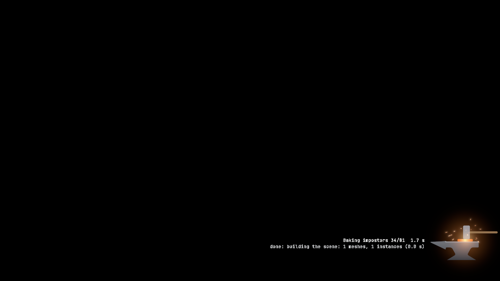
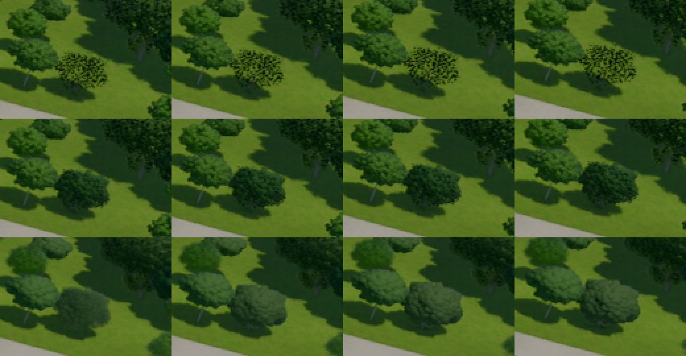
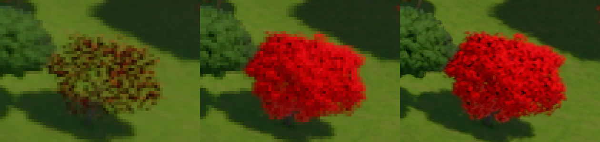
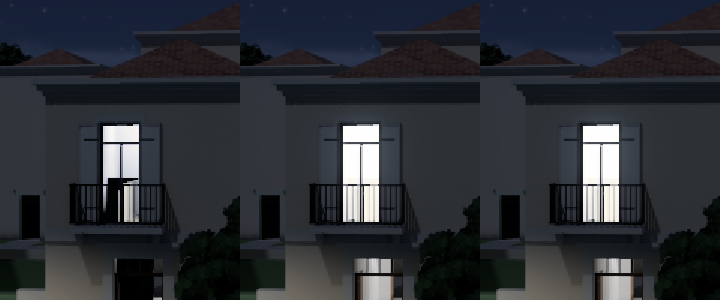
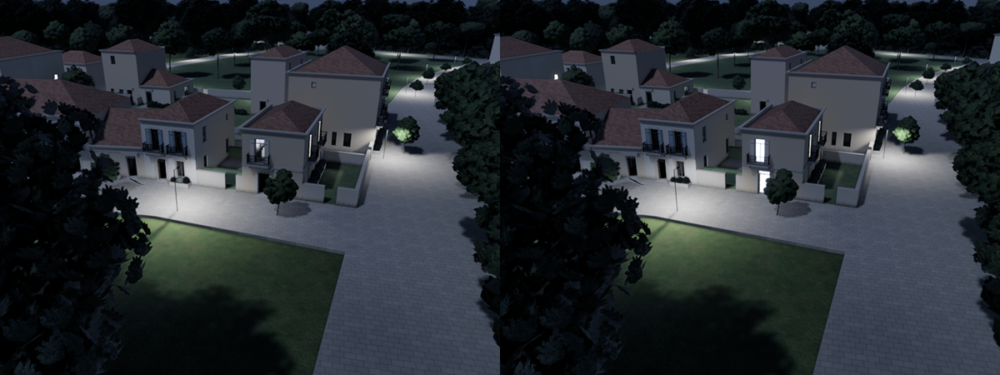
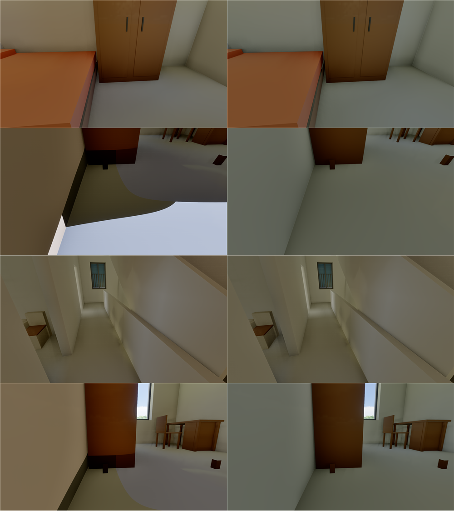
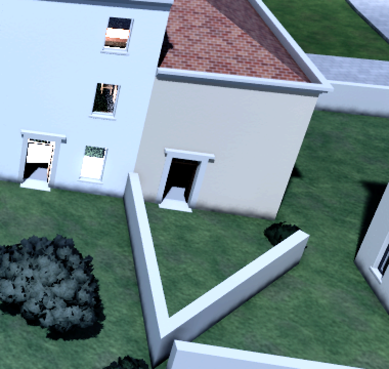
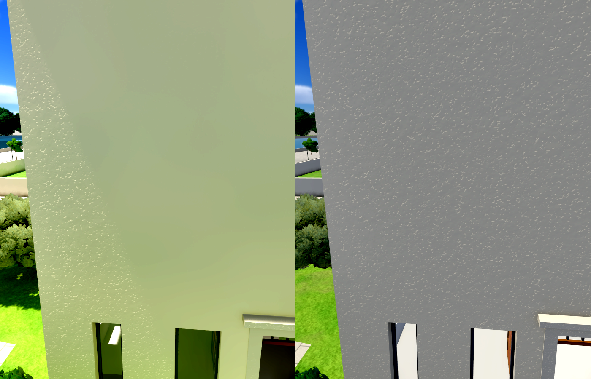
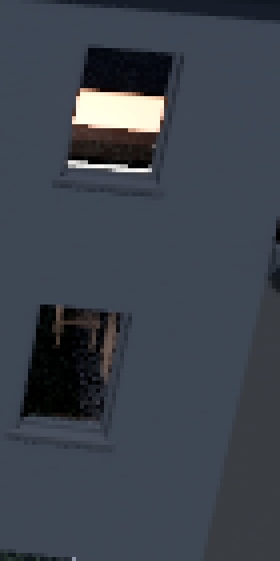
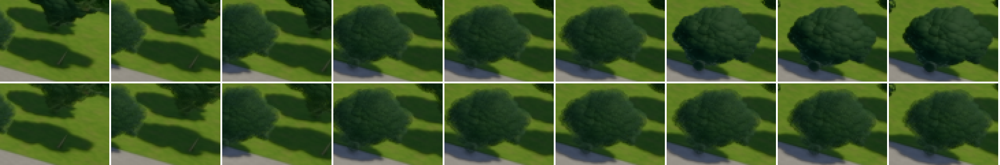

# Your walk of 29 October (#363)

You walked the village this morning and sent eight findings. Six are fixed and pushed. One I couldn't reproduce as given, but its cause turned up while fixing the pops. Two need your decision: the walls' V and the face's triangle.

| Finding | What it was | Done |
|---|---|---|
| The start stayed black | The trees' impostor bakes, paced at your screen's refresh | Loading screen over them, counted, presented uncapped (83f1fa3b) |
| Trees lose their leaves at one distance | Small leaf cards lost most of their leaves to the cut-out test's mip | The test reads one mip finer (b1d2c640) |
| Pops walking in at noon | Shells and impostors lighter than the cards they hand over to, and every tree's impostor leaving in one frame | The cut-out fix, the shells' tone refitted (898ccc58), and the impostors' fade beside the ladder (section 9) |
| Windows at midnight change too much | A far lit room lost its lamp's bounce past 20 m, and everything past 50 m | Far rooms take their lamps' light (c4315ac3) |
| Lighting in three rooms | Furniture cut the room grids' probes' view into patches and tinted the walls orange | Furniture out of the probes' rays (fd497bc2) |
| Walls' V | A spiked lot outline from the leftover-ground merge | Sharp corners counted and the simple ones cut (c1e55303); **yours needs the lots' fix: your call** |
| A face's odd triangle | The sunlit part of the wall | Nothing changed: **your call** |
| The window issue (walls view) | Probably the lit room's floor seen steeply from above, a bright band between the window's head and sill | **What looks wrong to you?** (section 7) |

## 1. The black start (83f1fa3b)

- **Cause:** after any change to the trees, the village bakes all 81 impostors again. Each bake draws its ~130 views one per frame. Your window presents at the screen's refresh (about 120 frames a second), so each kind took about 1 s and the 81 took about 85 s with nothing on screen. A scripted run presents uncapped and bakes them in 4 s.
- **Fix:** while the trees bake, the loading screen now stays up and says "Baking impostors 34/81". The window presents uncapped until the bakes end. All 81 now bake in 4.4 s.

I first blamed my build running beside your session. The interactive test showed the real cause.

## 2. Trees losing their leaves, and the pops (b1d2c640, 898ccc58)

The tree you meant is very likely the park's young holm oaks. I identified the species by painting its leaves red in a scratch build. From the air, 200 m off, they sit near your view.

- **What was wrong:** on their leaf cards they covered 2–5 % of their crown, against 61–73 % as shells and impostors. The leaves that remained were dark, because their cores' shade showed through. Supersampled or rendered at 3200 × 1800, the same cards were full and bright.
- **Cause:** the cut-out test reads the leaf texture at the mip its derivatives pick. For a card a few pixels across, that level's alpha falls under the cut-off for most leaves.
- **How it was narrowed down:** switching off AO, the probes, the shadows and the shadow denoiser in turn. The shadows' share was small; the cut-out test explained all of it.
- **Fix:** the test now reads one mip finer. Those crowns cover 55–63 %, and a tree no longer thins as it switches from shells to cards.

Below, one young holm oak along your walk: its cards before (top), its cards now (middle), and your normal view now (bottom: impostor, then shells).

The same cliff had skewed two earlier decisions:

- **The ladder:** on 25 October the trees at 6 px were "almost transparent". That was this cliff.
- **The shells' tone:** it was fitted against eroded cards, and only on green pixels, which left out the cards' dark gaps.

I refitted the tone on every pixel of five patches of the air view. Shells against cards, in linear light:

| Hour | Before | Now |
|---|---|---|
| 9:00 | +3–22 % | 0–12 % |
| 15:00 | +11–16 % | 3–6 % |
| noon | +21–36 % | 11–18 % |

Noon stays brighter on shells: with the sun overhead the cards' crowns hold more inner shade than solid lumps can. The far woods' impostor-to-cards step at noon fell from 8.3 to 2.2 sRGB.

**Not reproduced as given:** `--view=4.58,78.43,172.24,-3.9,-17.9` looked fine here at 1600 × 900 and 2560 × 1440, still and moving, under DLAA, FSR and no AA. If you still see leafless trees anywhere, an F12 capture in `reports/anomalies/` will pin it.

## 3. Windows at midnight (c4315ac3)

- **Cause:** a lit room's bounce came from its probe grid alone. Past the grids (20 m), its floor and furniture went dark under a bright ceiling. The probes also see only the frame's 64 nearest lamps, so past 50 m nothing lit the room behind the pane's glow.
- **Measured before:** one lit window seen straight on, at a fixed exposure, stepped from 0.79 to 0.53 at the grids' edge and stood at 0.37 at 70 m. The reference (grids out to 150 m, every lamp lit) reads 0.68–0.97.
- **Fix:** each far room now takes its lamps' lumens over its surfaces, times 18 for the bounce, and 14 more for the share of each lamp the frame leaves unlit.
- **Measured after:** 0.688 and 0.844 at 20 and 45 m (reference 0.682, 0.847), about 0.92 and 0.96 at 70 and 90 m (0.937, 0.966).

At 20 m, today's frame before the fix (left), the grids carried out (middle), and the reference (right):

On #354's dolly at midnight, the room under the lit balcony now glows through its door, as the grids light it (left before, right after):

## 4. Light in the rooms (fd497bc2)

- **Your bedroom view:** the floor took its light in sharp curved patches, cool against warm, and the walls an orange cast.
- **The patches:** the room grids' visibility test. A bed or a wardrobe in a probe's way cut its view of the floor. A grid twice as dense only shrank them.
- **The cast:** the orange furniture's bounce.
- **Fix:** furniture is now out of the probes' rays. It is still drawn, shadowed and mirrored. `--furniture-in-probes` puts it back in, to compare.
- **Result:** the patches go. The map check's room reads about five levels brighter and loses the orange (rgb 95, 87, 58 → 92, 95, 67).

Your three views and the floor towards the window, before (left) and after (right):

## 5. The walls' V (c1e55303), for your decision

- **New check:** sharp corners now count as an anomaly (`SharpWallCorner`, under 70°). There were 3 at 600 m, and 1 to 8 in the other sizes.
- **The simple ones:** where only two walls meet, a short wall now cuts the corner off. 600 m goes from 3 to 2, and the free wall ends at 400, 800 and 900 m went with them.
- **Yours keeps its point:** a third wall ends there, along a spike in lot 52's outline. That's a sliver under a metre wide between lots 50 and 53, from the merge of leftover ground into neighbouring lots on 24 October.
- **The proper fix:** take spikes out of merged lots. That reshapes lots 50–53 on your 600 m map, so it's your call. Should I do it?

## 6. The face's triangle, for your decision

- **What it is:** the sunlit part of that wall, bounded by the neighbouring building's shadow. With `--no-shadows` the whole wall shows the same relief (right).
- **Why it reads as a texture change:** at noon the sun grazes the wall, bringing out the stucco's relief while barely changing its brightness. In the shade the sky alone shows almost none of it.
- **Ruled out:** a second piece, a second material, a bent normal and broken texture derivatives.
- **Your call:**
  - **Soften the stucco's relief:** it would show less under a grazing sun.
  - **Leave it as is:** it's physically right.

## Also today

- **AMD's FSR:**
  - **Not published:** nothing of AMD's FSR SDK goes on GitHub, as you asked (a7a700e7).
  - **Used on any GPU:** under `r.aa=fsr`, the DLLs are used wherever the system has them (b2bfd248).
  - **Open:** the older FSR 3.1 shader headers have been in the repository since D-070. Should I move them to a local folder too?
- **Corrected hours:** #356's hours are fixed. The runs were at 09:36, noon, 13:48, 15:00 and 16:12.
- **Checks:**
  - **Day checks:** run with Slang 2026.20, your compiler: every sentinel at 0 px apart from #71's flake.
  - **Map check:** accepted after each change.
  - **Tier 1:** run on the whole batch before tonight's check. See "The full check" at the end of this file.

## 7. The window you circled (walls view, at night)

In the upper window (above), the lit room shows as a bright horizontal band, dark above and below. From 19 m up the camera looks steeply down through it. The band is probably the room's floor lit by its lamp, between the window's head and its sill. If something else looks wrong there (a figure, a see-through, a colour), tell me what and I'll go after it.

## 8. A review of the day's batch (e681f48b)

As after each batch, a read-only review went over the eight commits. It found real issues, all fixed and checked:

- **The darkest hours:** the far rooms' lamp light was stored in units that run past a half float's range when the night's reference light drops after moonset. The windows would have stepped again then. It is now stored in lux; at midnight the window reads the same 0.688.
- **The table rewrites:** moving at night, the frame's fading lamps changed the rooms' sums on most frames, rewriting the whole far-rooms table each time. Now only the rooms' records are rewritten.
- **The wall cut:** it could have opened a gap where a third wall runs through the corner or a house stands on it, and a cut too short to draw still cut the walls back. Both cases now keep the corner. The counts are unchanged.
- **The cut-out test:** it read its mip after early returns, where the derivatives are undefined. It now uses the explicit UV gradients, at the same one-mip bias.
- **Smaller ones:**
  - The AMD iGPU check now tests our FSR port again.
  - A recreated swapchain gets its HDR10 metadata back.
  - A recreate that wouldn't change the present mode is skipped.
  - A few doc lines.

One process slip of mine: I edited shaders while the first full check was capturing. I stopped that run and ran it again from the start, after the fixes.

## 9. The pops at noon: the impostors came in all at once

After the tone fixes I replayed your walk-in at noon from the start view, 8 m/s for 240 m. A new detector looked for 16-pixel tiles whose brightness steps in one frame while the frames around them move smoothly.

- **What it found:** apart from near trees sliding past the camera, a few trees jumped in one frame from a soft crown to their lumpy shells. Here is one, frames 600–720 (top: before; bottom: now):

- **Cause:** a tree goes cards → shells → impostor, each step crossing over a band of sizes. All 81 tree models in the village start crossing to their shells near the impostor's 40 px or below it (13–60 px), so the two bands overlap. The engine ran one crossing at a time: the impostor waited until the shells were complete, then came in at 19–100 % in one frame (all of it for the 23 smallest models, which reach their shells at 13–29 px).
- **Fix, in two parts:**
  - **The fade runs beside the crossing.** The cull works out the impostor's share once per tree. The cards and shells give that share of their pixels to the impostor by a second noise, and a tree its impostor fully covers draws no mesh at all.
  - **A plant's impostor never starts above the size its shells come in at.** With a flat 40 px, the shrubs by the main street went to their impostors, which look softer and greyer in the shade than their cards. Now the smallest plants keep their cards about as long as before, and only cross more smoothly.
- **Result on the walk-in:** tone steps of 3 levels or more in the middle of the view went from 24 to 5, and those of 5 or more from 5 to 0. The map check moved most in the air view (ꟻLIP 0.0085, the far trees' crossings) and the main street (0.0032).
- **Cost,** base and fix timed in turn: +0.02 ms from the air (3.83 → 3.85 ms), +0.07 ms on the main street (4.92 → 4.98 ms). A simpler fix, each fade moved below its crossing, lengthened the meshlet pass by 0.24 ms from the air, so I dropped it.
- **Still visible:** a shrub in deep shade, while it crosses, shows its impostor slightly greyer than its cards. That's the impostors' lighting under a canopy, a calibration of its own. Tell me if you notice it.

## The full check (Tier 1 on e681f48b)

The whole batch on both paths, with validation, in 48 minutes:

- **Tests:** 1,108 passed, clippy, fmt and credits clean.
- **Validation:** no errors.
- **The A/B harness and mesh against fallback:** 0 px everywhere.
- **#71's flake:** the HDR asteroids and the dominoes, as usual.
- **Sponza, the only real change:**
  - **What moved:** the plants in the pots and the lamps' chains, its alpha-tested materials. This is the cut-out fix of section 2.
  - **Size:** 1,747 px with probes (ꟻLIP mean 0.00026) and 6,782 px without (ꟻLIP mean 0.0012).
  - **Accepted:** the four shots were captured again at e681f48b, within 2 levels of the run, and accepted. Tonight's check compares against them.
